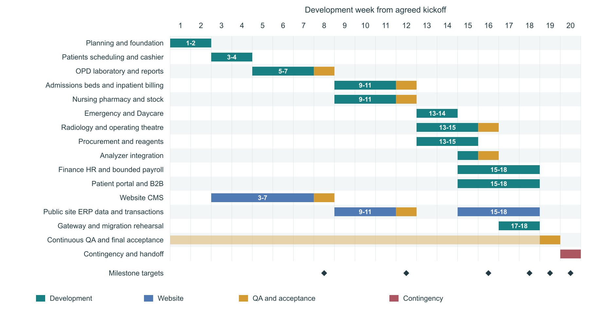

# HMS Core Modules and Development Timeline

Bytespate | Planning edition 1.0 | 24 October 2026

Our first release covers outpatient care and diagnostics: patient registration, appointments, cashier billing, consultation, prescriptions, laboratory processing and reports. Inpatient care and the wider hospital modules follow in dependency order. The first-release boundary is confirmed by decision C-031.

This document maps 14 ERP module groups and the public website workstream to an AI-assisted development schedule with a maximum duration of 20 weeks. It supports scope review, staffing and milestone planning. Week numbers run from an agreed kickoff. The 20-week limit is the owner-set planning constraint; the allocations below are estimates for meeting it.

## Planning assumptions

Estimate basis: three full-time developers using AI coding agents in parallel, one full-time QA engineer, part-time UX support and domain reviewers available every week. Staffing is an assumption to confirm in Week 1. Target feature completion is Week 18, integrated acceptance is Week 19, and Week 20 is the final contingency and handoff window.

Existing work is reused after verification in Week 1. The repository contains foundation and public-site work, but this document does not certify completion of any release gate. Validate capacity in Week 1 and review it weekly. If scope exceeds capacity, resolve scope or staffing within the 20-week limit; do not silently extend the deadline.

| Window | Development phase                 | Target outcome                                       |
| ------ | --------------------------------- | ---------------------------------------------------- |
| W1     | Phase 0 closure and baseline      | Freeze release slices and resolve priority decisions |
| W1-2   | Phase 1 foundation                | Shared platform and contracts ready                  |
| W3-4   | Phase 2 front desk and cashier    | Registration through payment and receipt             |
| W5-8   | Phase 3 OPD and diagnostics       | RP-A pilot readiness target at W8                    |
| W9-12  | Phase 4 inpatient                 | Beds, nursing, pharmacy and stock minimum            |
| W13-16 | Phase 5 procedures and operations | Approved emergency, procedures and supply slices     |
| W3-18  | Website and enterprise tracks     | CMS, portal, finance and approved integrations       |
| W19-20 | Acceptance and contingency        | Final UAT, corrections and development handoff       |

Delivery approach: AI assists implementation, tests and review preparation. Developers own integration and verification; hospital reviewers own clinical and financial decisions. No fixed AI productivity multiplier is assumed. Open scope must be settled early for this compressed schedule.

## Core modules for the first release

The following sub-modules describe planned product scope. A scheduled window does not mean every open or deferred feature is included.

### 01 SaaS platform and administration

Tenant and facility setup; module entitlements; users, roles and permissions; login, sessions and MFA; audit history; configuration and numbering; Bangla and English; shared UI; background jobs, request handling and monitoring.

W1-2, maintained throughout. Foundation for every module. Includes T-FND, T-DB, T-ACC, T-PLT, T-UI and T-I18N work. Commercial suspension and automated subscription billing remain outside the first release. Source C01.

### 02 Patients and scheduling

Patient registration and MRN; duplicate review; phone and name search; protected NID; identity history; practitioner records; sessions and appointments; reschedule and cancel; check-in, tokens, walk-ins and direct-diagnostic visits.

W3-4. First-release core. Uses confirmed registration, numbering and queue decisions C-033 to C-035. Patient merge and temporary-identity reconciliation remain subject to Q-036. Source C02.

### 03 Outpatient clinical care and orders

Doctor worklist; consultation notes and amendments; allergy capture; prescriptions and printing; hospital or external fulfilment choice; clinical and direct-diagnostic orders; service eligibility; controlled cancellation; viewing released results.

W5-6, integrated through W8. First-release core. Note content, prescription vocabulary and cancellation policy need approved scope or explicit interim handling under Q-066, Q-067 and Q-017. Source C03.

### 04 Billing and payments

Service catalogue and versioned prices; separate doctor-fee and combined service invoices; payment allocation and receipts; cash, card, mobile and bank method recording; cashier sessions; corrections; inpatient running accounts and final bills later.

W3-4 for RP-A; W10-12 for inpatient. Full payment before service, no deposits or overpayment in RP-A. One payment may cover multiple patient invoices. Discounts, refunds and gateway settlement are excluded from RP-A. Source C04; C-038 to C-043.

### 05 Laboratory

Test, panel, method, range and template setup; collection and barcode labels; specimen dispatch and receipt; rejection and recollection; manual result entry; verification and release; versioned amendment; report PDF, print and delivery; worklists.

W5-7 for RP-A; analyzer connection at W15. Lab authority, pilot test templates and amendment rules require Q-009 and Q-011 closure. Calculated-test formulas and critical-result notification workflows remain open. Source C05.

## Core modules for inpatient expansion

The following sub-modules describe planned product scope. A scheduled window does not mean every open or deferred feature is included.

### 06 Inpatient admission and beds

Bed and ward masters; admission from supported routes; waiting for a bed; bed allocation and occupancy; transfers; cleaning; discharge stages; physical departure; bed and patient labels; coordination with running and final bills.

W9-12. Depends on patient, billing and clinical foundations. Discharge with dues, bed charging, extra-bed rules and discharge sequencing need decisions before their affected tasks. Sources C06; Q-006 to Q-008 and Q-069.

### 07 Nursing station

Ward worklist; admission and departure status; released lab results; multi-line medicine indents; safe quantity edits; medicine-return requests and slips; pharmacy return status; order-cancellation requests; patient and bed labels.

W10-11, accepted with inpatient at W12. Depends on admissions, pharmacy and stock. Medication administration records and nursing observations remain open scope, not included in the minimum schedule. Source C07; Q-016, Q-018 and Q-070.

### 08 Pharmacy

Medicine catalogue; dispensing against prescriptions and ward indents; batches and expiry checks; partial issues; accepted medicine returns; stock and billing effects. A prescription alone never reduces hospital stock.

W10-11 with acceptance at W12. Depends on stock movements and patient billing. Unit conversion, substitution and return policy need Q-014, Q-015 and Q-018 closure. Walk-in POS and pharmacy credit remain separate scope decisions. Source C08.

### 09 Inventory procurement and reagents

Items, stores, units and batches; stock ledger; opening balances; adjustments and counts; transfers; requisitions and purchase orders; approval; goods receipt; supplier returns; reagent mappings and consumption reports.

Stock minimum W9-10; procurement W13-14; reagents W14-15. Procurement approval, valuation and consumption rules are conditional on Q-063 to Q-065. Wider purchasing scope requires detailed tasks before commitment. Source C09.

### 10 Emergency and Daycare

Emergency visits for known or temporary identities; staff-assigned priority; urgent orders; admission or referral; payment-exception controls. Daycare adds same-day admission, shared bed occupancy, nursing worklists, billing and discharge.

W13-14. Depends on patient, order, billing, bed and nursing modules. Emergency exception authority, triage documentation and the definition of Daycare must be agreed first. The system does not assign clinical priority. Source C10; Q-005, Q-025 and Q-026.

## Specialist and digital service modules

The following sub-modules describe planned product scope. A scheduled window does not mean every open or deferred feature is included.

### 11 Radiology and operating theatre

Radiology modalities, schedules, examination records, image references and draft-to-release reports. OT requisition, confirmation, anesthesia/reception, procedure, postoperative and clearance stages; traceable charge posting.

Radiology W13-14; OT W15-16; acceptance W16. Report authority, OT records, scheduling and package scope need Q-027, Q-028 and Q-061. Full PACS/DICOM is deferred and excluded from this estimate. Source C11.

### 12 Finance and human resources

Finance transaction inquiry, reconciliation, ledger or accounting export and period close. Employee records and reports; attendance capture; payroll and payslips only after rules are defined. Cashier close and collection reports arrive earlier with RP-A.

Discovery W1-2; finance W15-17; HR and bounded payroll W17-18. These are provisional delivery windows. Q-029 must choose ledger versus export; Q-030 must define HR/payroll rules. Statutory payroll remains deferred. Source C12.

### 13 Reports printing portal and B2B

Collection reports, invoice register, patient payment history, management dashboard, audited exports and background reports; bilingual document templates; patient/proxy portal; released reports; B2B orders and dispatch; referral configuration.

Print foundation W2; cashier documents W4; reports W7. Portal W15-17 and B2B W17-18 are conditional on identity and business rules. Referral formulas are not included until Q-031 is decided. Source C13; Q-013, Q-032 and Q-033.

### 14 Integrations and devices

Printer and scanner support; analyzer import with duplicate detection and quarantine; payment callbacks and reconciliation; accounting export; attendance-device import; notification providers; validated legacy imports and reconciliation tooling.

Device validation W2 and W8; analyzer W15; accounting/attendance with their modules; gateway W17-18; migration rehearsal W18. Estimates assume one initial adapter per selected type. Partner access and Q-029, Q-030, Q-045, Q-047 to Q-049 govern scope. Source C14.

### 15 Public website and content management

Public hospital pages; doctor and department directories; packages and tests; search, bilingual content and mock service forms. Later CMS adds settings, navigation, page sections, collections, media, draft/publish and staff permissions; ERP data and transactions follow.

Reuse and verify WEB-A in W1; CMS discovery W1-2, delivery W3-8; ERP data connections W9-12; approved booking/report transactions W15-18. WEB-A is a mock frontend, not live booking or a patient portal. WEB-B/C and shared-host work remain separately gated. Sources S6 and S7.

## Weekly schedule from Week 1 to Week 10

Three AI-assisted development tracks share one integrator. Track A handles patient and financial workflows, Track B handles departmental workflows, and Track C handles the website and integrations. QA runs continuously.

| Week | Main focus                   | Expected development outcome                                                                                                                                 |
| ---- | ---------------------------- | ------------------------------------------------------------------------------------------------------------------------------------------------------------ |
| W1   | Baseline and contracts       | Verify existing work; approve pilot slices and team capacity; resolve clinical/financial scope; agree shared contracts. Detail CMS and partner requirements. |
| W2   | Foundation gate              | Complete access, audit, jobs, safe retries and tenant isolation. Validate print prototypes and CI. Obtain operator-owned recovery evidence for RG-1.         |
| W3   | Patients billing and CMS     | Track A: registration, search, practitioners and tariffs. Track B: scheduling and invoice contracts. Track C: CMS settings, content model and permissions.   |
| W4   | Front desk acceptance        | Integrate check-in, walk-ins, invoices, cashier sessions and receipts; test payment retries. CMS page/collection editing progresses in parallel.             |
| W5   | Clinical and laboratory core | Track A: consultation and prescriptions. Track B: lab configuration, collection and labels. Track C: CMS media, preview and bilingual editing.               |
| W6   | Orders and specimen workflow | Integrate orders and payment eligibility; specimen receive/reject/recollect and result entry. CMS publishing, staff entry and access tests.                  |
| W7   | Release reports and CMS      | Lab verify/release/amendment, PDFs and delivery; collection reports and dashboard. Finish the agreed CMS slice and public content adapter.                   |
| W8   | RP-A and CMS acceptance      | Hospital UAT, load, Bangla, accessibility and printer checks; correct defects. Target RG-2/RG-3 evidence for RP-A and separate CMS acceptance.               |
| W9   | Inpatient and stock core     | Track A: admissions, bed board and allocation. Track B: stock ledger, stores and batches. Track C: approved ERP data on the public site.                     |
| W10  | Ward pharmacy and billing    | Transfers, running account and approved deposits; ward indents, dispensing, expiry and stock/billing consistency. Continue site data connections.            |

Each outcome includes API, data, permissions, audit, interface and tests. Contract review precedes parallel implementation; one integrator controls migrations and shared files. AI-generated changes require independent verification and clinical/financial sign-off where relevant.

## Weekly schedule from Week 11 to Week 20

Target milestones are RP-A readiness at Week 8, inpatient acceptance at Week 12, procedures and operations at Week 16, and agreed feature completion at Week 18. The final two weeks protect acceptance and the 20-week limit.

| Week | Main focus                     | Expected development outcome                                                                                                                                |
| ---- | ------------------------------ | ----------------------------------------------------------------------------------------------------------------------------------------------------------- |
| W11  | Returns and discharge          | Medicine returns and approved credits; discharge, final bills, departure and bed cleaning. Public data privacy and tenant-isolation checks.                 |
| W12  | Inpatient acceptance           | End-to-end IPD/nursing/pharmacy UAT, concurrency, reconciliation and labels; accept ERP-to-site data links. Confirm next module scopes.                     |
| W13  | Emergency radiology purchasing | Parallel tracks: emergency identity/priority and exceptions; radiology scheduling/exams; procurement requisition, PO and goods receipt.                     |
| W14  | Daycare reports and reagents   | Shared Daycare occupancy and discharge; radiology release; procurement approvals/returns and reagent mappings. Domain reviews for each slice.               |
| W15  | OT analyzer and portal         | Parallel tracks: agreed OT stages/charges; one analyzer adapter and reagent consumption; verified patient/proxy portal. Start bounded finance work.         |
| W16  | Operations acceptance          | Accept emergency, Daycare, radiology, OT and supply slices. Validate analyzer replay/quarantine. Continue portal and finance reconciliation.                |
| W17  | Enterprise and gateway         | Parallel tracks: finish finance and build HR/attendance; portal and B2B; one gateway adapter. Confirm bounded payroll rules before implementation.          |
| W18  | Feature complete target        | Finish agreed payroll/B2B, gateway and public booking/report flows; migration dry run and selected notifications. Freeze features and assemble evidence.    |
| W19  | Integrated acceptance          | Whole-product regression, security, load, bilingual/device tests and domain UAT for all accepted slices; training and operational handoff review.           |
| W20  | Contingency and handoff        | Final defect fixes and affected retests; complete development handoff by the end of W20. Record exclusions explicitly; deployment remains separately owned. |

Each outcome includes API, data, permissions, audit, interface and tests. Contract review precedes parallel implementation; one integrator controls migrations and shared files. AI-generated changes require independent verification and clinical/financial sign-off where relevant.

## Dependencies decisions and acceptance

### Decisions that control the schedule

| Due before          | Decision or evidence needed                                                                                                                                                            |
| ------------------- | -------------------------------------------------------------------------------------------------------------------------------------------------------------------------------------- |
| W1 baseline         | Confirm actual team capacity and existing completion evidence; agree pilot profile Q-042 and weekly reviewer availability.                                                             |
| W1-2 scope closure  | Confirm note/prescription scope Q-066/Q-067, lab authority Q-009, pilot templates/amendments Q-011, and approved cancellation/delivery handling Q-017/Q-013.                           |
| W7-8 readiness      | Production role grants, exact printer models, recovery/support targets Q-043, hospital UAT and operator-owned recovery evidence.                                                       |
| Before W9 inpatient | Resolve deposits/discharge/bed rules Q-004/Q-006/Q-007/Q-008/Q-040/Q-069, pharmacy/returns Q-014/Q-015/Q-018 and stock policy Q-063.                                                   |
| W1-2 discovery      | Agree bounded emergency, Daycare, RIS/OT, finance, HR, portal, B2B and CMS scope. Obtain partner specifications early; confirm each decision before its dependent task. See S1 and S6. |

The main dependency chain is platform, patients, visits and billing, then orders and diagnostics, then inpatient, nursing and pharmacy. ERP source data precedes live website booking and report access. Contract work may overlap across developers; shared schema and migrations remain serialized through the integrator.

### Acceptance and exclusions

RG-1 covers foundation evidence; RG-2 accepts each complete workflow; RG-3 confirms pilot readiness; RG-4 is the product owner's separate go-live decision; RG-5 controls each expansion. Apply confirmed amendments to older gate wording, including C-048 (SonarJS checks while the SonarQube server is deferred). Website releases also require their own RG-W gates.

The 20-week envelope excludes autonomous clinical AI, statutory features, multi-facility groups, offline mode, full PACS, automatic subscription billing and unapproved specialty modules. It does not promise full payroll, a general ledger or every third-party adapter. If a module cannot fit, the owner must approve a narrower release slice or extra capacity before its build window. The deadline stays at Week 20; excluded work is recorded separately. AI does not resolve missing policy decisions.

### Source references

S1 docs/planning/docs/A2-decision-register.md and A3-open-questions.md: confirmed decisions, exclusions and unresolved policies.

S2 docs/planning/docs/G-implementation-plan.md: phases, dependencies, epics and task IDs.

S3 docs/planning/docs/C-srs/C01 through C14: the module specifications corresponding to groups 01 through 14.

S4 docs/planning/docs/B-business-requirements.md and N-traceability-readiness.md: breadth and release-gate evidence.

S5 docs/DEPLOYMENT.md: development and deployment ownership.

S6 docs/site-planning/A-decisions-and-questions.md and G-implementation-plan.md: website decisions, stages and gates.

S7 docs/site-planning/C2-cms-requirements.md: website editing and publishing scope.

Source baseline: origin/dev at e593a8f, reviewed 24 October 2026. The module scope and phase order come from the repository; the 20-week maximum is the owner's requested constraint; allocations and staffing are planning estimates. Deploy impact of this documentation change: none.

## Development timeline Gantt chart

The chart shows parallel AI-assisted work, continuous QA and release acceptance. Targets: Week 8 RP-A readiness, Week 12 inpatient acceptance, Week 16 operations acceptance, Week 18 feature complete, Week 19 integrated acceptance and Week 20 contingency/handoff. The lighter QA bar is continuous testing. Website data work pauses between Weeks 12 and 15 while dependent services mature. All existing scope and staffing assumptions apply.
