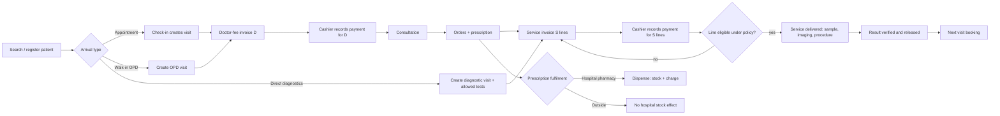

# B — Business Requirements Document (BRD)

| Control | Value |
| --- | --- |
| Document | B Business Requirements Document |
| Version | 0.4.0-draft |
| Status | Draft-for-review. Whole-hospital scope CONFIRMED (C-001). First release boundary OPEN (Q-001). |
| Owner role | Product owner |
| Reviewers | Pilot hospital management, finance lead, clinical lead |
| Updated | 2026-10-12 |
| Depends on | [A2 Decisions](A2-decision-register.md), [A3 Open questions](A3-open-questions.md), baseline [SOURCE_REQUIREMENTS](../baseline/hospital-saas-planning-kit-v0.3/docs/SOURCE_REQUIREMENTS.md) |

## 1. Purpose

This BRD states **why** the product exists, **who** it serves, **what** business outcomes it must produce and **how** the business will judge it. It does not specify screens or tables; those are in C (SRS), E and F. Wherever a business rule is not yet decided, this document points to the open question rather than choosing.

## 2. Business problem

Hospitals in the initial market run day-to-day work across reception, cashier desks, doctors' rooms, laboratories, wards, pharmacies and stores. The supplied documents (S1–S7) describe one such hospital, Sondhany Medical (CX-001), using a legacy HMS. Staff reported problems that fall into five groups:

1. **Money that does not add up.**
   - Bill totals differ between detail and summary views (SRC-B05).
   - OT and EMR charges are posted twice (SRC-B06).
   - The payment method is not stored as actually received (SRC-B04).
   - Returned medicines are not reflected in the bill (SRC-B03).
2. **States that do not persist.**
   - Lab reports revert to "Pending" after viewing, printing or pressing Back (SRC-L12–L15).
   - Discharge success is shown on screen but not saved (SRC-I05).
   - Bed occupancy disagrees between IPD, Daycare and the nurse station (SRC-I03).
3. **Lost or invisible work.**
   - Post-discharge medicine returns disappear (SRC-N01).
   - Return slips are not visible, which causes pharmacy–nursing disputes (SRC-N11).
   - Editing one indent quantity deletes the whole indent (SRC-N09).
4. **Slow, error-prone front-line operation.**
   - Pages take 1–1.5 minutes to load, spinners go stale, and keyboard flow is poor (SRC-B01).
   - Phone search fails on formatting (SRC-P02).
   - Bed labels fail to print on the first attempt (SRC-N12).
   - Sessions hang and accounts lock without explanation (SRC-N02, SRC-N10).
5. **Configuration that cannot be trusted.**
   - Ranges and methods do not update from analyzer attributes (SRC-L08).
   - Analyzer results go missing (SRC-L07).
   - Report formats drift (SRC-L02, SRC-L05).

Beyond this hospital, Bytespate wants **one maintained product** that each customer hospital receives as its own installation on its own domain (C-001, C-089). Each installation has its own configuration; there are no customer-specific code branches.

## 3. Product objectives

| ID | Objective | Primary pain addressed | Linked decisions |
| --- | --- | --- | --- |
| BO-01 | **One trustworthy patient identity and visit context** across all departments. Duplicate registrations are visible and never silently merged. | Wrong-patient risk; inconsistent data across departments (SRC-P01). | C-005..C-007, identity agreements |
| BO-02 | **Correct, reconciled patient billing.** This means: • a separate doctor-fee invoice and a combined service invoice • payment before service under configured policy • the actual payment method recorded • no duplicate postings • detail equals summary | Money that does not add up. | C-008..C-011, C-017, C-029 |
| BO-03 | **Departmental states that persist exactly as committed.** Covers lab statuses, discharge steps, bed occupancy and medicine returns. | States that do not persist. | C-014..C-016, C-019, C-029 |
| BO-04 | **Fast, keyboard-efficient front-line work** at reception, the cashier desk, sample collection and order entry. | Slow pages, poor keyboard flow. | — (targets PROPOSED in §10) |
| BO-05 | **Traceability and safe correction.** Every sensitive action is attributable; corrections never destroy evidence. | Lost work, disputes. | C-029 |
| BO-06 | **One product, one installation per hospital.** Install and configure the same product for each customer hospital, with per-hospital configuration and no customer-specific code. | Bytespate business model. | C-001, C-024, ADR-023 |
| BO-07 | **Operable and recoverable on VPS hosting.** Monitored, backed up, restorable and supportable. | Hospital continuity. | C-026 |
| BO-08 | **Bilingual (Bangla/English) operation and correct printing** on the hospital's real A4/A5 and label printers. | Printing and label errors. | C-025 |
| BO-09 | **Whole-hospital coverage over time**, delivered in dependency order without advertising incomplete modules as complete. | Breadth of hospital operations. | C-001, P-005 |

## 4. Customers, stakeholders and staff roles

### 4.1 Customers and external stakeholders

| Stakeholder | Interest | Notes |
| --- | --- | --- |
| Customer hospital management | Revenue integrity, operational control, reports, staff accountability | Buys the product. Approves the hospital's configuration and policies. |
| Patients and their proxies | Correct care, correct bills, timely reports, privacy | Portal access is a later, separately designed surface (Q-033). |
| Referring doctors and B2B diagnostic clients | Report delivery, statements | Source-derived (SRC-C01). Policies OPEN (Q-031, Q-032). |
| Bytespate (product owner) | One maintainable product, efficient installation, reliable operations | Runs each installation (AS-010). Bytespate staff have no routine patient-data access. |
| Device and payment partners | Analyzer, printer, payment provider integration | Discovery OPEN (Q-045..Q-047). |

### 4.2 Hospital staff roles (users)

Role names are proposed default templates. Each hospital confirms who does what (Q-003). The detailed permission catalogue is in [C00 §8](C-srs/C00-srs-overview.md#8-permission-catalogue-and-approval-responsibilities).

| Role | Main work in the product |
| --- | --- |
| Receptionist / front desk | Search and register patients; book, reschedule and cancel appointments; check in; create walk-in and direct-diagnostic visits; print tokens. |
| Cashier | Record payments against selected invoices; print receipts; open and close the cashier session. |
| Billing supervisor | Approve discounts, refunds and corrections within limits (rules OPEN). |
| Doctor (OPD/IPD) | Worklist; consultation notes; orders; prescriptions; admission requests; medical discharge. |
| Nurse | Ward worklist; observations (scope OPEN); indents and medicine returns; bed-related actions where permitted. |
| Lab technologist (operator) | Sample collection, receipt, rejection; result entry. |
| Lab authority (pathologist / senior) | Verification, release, amendment (mapping OPEN, Q-009). |
| Radiology staff / radiologist | Schedules, exams, reports (module later). |
| Pharmacist / pharmacy staff | Dispensing, accepting returns, POS (later). |
| Store keeper / procurement | Stock receipt, transfers, indents, purchase orders (later). |
| OT / emergency / Daycare staff | Module-specific operations (later). |
| Finance officer | Collection reconciliation, day close review, finance reports. |
| HR officer | Employee records (payroll later, Q-030). |
| Hospital administrator | Users, roles, configuration, price lists, templates. |
| Management viewer | Dashboards and reports, read-only. |

## 5. Scope

### 5.1 Whole-product scope (CONFIRMED breadth, C-001)

Status of each capability's *specification* (not its existence in the product):
- **SPECIFIED**: detailed enough to build once its blocking questions are answered.
- **PARTIAL**: core flow specified; important rules OPEN.
- **GAP**: named capability with insufficient specification.

| Capability area | Specification status | SRS file |
| --- | --- | --- |
| Users, roles, audit, configuration, localization | SPECIFIED (policy values OPEN) | [C01](C-srs/C01-platform-access-audit.md) |
| Patient registration, practitioners, scheduling, check-in, visits | SPECIFIED (MRN format, required fields OPEN) | [C02](C-srs/C02-patients-scheduling.md) |
| OPD consultation, orders, prescriptions | PARTIAL (clinical form content OPEN) | [C03](C-srs/C03-opd-clinical-orders.md) |
| Patient billing and cashier payments | PARTIAL (deposits, discounts, refunds, rounding OPEN) | [C04](C-srs/C04-billing-payments.md) |
| Laboratory (LIS) | PARTIAL (reviewer mapping, formulas OPEN) | [C05](C-srs/C05-laboratory.md) |
| IPD admission, beds, transfers, discharge | PARTIAL (bed rent, discharge with dues OPEN) | [C06](C-srs/C06-ipd-beds-discharge.md) |
| Nursing station | PARTIAL (MAR scope, return sequence OPEN) | [C07](C-srs/C07-nursing.md) |
| Pharmacy | PARTIAL (substitution, units, batch rules OPEN) | [C08](C-srs/C08-pharmacy.md) |
| Inventory, procurement, reagents | PARTIAL / GAP | [C09](C-srs/C09-inventory-procurement-reagents.md) |
| Emergency and Daycare | GAP (triage, payment exceptions, Daycare definition OPEN) | [C10](C-srs/C10-emergency-daycare.md) |
| Radiology and OT | GAP | [C11](C-srs/C11-radiology-ot.md) |
| Finance (ledger) and HR/attendance/payroll | **GAP** (explicitly thin in sources) | [C12](C-srs/C12-finance-hr-payroll.md) |
| Reporting, printing, patient portal, B2B, referrals | PARTIAL (printing SPECIFIED; portal/B2B/referral GAP) | [C13](C-srs/C13-reporting-printing-portal-b2b.md) |
| Integrations and devices | GAP (partner details unknown) | [C14](C-srs/C14-integrations-devices.md) |

### 5.2 Explicit exclusions and things not assumed

| Item | Status | Reason |
| --- | --- | --- |
| Autonomous clinical AI (diagnosis, triage, dosing, result interpretation) | Excluded (C-027) | AI helps develop the software only. |
| Government-specific/statutory requirements, national interfaces, mandated reports | DEFERRED (DEF-001) | Owner request. No compliance claim is made. |
| Multi-facility group features | DEFERRED (DEF-002) | C-024. |
| Offline mode | DEFERRED (DEF-003) | Paper downtime procedure instead. |
| Full PACS | DEFERRED (DEF-004) | Partner-dependent. |
| Blood bank/transfusion, dialysis, dietary/kitchen, ambulance, asset management, insurance claims | **Not in scope until decided** | v0.3 MODULES "scope limits". They must not be advertised. |
| Tax/VAT on patient invoices | Not modeled (AS-014) | Tax rules are deferred with government topics. |

## 6. Customer and facility model

**CONFIRMED (C-001, C-024, C-089); mechanisms PROPOSED (P-002, P-004, ADR-023).**

- Each customer hospital gets its **own installation** on its own domain. It initially has exactly **one facility** (C-024). The model keeps the facility level so groups can be enabled later (DEF-002).
- Each installation has its own:
  - users and memberships
  - roles (copied from templates)
  - price lists
  - payment-eligibility policies
  - numbering patterns
  - print templates
  - lab configuration
  - language defaults
- **One product, many configurations.** No customer-specific code branches (P-004). A hospital-specific behavior is either a configurable policy, listed in [C00 §6](C-srs/C00-srs-overview.md#6-fixed-product-rules-versus-configurable-hospital-policies), or a product change that applies to everyone.

**Setup outcome (BW-14).** A new installation is configured and verified without manual database edits.

## 7. Current operational pain points (from supplied sources)

| # | Pain point | Source | Business impact | Objective |
| --- | --- | --- | --- | --- |
| PP-01 | Page loads and order entry take 1–1.5 minutes; spinners go stale; keyboard flow is poor; required doctor/MO fields missing | SRC-B01 | Queues at reception and cashier; staff workarounds | BO-04 |
| PP-02 | Detail vs summary totals disagree; fraction adjustments are implicit; service charge is computed inconsistently | SRC-B05 | Revenue disputes, audit failure | BO-02 |
| PP-03 | Duplicate EMR/IPD and OT charges | SRC-B06 | Overbilling, refunds, reputation | BO-02 |
| PP-04 | Payment method (cash/card/bKash) not stored as received; corrections not traceable | SRC-B04 | Cash reconciliation failures | BO-02, BO-05 |
| PP-05 | Accepted medicine returns not reflected in net charges; medicine/non-medicine subtotals mixed | SRC-B03, SRC-N01 | Patient overcharged; disputes | BO-02, BO-03 |
| PP-06 | Lab reports revert to Pending after Back, Print or Customize; processing does not persist status | SRC-L12–L15 | Reports re-verified or wrongly delivered; clinical risk | BO-03 |
| PP-07 | Analyzer (EXL-200 Blood Urea) results missing; immunology attributes do not update range/method | SRC-L07, SRC-L08 | Manual re-entry, wrong reference ranges | BO-03 (integration later) |
| PP-08 | Lab printing: formats drift, fonts change after save, advice auto-bolded, biochemistry serials wrong, room/bed missing | SRC-L02, L04–L06, L10 | Rework, wrong-ward delivery | BO-08 |
| PP-09 | Bed occupancy inconsistent across IPD, Daycare and nurse station; dummy beds confusing; extra beds untagged | SRC-I01–I03 | Double allocation, lost patients | BO-03 |
| PP-10 | Discharge shows success but is not saved; discharged patients not clearly identified | SRC-I05, SRC-N06 | Beds blocked; care confusion | BO-03 |
| PP-11 | Indent quantity edit deletes the whole indent; one-by-one entry; return slips invisible | SRC-N08, N09, N11 | Nursing time lost; pharmacy disputes | BO-03, BO-05 |
| PP-12 | Sessions hang; re-login fails; account-lock reasons not visible | SRC-N02, SRC-N10 | Nurses locked out during shifts | BO-04, BO-07 |
| PP-13 | Phone search fails with spaces/hyphens; duplicate doctors by name | SRC-P02, SRC-P03 | Duplicate patients, wrong doctor | BO-01 |
| PP-14 | Bed number does not print on first attempt | SRC-N12 | Wrong labels on wards | BO-08 |
| PP-15 | Mistaken X-ray order cannot be cancelled cleanly | SRC-N07 | Wrong charges, manual fixes | BO-02, BO-05 |

## 8. Intended business workflows and outcomes

Detailed actors, states and paths are in the SRS. The table states the **business outcome** each workflow must reliably produce.

| ID | Workflow | Business outcome | Status | SRS |
| --- | --- | --- | --- | --- |
| BW-01 | **OPD consultation journey**: search/register → check-in or walk-in → doctor-fee invoice → cashier payment → consultation → orders/prescription → service invoice → payment → services → results → next visit | Patient is served in order; the doctor fee and the service charges are paid and reported separately; nothing starts unpaid unless policy allows. | CONFIRMED (C-005, C-008, C-009, C-011) | C02, C03, C04 |
| BW-02 | **Direct diagnostic visit**: reception creates a diagnostic visit with directly orderable tests → service invoice → payment → sample → result → release → delivery | A diagnostic-only patient never needs a consultation; restricted tests cannot be ordered at the desk. | CONFIRMED (C-006) | C02, C03, C05 |
| BW-03 | **Appointment and next visit**: book, reschedule, cancel, check in | Bookings never count as attendance; history of changes is kept. | CONFIRMED (C-007, C-018) | C02 |
| BW-04 | **Laboratory order to release**: eligibility → label/collect → (dispatch) → receive or reject/recollect → enter → verify → release → deliver; amendments versioned | Released reports never regress; every release is attributable; rejected samples are traceable. | CONFIRMED lifecycle (C-019); actor mapping OPEN (Q-009) | C05 |
| BW-05 | **Inpatient stay**: admission (OPD / emergency / planned) → wait for bed or allocate → transfers → charges and deposits on running account → discharge steps → final bill → departure → cleaning → bed available | Occupancy always matches reality; the bed is not reused before cleaning; charges post once; the final bill accounts for deposits exactly once. | CONFIRMED (C-013..C-017); settlement OPEN (Q-006, Q-007) | C06, C04 |
| BW-06 | **Nursing indent and return**: batch indent → pharmacy issue → batch return → pharmacy acceptance → credit | Both sides see the same return record; quantities and credits reconcile. | SOURCE-DERIVED; sequence OPEN (Q-018) | C07, C08 |
| BW-07 | **Prescription fulfilment**: hospital pharmacy dispense (stock + bill) or outside pharmacy (no stock effect) | Hospital stock moves only on actual dispensing. | CONFIRMED (C-012) | C03, C08 |
| BW-08 | **Emergency arrival**: known or temporary identity → staff-assigned priority → orders → admit/refer/discharge | Care is never blocked by unknown identity; reconciliation is authorized and traceable. | CONFIRMED identity rules; payment exceptions OPEN (Q-005) | C10 |
| BW-09 | **Daycare stay** | Same-day stays never show an occupied bed as available. | SOURCE-DERIVED; definition OPEN (Q-026) | C10 |
| BW-10 | **Radiology exam and report** | Report tied to the right order and version. | SOURCE-DERIVED (Q-028) | C11 |
| BW-11 | **OT booking to clearance** | OT stages and charges post once to the patient account. | SOURCE-DERIVED (Q-027) | C11 |
| BW-12 | **Procurement and stock**: requisition → PO → approval → GRN → stock → transfer/issue | Stock quantities follow movements only; receipts are never double counted. | SOURCE-DERIVED (Q-063, Q-064) | C09 |
| BW-13 | **Cashier session and day close** | Each cashier's collections by method reconcile with receipts and with the collection report. | SOURCE-DERIVED (SRC-B07); details in C04 | C04, C13 |
| BW-14 | **Hospital setup**: facility → admin → masters/prices/templates → verify → go live | A new installation can go live without manual database edits. | CONFIRMED direction (C-001) | C01 |
| BW-15 | **Finance reconciliation and HR/payroll** | To be defined. | **GAP** (Q-029, Q-030) | C12 |
| BW-16 | **Reports, portal and B2B delivery** | Authorized, reconciled reporting; delivery only of released reports. | PARTIAL | C13 |

## 9. Proposed release boundaries

**Status: PROPOSED. The first production release is not approved (Q-001).** The options below are alternatives for the product owner. Each option includes the foundation (tenancy, access, audit, configuration, bilingual UI, printing baseline, backups, CI). Each assumes the blocking questions listed for it are answered. A department must not be marketed as complete when only part of it is delivered (v0.3 PRD rule).

| Option | Scope | Suits a pilot that… | Blocking questions | Main risks |
| --- | --- | --- | --- | --- |
| **RP-A: Outpatient & Diagnostics** (recommended default) | Foundation; patients & scheduling; walk-in/appointment/direct diagnostic visits; doctor-fee invoice + cashier; consultation notes + prescription print (outside fulfilment only); orders; service invoice + payment gate (full payment); LIS with manual entry, verification, release, A4 reports, specimen labels; cashier day close; core reports | …can run IPD, pharmacy and stores on the legacy system or paper for a period | Q-003, Q-009, Q-017, Q-020, Q-022, Q-024, Q-034, Q-035, Q-037, Q-038, Q-039, Q-046, Q-050, Q-051. Q-004 is answered **or** deposits are excluded. | Two systems in parallel during the transition; IPD patients' OPD history split |
| **RP-B: Outpatient, Diagnostics & Inpatient core** | RP-A + admission, bed board, allocation/transfer/cleaning, running account with deposits, final bill, nursing worklist with batch indent/return, minimum pharmacy dispensing with batch/expiry and returns | …cannot run IPD on paper or legacy, as the Sondhany sources suggest | RP-A list + Q-004 (required), Q-006, Q-007 (or manual bed charges), Q-008, Q-014, Q-015, Q-016, Q-018, Q-040, Q-063 | Largest scope; IPD money rules unresolved today; longest path to first value |
| **RP-C: Diagnostic centre first** | Foundation; patients; direct diagnostic visits; service invoice + cashier; LIS; report delivery; day close | …is a diagnostic centre or wants the lab first | Q-003, Q-009, Q-020, Q-022, Q-034, Q-035, Q-039, Q-046, Q-050, Q-051 | Does not exercise the doctor-fee invoice; OPD follows separately |

**Recommendation (PROPOSED):** plan for **RP-A**, because:

1. It delivers the confirmed core money model (C-008..C-011) and the lab problems with the strongest source evidence (PP-02..PP-08).
2. Its blocking questions are answerable by the front desk, cashier, finance and lab leads, without the unresolved IPD settlement and bed-rent rules (Q-006, Q-007).
3. It builds every foundation that RP-B needs, so choosing RP-B later costs no rework.

Choose **RP-B** if the pilot profile (Q-042) shows IPD cannot be left on the legacy system. In that case, Q-006 and Q-007 move to priority P1, or manual bed charges are accepted as an interim measure. Choose **RP-C** if the first customer is diagnostics-led.

Implementation phases that realize each option are in [G §2](G-implementation-plan.md#2-dependency-based-phases).

## 10. Success measures

Targets marked **PROPOSED** are suggestions to make measurement concrete. They are not approved and not promised. Baselines must be measured at the pilot before go-live (for example, current registration time).

| ID | Measure | How measured | Target | Status |
| --- | --- | --- | --- | --- |
| SM-02 | Daily collection reconciliation | Cashier session totals by method = sum of receipts = collection report, per day | 100% of days reconcile without database edits | PROPOSED |
| SM-03 | Duplicate financial postings from retries or repeated events | Duplicate-detection query on `charge.source_ref` and payment idempotency keys | Zero | PROPOSED |
| SM-04 | Front-desk task time | Timed observation: returning patient search → check-in → doctor invoice issued | Median below the measured legacy baseline; numeric target set after baseline | PROPOSED |
| SM-05 | Interactive response time | API p95 for search, check-in, payment under the agreed load ([M §7](M-capacity-performance.md#7-load-test-methodology-and-measurable-targets)) | e.g. p95 ≤ 800 ms at pilot peak (to be confirmed) | PROPOSED |
| SM-06 | Lab status regressions | Regression suite AT-LAB-*; production audit of RELEASED → non-released transitions without amendment | Zero | PROPOSED |
| SM-07 | Bed board accuracy | Spot-check physical census vs bed board | 100% match at each check | PROPOSED (RP-B only) |
| SM-08 | Duplicate patient registrations | Share of new registrations later flagged as duplicates | Trend down from baseline | PROPOSED |
| SM-09 | Recoverability | Timed restore drill reaches a consistent state | Within RTO agreed in Q-043 | Measure CONFIRMED by C-029; value OPEN |
| SM-10 | UAT acceptance | Department UAT pass rate at RG-3 ([I](I-manual-test-uat-plan.md)) | All P1 cases pass; no open Severity 1/2 defects | PROPOSED |
| SM-11 | Staff-reported blockers in the first weeks after go-live | Support tickets by category | Downward trend; no unresolved "cannot complete work" tickets older than one business day | PROPOSED |

## 11. Dependencies

| Type | Dependency | Needed for | Owner |
| --- | --- | --- | --- |
| Business decisions | Open questions per release option (§9) | Ready tasks | Product owner + responders in A3 |
| Pilot hospital | Profile (Q-042), staff for UAT, sample documents (receipts, report formats, label sizes) | RG-3 | Product owner |
| Devices | Printers, label printers, scanners at pilot (Q-046) | Print UAT | Pilot IT |
| Data | Legacy migration scope (Q-048) | Cutover | Product owner |
| Hosting | VPS provider and region (Q-044); off-site backup storage | RG-1 staging, RG-4 | DevOps |
| Tooling | GitHub plan (Q-055); SonarQube host (Q-056) | CI | DevOps |
| Language | Native-speaker review of Bangla labels and print templates (Q-050) | RG-3 | Product owner |
| Partners | Analyzer vendor (Q-047), payment provider (Q-045) | Integration slices | Product owner |

## 12. Business acceptance criteria

These criteria apply to whichever release option is approved. "Accepted" means the named business owner signs off on evidence produced by [I](I-manual-test-uat-plan.md), not merely that automated tests pass.

| ID | Criterion | Evidence | Signs off |
| --- | --- | --- | --- |
| BAC-01 | A returning patient can be found by name, MRN or phone in any common format. A new registration warns about likely duplicates and never auto-merges. | UAT-REC-001..004 | Front desk lead |
| BAC-02 | For a visit with doctor fee D and services S, paying D leaves S's balance unchanged, and the receipts and reports show D and S separately. | UAT-CSH-002; AT-BIL-001 | Finance lead |
| BAC-03 | A service cannot start unless its line is eligible under the configured policy. The UI explains why. | UAT-CSH-004, UAT-LAB-001 | Finance + lab lead |
| BAC-04 | Each cashier's session closes with totals by method that match receipts and the daily collection report. | UAT-CSH-010 | Finance lead |
| BAC-05 | A released lab report stays released through view, print and back navigation. Corrections create a visible amendment. | UAT-LAB-008..010 | Pathologist |
| BAC-06 | A rejected sample keeps its reason, and the recollected sample is linked to it. | UAT-LAB-005 | Lab manager |
| BAC-07 | Printed receipts, reports and labels are legible and correctly laid out in Bangla and English on the pilot's printers. | UAT-PRN-* | Pilot IT + department leads |
| BAC-09 | A restore drill on staging returns to a consistent state, and staff can continue the core workflow. | Restore record ([J RB-07](J-vps-deployment-operations.md#12-runbooks)) | Product owner + DevOps |
| BAC-10 | *(RP-B only)* An admission can wait for a bed. Transfers keep history. A discharged bed cannot be allocated before cleaning. The final bill counts deposits exactly once. | UAT-IPD-* | IPD manager + finance |
| BAC-11 | Every sensitive action shown in the audit view identifies who, when, what record and why (where a reason is required). | UAT-ADM-004 | Hospital administrator |
| BAC-12 | Staff can work the full journey of the release in their chosen language (Bangla or English) and switch without losing work. | UAT-I18N-* | Front desk + native reviewer |

## 13. Business risks

The v0.3 risk register (R-01..R-11) is carried into [N §6](N-traceability-readiness.md#6-risk-register-extended). The most important business risks are:

- a wrong patient being selected (R-01)
- a doctor-fee payment unlocking unpaid tests (R-02)
- duplicate postings (R-04)
- an AI agent inventing unresolved policy (R-10)
- the release scope being chosen without the pilot profile (new R-12)
