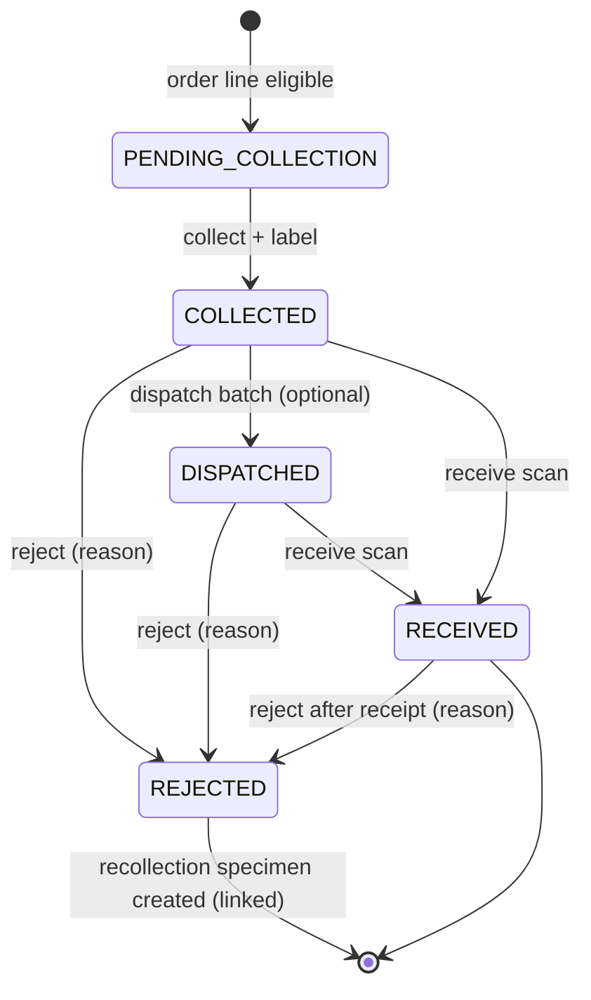
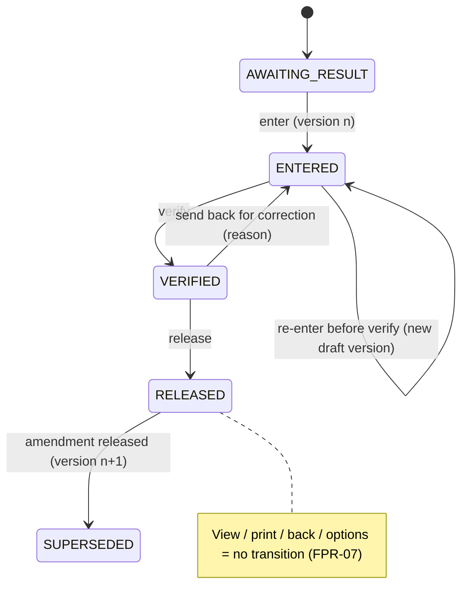

# C05 — Laboratory (LIS): specimens, results, verification, release, amendment, delivery

| Control | Value |
| --- | --- |
| Module | `mod-lab` |
| Version | 0.4.0-draft |
| Status | Lifecycle CONFIRMED (C-019). The S2 feedback items are SOURCE-DERIVED (adoption proposed below). Reviewer mapping, formulas, ranges and reversal target are OPEN. |
| Domain reviewer | Pathologist + lab manager |
| Sources | C-011, C-019, C-027; SRC-L01..L17; SRC-N04; SRC-Q01; v0.3 LAB, CLINICAL_SAFETY |

## 1. Purpose and scope

Take an eligible test order through:
1. labelling and collection
2. optional dispatch
3. receipt or rejection (with recollection)
4. result entry
5. verification
6. release
7. delivery

…with versioned, reproducible reports. **Primary quality goal:** a released report never silently changes state (PP-06).

Manual result entry is assumed for the first release (AS-008). Analyzer interfaces are in [C14](C14-integrations-devices.md).

## 2. Actors

Lab technologist (LBT), lab authority (LBA; pathologist or senior technologist per Q-009), receptionist/delivery desk, doctor and nurse (readers), system (analyzer adapter, later).

## 3. Proposed adoption of source requirements

The pathologist must confirm each line. Adoption here is PROPOSED.

| Source | Adoption | Requirement |
| --- | --- | --- |
| SRC-L01 eosinophil rounding | **Defer formula** (OPEN Q-010). Manual value entry only. | FR-LAB-015 |
| SRC-L02 PBF format | Adopt as configurable template | FR-LAB-014 |
| SRC-L03 repeated short forms (RBCs) | Adopt (no over-validation of free text) | FR-LAB-018 |
| SRC-L04 advice not auto-bold | Adopt (formatting only as configured) | FR-LAB-014 |
| SRC-L05 stable fonts after save/print | Adopt (template-controlled fonts) | FR-LAB-014 |
| SRC-L06 biochemistry sequence/serials | Adopt (configured order) | FR-LAB-019 |
| SRC-L07 EXL-200 mapping | Defer to integration (Q-047) | FR-LAB-024, C14 |
| SRC-L08 immunology attributes → range/method | Adopt as versioned mapping | FR-LAB-016 |
| SRC-L09 group report reversal | Adopt **as amendment**. Reversal to an earlier state is OPEN (Q-011). | FR-LAB-012, FR-LAB-013 |
| SRC-L10 room/cabin/bed on lab copy | Adopt | FR-LAB-020 |
| SRC-L11 consumption summary filters | Adopt (report correctness) | FR-LAB-021 |
| SRC-L12..L15 status regressions | Adopt as **fixed rule** FPR-07 | FR-LAB-002 |
| SRC-L16 collection/dispatch/receive/reject and stages | Adopt (stage actors OPEN) | FR-LAB-004..011 |
| SRC-L17 sample types, analyzers, ranges, defaults, positive/negative, test condition, B2B distribution | Adopt configuration (B2B later) | FR-LAB-016, FR-B2B-001 |

## 4. Requirements

| ID | Requirement | Status | Verify | Source |
| --- | --- | --- | --- | --- |
| FR-LAB-001 | The LIS shall track, for each lab order:<br>• specimen(s)<br>• collection, dispatch, receipt or rejection<br>• recollection<br>• result versions<br>• verification<br>• release<br>• amendment<br>• delivery<br>Each event records actor and time. | CONFIRMED | T | C-019 |
| FR-LAB-002 | Viewing, printing, previewing, exporting, pressing Back, opening "customize/print options", or reopening a report shall **never** change any result or report status. A status changes only through the explicit commands Enter, Verify, Release, Amend (and Reject/Receive for specimens). | SOURCE-DERIVED → fixed rule (FPR-07) | T | SRC-L12..L15 |
| FR-LAB-003 | Each result version shall reference the test definition version, reference-range version, method, unit and template version used. Changing configuration later never changes a released version or its print output. | CONFIRMED (v0.3) | T | SRC-L08, SRC-L17 |
| FR-LAB-004 | The collection worklist shall include only order lines that are payment-eligible (FR-BIL-003) or covered by an authorized exception (OPEN). Ineligible orders appear in a separate "awaiting payment" list with the amount due. | CONFIRMED (C-011) | T | C-011 |
| FR-LAB-005 | Collecting a specimen shall generate a unique specimen ID (CP-09) and print a barcode label. Label content:<br>• patient name<br>• MRN<br>• age/sex<br>• specimen ID as Code 128 (PROPOSED symbology)<br>• specimen type<br>• collection date/time<br>• test short codes<br>• ward/bed for inpatients<br>Several tests may share one specimen when their definitions share specimen type and container. Reprints are marked and audited. | SOURCE-DERIVED; symbology and size OPEN (Q-046) | T, U | SRC-L16 |
| FR-LAB-006 | Receiving a specimen shall either accept it (`RECEIVED`) or reject it (`REJECTED`) with a reason from a configured list plus free text. Rejection automatically creates a linked **recollection** request (`PENDING_COLLECTION`, `recollection_of` = rejected specimen). The rejected specimen is never deleted. | CONFIRMED (C-019) | T | C-019, SRC-L16 |
| FR-LAB-007 | When collection happens away from the lab, dispatch and receipt shall be recorded as separate events, with a dispatch batch listing the specimens. Receipt by barcode scan marks each specimen. | SOURCE-DERIVED | T | SRC-L16 |
| FR-LAB-008 | Result entry shall support:<br>• numeric (with unit and configured decimal places)<br>• text<br>• option lists (e.g., positive/negative)<br>• configured default values<br>Abnormal flags (H/L/critical) are computed by comparing against the configured range version. The product supplies **no** clinical ranges. | CONFIRMED capability; ranges by lab (CP-14) | T | SRC-L17 |
| FR-LAB-009 | Verification shall require `lab.result.verify`. It records the verifier and version. Verification is blocked while any required result in the group is missing. | CONFIRMED capability; actor mapping OPEN (Q-009) | T | C-019 |
| FR-LAB-010 | Release shall require `lab.result.release` and a verified version. If CP-13 forbids it, the releaser must differ from the verifier (`SEGREGATION_OF_DUTY`). Release creates an immutable released version and a `LabResultReleased` event. | CONFIRMED (C-019); separation value OPEN (Q-009) | T | C-019 |
| FR-LAB-011 | Skipping a stage (e.g., release without separate verification) is allowed only where CP-13 permits it for that test category, and is recorded as such. | SOURCE-DERIVED; who may OPEN (Q-009) | T | SRC-L16 |
| FR-LAB-012 | Amending a released result shall:<br>• require `lab.result.amend` and a reason<br>• create a new version, verified and released per FR-LAB-009/010<br>• mark the earlier released version `SUPERSEDED` but keep it viewable<br>• print "Amended report" with the amendment date on the new report<br>• notify the previous recipients in the delivery list (notification method OPEN, Q-012) | CONFIRMED principle (C-029); approval OPEN (Q-011) | T | SRC-L09, v0.3 CLINICAL_SAFETY |
| FR-LAB-013 | Returning a released group report to an earlier, un-released state ("reversal", SRC-L09) is **not available** in the interim: corrections use FR-LAB-012. Whether reversal is required, its target state, and its effect on delivered copies are OPEN. | OPEN (Q-011) | — | SRC-L09 |
| FR-LAB-014 | Report templates shall be configured and versioned per test or panel (A4 default). Rules:<br>• fonts, sizes and emphasis come from the template, not from editor state, so saving, printing or using shortcuts cannot change them<br>• free-text "advice" is printed as entered, with no automatic bold<br>• the PBF layout follows the pathologist-approved template | SOURCE-DERIVED | T, U | SRC-L02, SRC-L04, SRC-L05 |
| FR-LAB-015 | Calculated tests (e.g., absolute eosinophil count) and their rounding. | **OPEN (Q-010).** Not implemented; enter values manually. | — | SRC-L01 |
| FR-LAB-016 | Test definitions shall configure:<br>• specimen type and container<br>• units<br>• methods<br>• reference ranges by sex and age band<br>• default values<br>• option lists<br>• test conditions<br>• analyzer attribute mapping<br>Publishing a new version applies to results entered afterwards. When an analyzer attribute maps to a range/method version, the mapped version is applied (SRC-L08). | SOURCE-DERIVED | T | SRC-L08, SRC-L17 |
| FR-LAB-017 | Critical results: computed critical flag displayed prominently on worklists and report. A notification and acknowledgment workflow is **OPEN** (Q-012). Printing is not acknowledgment. | Flag PROPOSED; workflow OPEN | T | v0.3 CLINICAL_SAFETY |
| FR-LAB-018 | Free-text result fields shall accept repeated legitimate abbreviations (e.g., "RBCs", "WBCs") without auto-correction or duplicate warnings. | SOURCE-DERIVED | T | SRC-L03 |
| FR-LAB-019 | Within a report, tests shall appear in the configured sequence for the panel or section, with serial numbers following that sequence. | SOURCE-DERIVED | T | SRC-L06 |
| FR-LAB-020 | Reports and lab copies for inpatients shall show ward, room/cabin and bed as at collection time, plus current location if different. | SOURCE-DERIVED | T, U | SRC-L10 |
| FR-LAB-021 | The test consumption summary report shall return data for every valid filter combination (date range, section, test, analyzer) and agree with posted test counts. | SOURCE-DERIVED | T | SRC-L11 |
| FR-LAB-022 | Report delivery (handed to patient, sent to doctor, portal, B2B) shall be recorded as a delivery event (recipient, channel, version, actor, time), separate from printing. | CONFIRMED (v0.3 WORKFLOWS) | T | v0.3 |
| FR-LAB-023 | Lab worklists shall exist per stage:<br>• awaiting collection<br>• in transit<br>• to receive<br>• result entry by section<br>• to verify<br>• to release<br>• ready for delivery<br>Each has filters (date, section, priority, ward) and server-side pagination. Concurrent edits of the same result are version-checked (SP-03). | PROPOSED | T, U | SRC-L16 |
| FR-LAB-024 | Analyzer results (when integrated) shall arrive as `ENTERED` versions with source = analyzer and message ID. They are never auto-released. Duplicates are idempotent; unmatched messages are quarantined (C14). | PROPOSED (auto-release excluded per C-027) | T | SRC-L07 |
| FR-LAB-025 | Nurses and doctors shall see released results for patients in their scope (FR-NUR-001, FR-CLI-010). Unreleased results are visible only to lab roles. | SOURCE-DERIVED | T | SRC-N04 |

## 5. Use cases

### UC-LAB-01 Collect and label a specimen

- **Actor:** LBT (`lab.specimen.collect`).
- **Preconditions:** order line eligible (FR-LAB-004); patient identity confirmed at the bedside or desk.
- **Normal path:**
  1. Scan or select the patient.
  2. The worklist shows eligible tests grouped by specimen type and container.
  3. Confirm collection. The server creates the specimen(s), links the tests, marks the order `IN_PROGRESS` and logs the label print event.
  4. Print the labels.
  5. Attach the labels to the tubes.
- **Denied paths:**
  - D1: test not eligible → `PAYMENT_NOT_ELIGIBLE` with the amount due.
  - D2: an order outside the user's facility scope → SP-05.
- **Recovery:**
  - R1: printer jam → reprint from the specimen (no new specimen, FR-PRN-004).
  - R2: duplicate submit → SP-01.
- **Requirements:** FR-LAB-004, FR-LAB-005, FR-BIL-003.

### UC-LAB-02 Receive or reject a specimen

- **Normal path:** scan the specimen barcode at the lab bench → `RECEIVED` with time and user.
- **Alternative path (reject):**
  1. Choose "Reject" and a reason (e.g., haemolysed, insufficient volume, unlabelled; list configured by the lab).
  2. The server sets `REJECTED` and creates a linked recollection request.
  3. The collection worklist shows "Recollection needed", linked to the original.
- **Requirements:** FR-LAB-006, FR-LAB-007.

### UC-LAB-03 Enter, verify and release results

- **Normal path:**
  1. The LBT opens the section worklist, selects a specimen and enters values. The server stores result version v1 `ENTERED` with ranges and flags computed.
  2. The LBA opens the "to verify" list, reviews and verifies → `VERIFIED`.
  3. The LBA (or a different LBA if CP-13) releases → `RELEASED`. The report status becomes `RELEASED` when all tests in the report group are released (or `PARTIALLY_RELEASED`, if the lab configures partial release, PROPOSED).
  4. Doctor and nurse views show the released result. The delivery desk shows "Ready".
- **Denied paths:**
  - D1: the LBT presses release → SP-04.
  - D2: the same person verifies and releases while CP-13 forbids it → `SEGREGATION_OF_DUTY`.
  - D3: required values missing → `VALIDATION_FAILED`.
- **Recovery:** R1: two LBTs edit the same result → the second gets `STALE_RECORD` with the current values shown.
- **Requirements:** FR-LAB-008..011, FR-LAB-019, FR-LAB-025.

### UC-LAB-04 Amend a released result

- **Normal path:**
  1. The LBA opens the released report and selects "Amend".
  2. The LBA edits the value or comment and enters a reason.
  3. The new version is verified and released.
  4. The old version is marked `SUPERSEDED`. The report prints "Amended". Previous recipients are listed for follow-up.
- **Requirements:** FR-LAB-012.

### UC-LAB-05 View, print, go back (regression guard)

- **Normal path:**
  1. Any permitted user opens a released report, previews, prints, chooses "print options", presses browser Back, and reopens it.
  2. At every step the status remains `RELEASED` and the version is unchanged.
  3. The print event is logged.
- **Requirements:** FR-LAB-002, FPR-07.

### UC-LAB-06 Deliver a report

- **Normal path:** at the delivery desk, find by MRN or receipt → select released reports → print for the patient (print event) → mark delivered to the patient (delivery event). A dues warning appears if CP-17 says so; delivery with dues is allowed in the interim (Q-013).
- **Requirements:** FR-LAB-022, FR-REP-006.

## 6. State machines





## 7. Fixed rules versus configurable policy

| Fixed | Configurable |
| --- | --- |
| No status change on view/print/back (FPR-07) | Ranges, units, methods, templates, defaults (CP-14) |
| Released versions immutable; amendment creates a new version | Verify/release separation (CP-13) |
| Rejection keeps the specimen and links the recollection | Rejection reasons list |
| No auto-release from analyzers (C-027) | Label size and symbology (Q-046) |
| Payment eligibility before collection (C-011) | Partial release of a report group (PROPOSED option) |

## 8. Acceptance examples (including the source regression set)

```gherkin
Scenario: Released report stays released through navigation (SRC-L12..L15, FR-LAB-002)
  Given report R for Karim Ahmed with CBC is RELEASED as version 1
  When a lab user opens R, opens print options, prints, presses Back and reopens R
  Then R.status = RELEASED and R.version = 1
  And a print event exists and no status event exists

Scenario: Processing a pending report moves it forward and persists (SRC-L13)
  Given CBC is ENTERED for specimen S-1001
  When the lab authority verifies it
  And reloads the worklist
  Then the CBC result is VERIFIED and appears in "to release", not in "to verify"

Scenario: Back from Customize does not revert (SRC-L15)
  Given CBC is VERIFIED
  When the lab authority opens "customize print layout" and presses Back without saving
  Then CBC remains VERIFIED

Scenario: Rejection and linked recollection (FR-LAB-006)
  Given specimen S-1001 is COLLECTED for CBC
  When the technologist rejects it with reason "Haemolysed"
  Then S-1001 is REJECTED with the reason and actor
  And a new collection request exists with recollection_of = S-1001
  And the CBC order line remains eligible without new payment

Scenario: Entry-only user cannot release (FR-LAB-010)
  Given user tech1 has lab.result.enter only
  When tech1 calls ReleaseLabResult for a VERIFIED result
  Then PERMISSION_DENIED is returned and the result stays VERIFIED

Scenario: Configuration change does not rewrite history (FR-LAB-003)
  Given haemoglobin result 11.2 g/dL was released with range version RV-3
  When the lab publishes range version RV-4
  Then re-printing the released report shows RV-3's range text
  And new results use RV-4

Scenario: Amendment keeps the earlier release (FR-LAB-012)
  Given CBC v1 is RELEASED
  When the lab authority amends WBC with reason "Transcription error" and releases v2
  Then v1 is SUPERSEDED and viewable, v2 is RELEASED
  And the printed report says "Amended" with the amendment date
```

## 9. Traceability

| Requirement | Decision / source | Command | Data | Permission | Tests |
| --- | --- | --- | --- | --- | --- |
| FR-LAB-002 | SRC-L12..L15 | read endpoints only | `lab_report`, `print_event` | — | AT-LAB-001..005, UAT-LAB-008..010 |
| FR-LAB-003, -016 | SRC-L08, SRC-L17 | `PublishTestDefinitionVersion` | `test_definition_version`, `reference_range_version` | `lab.config.manage` | AT-LAB-006, AT-LAB-007 |
| FR-LAB-004, -005 | C-011, SRC-L16 | `CollectSpecimen` | `specimen`, `specimen_test` | `lab.specimen.collect` | AT-LAB-008, AT-LAB-009, UAT-LAB-001..003 |
| FR-LAB-006, -007 | C-019 | `ReceiveSpecimen`, `RejectSpecimen`, `DispatchSpecimens` | `specimen`, `specimen_event` | `lab.specimen.*` | AT-LAB-010, AT-LAB-011, UAT-LAB-004, UAT-LAB-005 |
| FR-LAB-008..011 | C-019, Q-009 | `EnterResult`, `VerifyResult`, `ReleaseResult` | `result_version`, `lab_review_event` | `lab.result.*` | AT-LAB-012..016, UAT-LAB-006, UAT-LAB-007 |
| FR-LAB-012 | C-029 | `AmendResult` | `result_version.amends` | `lab.result.amend` | AT-LAB-017, UAT-LAB-011 |
| FR-LAB-014, -019, -020 | SRC-L02/L04/L05/L06/L10 | `RenderLabReport` | `report_template_version` | — | AT-LAB-018..020, UAT-PRN-004 |
| FR-LAB-021 | SRC-L11 | `GetConsumptionSummary` | read model | `report.view.lab` | AT-LAB-021 |
| FR-LAB-022 | v0.3 | `RecordReportDelivery` | `report_delivery_event` | `lab.report.deliver` | AT-LAB-022, UAT-LAB-012 |
| FR-LAB-024 | SRC-L07 | adapter → `ImportAnalyzerResult` | `inbox_message`, `result_version` | system | AT-INT-001..004 |

`lab.report.deliver` is added to the [C00 §8](C00-srs-overview.md#8-permission-catalogue-and-approval-responsibilities) catalogue (default: delivery desk / receptionist, LBT).

## 10. Gaps and open questions

- Q-009 stage actors and separation
- Q-010 calculated tests
- Q-011 ranges, templates, amendment approval, reversal target
- Q-012 critical result workflow
- Q-013 delivery with dues
- Q-046 label printer and size
- Q-047 analyzers
- Q-065 reagent consumption (C09)
