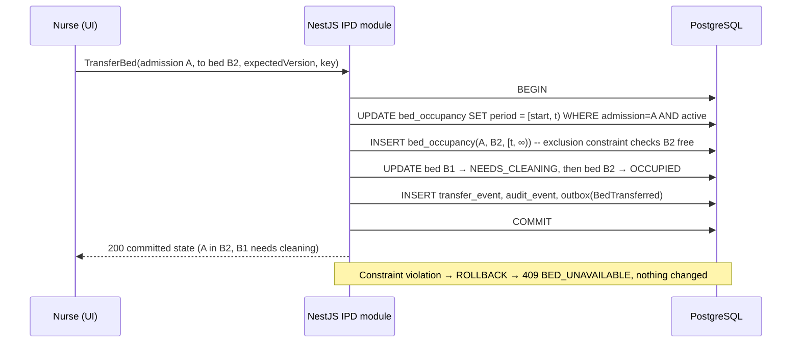

# C06 — Inpatient admission, beds, transfers, cleaning and discharge

| Control | Value |
| --- | --- |
| Module | `mod-ipd` (admissions, beds, occupancy, transfers, cleaning, discharge steps) |
| Version | 0.4.0-draft |
| Status | Admission routes, waiting for a bed, transfers with history, and cleaning after discharge are CONFIRMED (C-013..C-016). Bed rent, discharge with dues, backdating and transfer cleaning are OPEN. |
| Domain reviewer | IPD manager + nursing superintendent + finance (charges) |
| Sources | C-013..C-017; SRC-I01..I07, SRC-N05, SRC-N06, SRC-N12; v0.3 IPD_BEDS |

## 1. Purpose and scope

This module covers:
- creating admissions from any route
- tracking where each admitted patient is
- preventing double allocation
- keeping transfer history
- forcing cleaning before reuse
- separating the three discharge facts: medical discharge, financial clearance and physical departure

Charges post to the running account through billing (C04).

## 2. Actors

Admission desk (receptionist), doctor, ward nurse / ward in-charge, housekeeping (cleaning; may be a nurse role), cashier / billing supervisor (clearance), IPD manager (bed master).

## 3. Proposed adoption of source requirements

| Source | Adoption |
| --- | --- |
| SRC-I01 floor-wise views, filters, patient/doctor display | Adopt (bed board) |
| SRC-I01 "dummy bed" distinction | **Not adopted.** An admission waiting for a bed (C-014) replaces dummy beds. Legacy dummy beds are not migrated as beds (Q-048). |
| SRC-I02 extra beds tagged, primary/extra history | Adopt capability; rules OPEN (Q-007) |
| SRC-I03 consistent occupancy across IPD, Daycare and nurse station | Adopt as fixed rule (one occupancy model) |
| SRC-I04 remarks/item history; certificates; newborn; package merge/split | Remarks adopted; certificates and newborn OPEN (Q-060); packages OPEN (Q-061) |
| SRC-I05 persisted discharge state; UI success equals saved | Adopt (FPR-15) |
| SRC-I06 capped rent, revenue head, timestamped transfer charges | OPEN (Q-007) |
| SRC-I07 noon-to-noon, 6 p.m. posting | OPEN (Q-007, CX-005) |

## 4. Requirements

| ID | Requirement | Status | Verify | Source |
| --- | --- | --- | --- | --- |
| FR-IPD-001 | Admission can be created from an OPD visit, an emergency visit or a planned/direct route. It records the source visit (if any), admitting doctor, department, reason (free text), admission time, creating user and the initial state `AWAITING_BED`. | CONFIRMED | T | C-013, C-014 |
| FR-IPD-002 | Staff shall transfer an admitted patient between beds. One transaction:<br>• closes the current occupancy at the effective time<br>• opens the new occupancy at the same instant<br>• records a transfer event (from, to, time, actor, reason)<br>Admission ID and MRN never change. | CONFIRMED | T | C-015, SRC-N05 |
| FR-IPD-003 | When a bed is vacated by departure, it becomes `NEEDS_CLEANING` and cannot be allocated until a user with `ipd.bed.cleaning.complete` records cleaning completion. | CONFIRMED | T | C-016 |
| FR-IPD-004 | Each admission has a running account accepting charges and deposits/partial payments, followed by a final bill (C04 FR-BIL-028/029). | CONFIRMED | T | C-017 |
| FR-IPD-005 | The bed board shall show beds by facility → floor → ward → room, with:<br>• status<br>• patient name, MRN, age/sex<br>• admitting doctor<br>• admission time<br>• extra-bed tag<br>Filters: department, ward, status. It shows the same committed data as the nurse station and Daycare views. | SOURCE-DERIVED | T, U | SRC-I01, SRC-I03 |
| FR-IPD-006 | Bed operational status: `AVAILABLE`, `OCCUPIED`, `NEEDS_CLEANING`, `OUT_OF_SERVICE` (PROPOSED, with reason). `OCCUPIED` holds if and only if the bed has an active occupancy. Whether a bed vacated by **transfer** also needs cleaning is CP-15 (OPEN, Q-008; interim: required). | CONFIRMED core; extras PROPOSED/OPEN | T | C-016, v0.3 DESIGN |
| FR-IPD-007 | Allocation shall guarantee, under concurrency:<br>• at most one active occupancy per bed (FPR-10)<br>• at most one active **primary** occupancy per admission<br>A losing concurrent request receives `BED_UNAVAILABLE`. | CONFIRMED (R-06) | T | C-014, P-012 |
| FR-IPD-008 | Admission deposits are recorded as payments to the admission's running account (FR-BIL-028). Carrying deposits across admissions is OPEN (Q-040). | CONFIRMED capability | T | C-017 |
| FR-IPD-009 | Automatic bed charges: **OPEN (Q-007)**. Interim: an authorized user posts a manual "bed charge" service for a bed and service date. The source reference `(IPD, BED_DAY_MANUAL, admission, bed, service_date)` prevents duplicates. | OPEN; interim PROPOSED | T | SRC-I06, SRC-I07 |
| FR-IPD-010 | A doctor or nurse may record a **discharge request** (planned discharge time, note). It notifies billing to prepare the final bill. | SOURCE-DERIVED | T | SRC-I05 |
| FR-IPD-011 | A doctor with `ipd.discharge.medical` records **medical discharge** (time, discharge type from a configured list, summary link). After medical discharge, routine clinical orders are blocked; corrections and returns follow their own rules. | CONFIRMED distinction (v0.3); detail PROPOSED | T | v0.3 GLOSSARY |
| FR-IPD-012 | **Financial clearance** is recorded by billing (`ipd.discharge.financial_clear`) when the final bill is settled (balance 0). Clearance with an outstanding balance is **not available** until Q-006. | CONFIRMED distinction; dues policy OPEN (Q-006) | T | C-017, Q-006 |
| FR-IPD-013 | **Departure** (the patient physically leaves) is recorded by staff with `ipd.discharge.depart`. It closes the occupancy and sets the bed to `NEEDS_CLEANING`. Departure is a physical fact and can always be recorded, so the bed board stays truthful. If financial clearance is missing, the user must acknowledge "Departing with outstanding balance <amount>". The admission is then flagged `DEPARTED_WITH_DUES` for finance follow-up. This records a fact and decides **no** policy about whether such departures are allowed (Q-006). | CONFIRMED need (SRC-I05); acknowledgement PROPOSED | T | SRC-I05, SRC-N06 |
| FR-IPD-014 | Discharge certificate, death certificate and newborn registration documents. | OPEN (Q-060) | — | SRC-I04 |
| FR-IPD-015 | Admission remarks and an item/charge history view per admission, chronological, with actor. | SOURCE-DERIVED | U | SRC-I04 |
| FR-IPD-016 | Each occupancy and transfer stores both the **effective time** and the **entry time**. Interim: effective time = server time. Backdating is not available until its rules are defined (Q-069). | PROPOSED interim | T | v0.3 IPD_BEDS |
| FR-IPD-017 | Cancelling an admission created in error (no care recorded, no charges) with a reason. Rules beyond that are OPEN. | PROPOSED | T | — |
| FR-IPD-018 | IPD, Daycare (C10) and the nurse station shall read one bed and occupancy model. A bed occupied by any stay type is unavailable to all. | SOURCE-DERIVED → fixed rule | T | SRC-I03 |
| FR-IPD-019 | Extra beds can be created by an authorized user as temporary beds in a ward (kind `EXTRA`). They are visibly tagged on the board, prints and labels, and retired after use. Charging rules are OPEN (Q-007). | SOURCE-DERIVED capability | T | SRC-I02 |
| FR-IPD-020 | Discharged and departed patients shall be visually distinct from active patients on all ward lists (FR-NUR-011). | SOURCE-DERIVED | U | SRC-N06 |

## 5. Use cases

### UC-IPD-01 Admit a patient (any route)

- **Actor:** admission desk or doctor (`ipd.admission.create`).
- **Inputs:**
  - patient
  - route (`OPD`, `EMERGENCY`, `PLANNED`) and source visit (required for OPD/EMERGENCY)
  - admitting doctor, department, reason
  - optional preferred ward
  - idempotency key
- **Normal path:**
  1. Create the admission `AWAITING_BED`.
  2. Billing opens the running account.
  3. Optionally allocate a bed immediately (UC-IPD-02).
  4. Print the admission form.
- **Alternative paths:** A1: no bed is available → the admission stays `AWAITING_BED` and appears on the "Awaiting bed" list with waiting time.
- **Denied paths:** D1: the patient already has an active admission → `INVALID_TRANSITION` (one active admission per patient; PROPOSED fixed rule).
- **Requirements:** FR-IPD-001, FR-IPD-004.

### UC-IPD-02 Allocate a bed

- **Preconditions:** admission `AWAITING_BED`; bed `AVAILABLE`.
- **Normal path:**
  1. Choose the bed on the board.
  2. Confirm with the expected bed version.
  3. One transaction: insert the occupancy (constraint-protected), set the bed to `OCCUPIED`, set the admission to `ACTIVE`, emit `BedAllocated`.
- **Denied paths:**
  - D1: the bed was taken a moment ago → `BED_UNAVAILABLE`; the board refreshes.
  - D2: the bed is `NEEDS_CLEANING` → `BED_NEEDS_CLEANING`.
- **Requirements:** FR-IPD-007, FR-IPD-006.

### UC-IPD-03 Transfer a bed

- **Normal path:**
  1. Select the patient.
  2. Choose "Transfer" and the destination bed.
  3. Enter a reason (optional, configurable).
  4. The server, in one transaction:
     - ends the current occupancy at `t`
     - starts the new occupancy at `t`
     - sets the source bed to `NEEDS_CLEANING` (or `AVAILABLE` if CP-15 says so)
     - sets the destination bed to `OCCUPIED`
     - records the transfer event
- **Denied paths:** D1: destination unavailable → `BED_UNAVAILABLE`. The source occupancy is unchanged (the whole transaction rolls back).
- **Recovery:** R1: label print failure after transfer → reprint the bed label (FR-PRN-003). The transfer is not repeated.
- **Requirements:** FR-IPD-002, FR-IPD-006, FR-IPD-016.

### UC-IPD-04 Discharge steps

| Step | Who | Effect | Blocks |
| --- | --- | --- | --- |
| Discharge request | Doctor/nurse | Admission `DISCHARGE_REQUESTED`; billing notified | — |
| Medical discharge | Doctor | `MEDICALLY_DISCHARGED`; routine orders blocked | — |
| Final bill issued | Billing | Running account `FINAL_ISSUED` | Pending charges must be posted first |
| Financial clearance | Cashier/supervisor | `financial_clearance = CLEARED` when balance 0 | Clearing with dues is OPEN (Q-006) |
| Departure | Nurse/desk | Occupancy closed; bed `NEEDS_CLEANING`; admission `DEPARTED` (flag `DEPARTED_WITH_DUES` if not cleared) | Always recordable (FR-IPD-013) |

**Order:** departure normally follows clearance. The order between medical discharge and the final bill is not enforced, because the hospital's policy is OPEN.

### UC-IPD-05 Complete bed cleaning

- **Normal path:** the housekeeping/nurse list shows `NEEDS_CLEANING` beds with the vacated time → "Cleaning complete" → bed `AVAILABLE`; an event records the actor and time.
- **Denied paths:** D1: the bed is not `NEEDS_CLEANING` → `INVALID_TRANSITION`.
- **Requirements:** FR-IPD-003.

## 6. State machines

**Admission:**

| From | To | Trigger |
| --- | --- | --- |
| (new) | `AWAITING_BED` | Admit |
| `AWAITING_BED` | `ACTIVE` | Allocate bed |
| `AWAITING_BED` | `CANCELLED` | Cancel in error (FR-IPD-017) |
| `ACTIVE` | `DISCHARGE_REQUESTED` | Discharge request |
| `ACTIVE` or `DISCHARGE_REQUESTED` | `MEDICALLY_DISCHARGED` | Medical discharge |
| `MEDICALLY_DISCHARGED` | `DEPARTED` | Departure |
| `ACTIVE` | `DEPARTED` | Departure without medical discharge, e.g. leaving against advice. **Interim:** recordable with reason; any categories needed are OPEN. |

Financial clearance is a separate attribute: `NOT_CLEARED → CLEARED`.

**Bed:** `AVAILABLE → OCCUPIED → NEEDS_CLEANING → AVAILABLE`; any state except `OCCUPIED` → `OUT_OF_SERVICE` → `AVAILABLE` (PROPOSED).



## 7. Fixed rules versus configurable policy

| Fixed | Configurable / OPEN |
| --- | --- |
| Admission ≠ occupancy; admission can wait (FPR-02) | Cleaning after transfer (CP-15, Q-008) |
| One active occupancy per bed (FPR-10) | Bed rent rules (CP-16, Q-007) |
| Cleaning after discharge vacancy (C-016) | Discharge type list |
| Transfers keep history; IDs never change | Backdating window (Q-069) |
| Departure is a recordable fact; dues flagged, not hidden | Clearance with dues (Q-006) |
| One occupancy model for IPD, Daycare and nurse station | Extra-bed charging (Q-007) |

## 8. Acceptance examples

```gherkin
Scenario: Admission waits for a bed (FR-IPD-001)
  Given all beds in Ward 3 are OCCUPIED
  When the doctor admits Salma Begum from OPD visit V-55 to Ward 3
  Then admission A-12 exists with state AWAITING_BED and source visit V-55
  And no occupancy exists for A-12

Scenario: Two users race for the last bed (FR-IPD-007)
  Given bed W3-07 is AVAILABLE
  When nurse N1 allocates W3-07 to A-12 and nurse N2 allocates W3-07 to A-13 at the same moment
  Then exactly one allocation succeeds
  And the other receives BED_UNAVAILABLE

Scenario: Transfer keeps identity and history (FR-IPD-002)
  Given A-12 occupies W3-07 since 2026-11-02 10:00 (Asia/Dhaka)
  When the ward in-charge transfers A-12 to W4-02 at 2026-11-03 15:30
  Then A-12 and MRN are unchanged
  And occupancy W3-07 = [2026-11-02 10:00, 2026-11-03 15:30)
  And occupancy W4-02 starts 2026-11-03 15:30
  And W3-07 is NEEDS_CLEANING (CP-15 interim)

Scenario: Cleaning required before reuse (FR-IPD-003)
  Given A-12 departed from W4-02
  When the admission desk tries to allocate W4-02 to A-14
  Then BED_NEEDS_CLEANING is returned
  When housekeeping records cleaning complete for W4-02
  Then W4-02 is AVAILABLE and can be allocated

Scenario: Departure with dues is recorded and flagged, not hidden (FR-IPD-013)
  Given A-12's final bill shows balance due 4,500.00 BDT
  When the nurse records departure and acknowledges the outstanding balance
  Then the bed is NEEDS_CLEANING
  And A-12 is DEPARTED with flag DEPARTED_WITH_DUES
  And the running account is not marked settled

Scenario: Manual bed charge cannot be duplicated (FR-IPD-009)
  Given a manual bed charge for A-12, bed W3-07, service date 2026-11-02 exists
  When the same manual charge is submitted again
  Then no second charge is created
```

## 9. Traceability

| Requirement | Decision / source | Command | Data | Permission | Tests |
| --- | --- | --- | --- | --- | --- |
| FR-IPD-001 | C-013, C-014 | `AdmitPatient` | `admission` | `ipd.admission.create` | AT-IPD-001, AT-IPD-002 |
| FR-IPD-002, -016 | C-015 | `TransferBed` | `bed_occupancy`, `bed_transfer_event` | `ipd.bed.transfer` | AT-IPD-003, AT-IPD-004 |
| FR-IPD-003, -006 | C-016 | `CompleteBedCleaning` | `bed`, `bed_cleaning_task` | `ipd.bed.cleaning.complete` | AT-IPD-005, AT-IPD-006 |
| FR-IPD-007 | P-012 | `AllocateBed` | exclusion constraints | `ipd.bed.allocate` | AT-IPD-007 (concurrency), AT-DB-003 |
| FR-IPD-009 | Q-007 | `PostManualBedCharge` | `charge.source_ref` | `billing.invoice.issue` | AT-IPD-008 |
| FR-IPD-010..013 | Q-006 | `RequestDischarge`, `RecordMedicalDischarge`, `ClearFinancially`, `RecordDeparture` | `admission` | `ipd.discharge.*` | AT-IPD-009..012, UAT-IPD-006..008 |
| FR-IPD-018 | SRC-I03 | bed board query | `bed`, `bed_occupancy` | `nursing.worklist.view` | AT-IPD-013 |

## 10. Gaps and open questions

- Q-006 dues at discharge
- Q-007 bed rent (CX-005)
- Q-008 cleaning after transfer
- Q-040 deposits across admissions
- Q-060 certificates and newborn
- Q-061 packages
- **Q-069** Backdating of admissions, transfers and departures: is it allowed, how far back, by whom, and how do charges react?
- Daycare boundaries (Q-026, C10)
