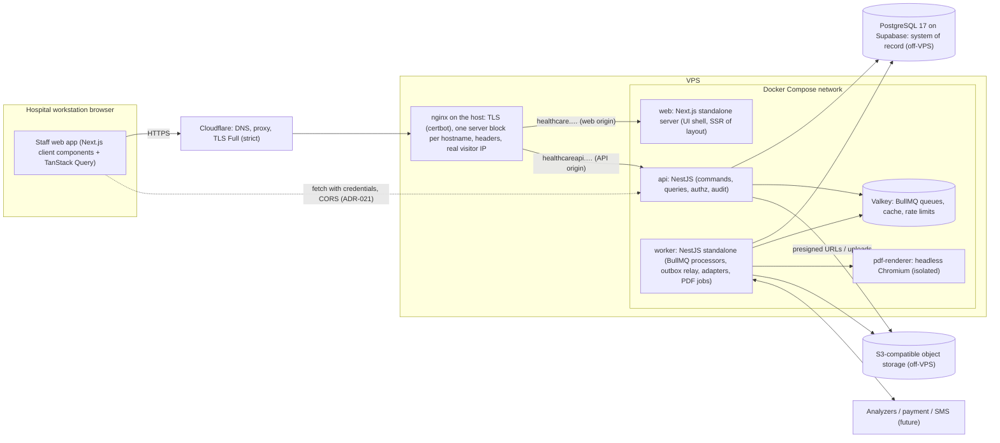
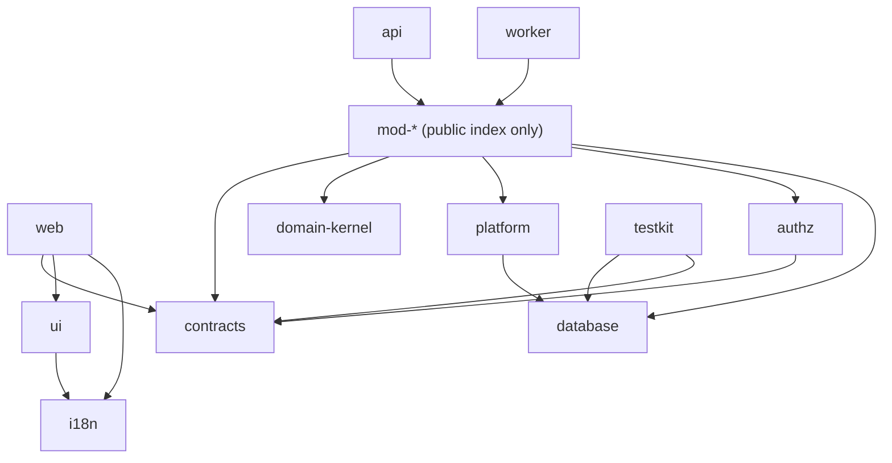
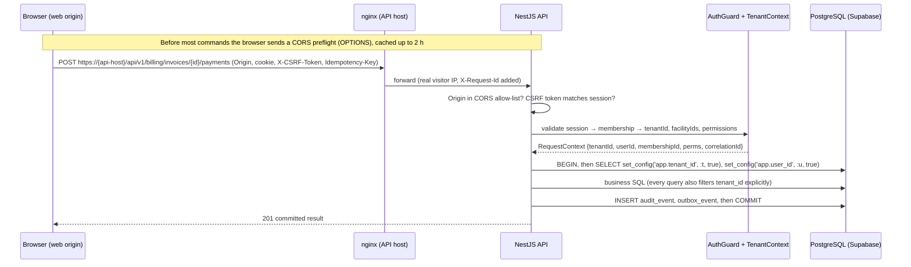
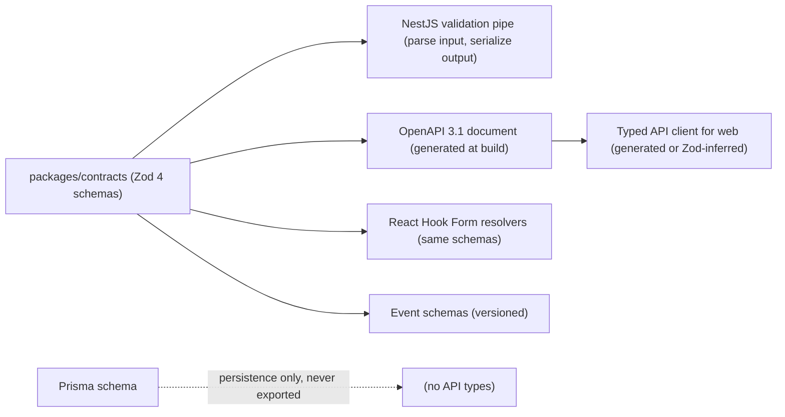
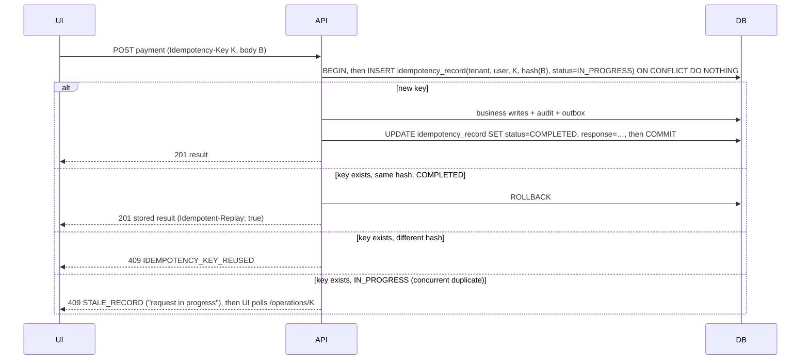
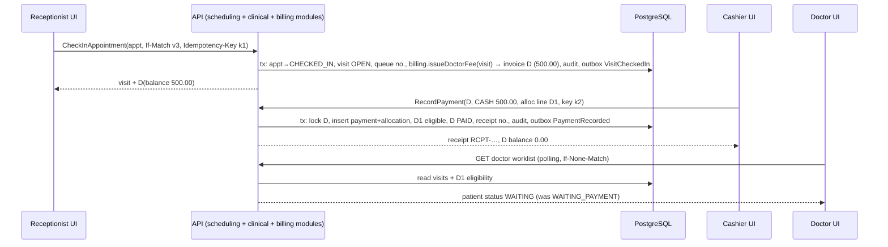

# D — System design

| Control | Value |
| --- | --- |
| Document | D System design (architecture, runtime responsibilities, boundaries, cross-cutting mechanisms) |
| Version | 0.4.0-draft |
| Status | **PROPOSED.** The stack direction is CONFIRMED (C-003): Next.js, NestJS, PostgreSQL, Turborepo. Everything else is a proposal recorded in [ADRs](D2-adr/README.md) until approved. |
| Owner role | Technical architect |
| Updated | 2026-10-14 |
| Depends on | [C-srs](C-srs/C00-srs-overview.md), [D1 Stack assessment](D1-stack-assessment-and-versions.md), [E Database design](E-database-design.md) |
| Amended by | [ADR-019](D2-adr/ADR-019-supabase-postgres.md) (PostgreSQL 17 on Supabase), [ADR-020](D2-adr/ADR-020-valkey-nginx-droplet.md) (Valkey; host nginx instead of Caddy), [ADR-021](D2-adr/ADR-021-separate-web-api-origins.md) (separate web and API origins). §4, §6.1 and §7.1 are updated to match. |

## 1. Architecture drivers from the hospital workflows

The architecture is chosen to serve these specific hospital needs. Generic preferences did not drive it.

| # | Driver (from requirements) | Architectural consequence |
| --- | --- | --- |
| AD-1 | **Money must be exact and never duplicated** (FPR-03, FPR-06, FPR-08, FPR-09). One cashier action touches payment, allocation, line eligibility, receipt numbering, audit and the outbox. | These writes must commit in **one PostgreSQL transaction**. This argues strongly for a single application process over a shared database (modular monolith) rather than services coordinating money over a network. |
| AD-2 | **Cross-department gates** (C-011): lab collection checks billing eligibility; orders create charges; dispensing moves stock and posts charges. | In-process module interfaces with transactional calls. No distributed transactions or sagas for core flows. |
| AD-3 | **Concurrency hot spots**: last bed, last slot, last stock units, two cashiers on one invoice (R-06, FR-BIL-034). | Database-enforced constraints (exclusion, unique, check) plus optimistic versions. The database is the arbiter. |
| AD-4 | **Multi-tenant isolation** (C-001, C-029). | Tenant context derived server-side. Composite tenant foreign keys and RLS as defence in depth. Tenant-scoped keys in cache, jobs and files. |
| AD-5 | **States must persist exactly** (PP-06, PP-10, FPR-07, FPR-15). | Explicit command endpoints for transitions. Read endpoints are side-effect-free. The UI shows success only after commit. |
| AD-6 | **Auditability and correction** (C-029, P-013). | Append-only tables for posted facts. Audit written in the same transaction. |
| AD-7 | **Bilingual UI and print on real printers** (C-025, SRC-Q01). | Message catalogs, Bangla fonts, HTML print views, and server-side PDF rendering with Chromium for archived documents. |
| AD-8 | **VPS hosting, modest budget, small team plus AI agents** (C-004, C-026). | Few moving parts. Docker Compose. One codebase with strict module boundaries that agents can work in independently. |
| AD-9 | **24-hour hospital operations; outages handled on paper** (AS-004). | Graceful deploys, fast restore, reconciliation after downtime. No offline sync (DEF-003). |
| AD-10 | **Device and partner integrations with unknown protocols** (C14). | Adapter boundary in a worker; durable inbox/outbox; quarantine. |

## 2. Architecture style: modular monolith versus alternatives

**Proposal (ADR-001, P-001):** a **modular monolith** with:
- one NestJS API application
- one NestJS worker application built from the same domain packages
- one PostgreSQL database

| Option | Fit for this product | When it would be preferable |
| --- | --- | --- |
| **Modular monolith** (proposed) | Single transactions for AD-1/AD-2. One deployment unit on a VPS. Simplest local development for agents. Module boundaries enforced by tooling, not the network. | Default for the foreseeable scale ([M](M-capacity-performance.md)). |
| Microservices (per domain) | Network calls between billing, lab and IPD would turn every payment gate into a distributed consistency problem. Many deployables, more infrastructure (gateway, service discovery, tracing). | Only if separate teams need independent release cadence **and** load profiles diverge sharply. Neither applies now. |
| Monolith without module boundaries | Fastest at first, but agents working in parallel would entangle billing, lab and IPD tables. Ownership rules (v0.3 MODULES) would erode. | Never preferred. Boundaries are cheap to keep from day one. |
| Serverless functions | Cold starts, connection storms against PostgreSQL, and provider lock-in conflict with VPS hosting (C-026). | Not applicable. |
| Separate deployment per hospital (single-tenant installs) | Strong isolation, but N upgrades, N databases, N monitoring setups. Contradicts "one maintained product" (C-001). | As a premium option for a specific customer (DEF-005). |

**Extraction path.** If one module later needs independent scaling, it can be extracted because:
- its tables are owned exclusively (E §2)
- other modules call it only through its public interface
- events already flow through the outbox

The likely first candidates are the **worker-side integration adapters** and **report generation**. Both are already separate processes.

## 3. Frontend framework: Next.js versus React + Vite

Next.js is **CONFIRMED** (C-003). The comparison below explains the trade-offs, constrains how Next.js is used, and states when an alternative would be preferable. Changing framework would need an owner decision.

| Criterion | Next.js (App Router) | React + Vite SPA |
| --- | --- | --- |
| Nature of the staff app | Long-lived, authenticated, highly interactive workstation screens: queues, worklists, forms. SEO is irrelevant. | A natural fit for exactly this kind of app. |
| Server rendering benefit | Fast first paint of the shell. Server-side auth gating before the page loads. Useful for the **patient portal** (public pages, slow mobile networks). | None, unless an SSR framework is added. |
| Runtime to operate | Requires a Node server process (standalone output) and patching for framework-level vulnerabilities (e.g., the December 2025 React Server Components CVEs and the 2026-10-14 security release, CX-019). | Static files served by nginx. Smaller attack surface. |
| Complexity for agents | Server/client component boundaries, caching semantics and Server Actions add ways to write data or leak caches incorrectly. | One mental model: the browser calls the API. |
| Routing, i18n, layouts | Built-in nested layouts, i18n routing support (`next-intl`), file-system routing. | Needs a router library (React Router or TanStack Router) and i18n setup. |
| One framework for staff + portal | Yes. | A separate SSR solution for the portal if SEO or first-load performance matters. |

**Recommendation (PROPOSED, ADR-002).** Keep Next.js (confirmed) and use it as a **staff workspace shell**:

1. Workstation screens are **client components** fetching from the NestJS API with TanStack Query.
2. Server components render the shell (navigation, language, permission-filtered menu) and may prefetch initial data by calling the API with the user's cookie.
3. **No Server Actions and no Route Handlers write business data.** All writes go to NestJS (v0.3 AGENTS rule). Route Handlers are limited to health checks.
4. `proxy.ts` (renamed from middleware in Next.js 16) may redirect unauthenticated users to login. It is **never** an authorization control; the API enforces authorization (FR-ACC-009). Next.js's own documentation warns against relying on Proxy alone.
5. `output: 'standalone'` for Docker (K).
6. Authenticated pages are dynamic. Nothing tenant-specific is cached by Next.js (§11).

**When React + Vite would be preferable:**
- if the team finds the server/client boundary slows delivery or causes defects in review
- if operating a Node SSR runtime for the staff app becomes a security or ops burden

The staff app could then become a Vite SPA served by nginx, with Next.js kept only for the portal. The API design is unaffected because all business logic lives in NestJS.

## 4. Runtime components and responsibilities



| Component | Owns | Must not |
| --- | --- | --- |
| **nginx** (reverse proxy on the host, ADR-020) | TLS certificates (certbot), HTTP→HTTPS redirect, one server block per hostname (web origin → web, API origin → api, ADR-021), restoring the real visitor IP from Cloudflare, security headers, request size limits, access logs (no bodies). | Hold business logic or authorization. Add CORS headers: the API owns its CORS allow-list. |
| **web** (Next.js) | Presentation, navigation, forms, client-side validation (the same Zod schemas), language switching, print views (HTML/CSS). The **browser** calls the API origin directly; the Next.js server never holds the user's session (ADR-021). | Write to the database, decide permissions, compute authoritative money values, cache tenant data across users. |
| **api** (NestJS) | Authentication, sessions, authorization, every business command and query, transactions, idempotency, audit, outbox writes, presigned file access, OpenAPI document, the CORS allow-list for the web origin (ADR-021). | Call slow external providers inside a DB transaction; run heavy reports inline beyond the interactive budget. |
| **worker** (NestJS standalone) | Outbox relay, BullMQ processors (PDF rendering, report jobs, notifications, reconciliation, exports, maintenance), integration adapters (inbox/outbox), scheduled jobs. | Accept user HTTP traffic; bypass domain interfaces; act without re-checking tenant and permission context for delayed sensitive actions. |
| **PostgreSQL** (17, managed on Supabase, ADR-019) | All business records, constraints, RLS, audit, outbox/inbox, idempotency records, job state of record. Tables live in the `hms` schema. | Be reachable through Supabase's Data API, or be used by the app as `postgres`/`service_role` (they bypass RLS). |
| **Valkey** (Redis-protocol store, ADR-020) | BullMQ queues, short-lived caches (§12), rate-limit counters, session lookup cache (optional). | Be the only copy of anything important. If Valkey is lost, the outbox replays jobs (ADR-006). |
| **pdf-renderer** | Rendering HTML print templates to PDF with Bangla fonts, in a sandboxed container with no internet egress. | Fetch arbitrary URLs. It only receives HTML from the worker. |
| **Object storage** | Generated PDFs, exports, uploaded attachments, backup repository (separate bucket/credentials). | Serve public URLs. Access is through short-lived presigned URLs issued after authorization. |

## 5. Turborepo applications, packages and dependency boundaries

**Proposed layout (ADR-001). Names are PROPOSED (CX-020).**

```text
apps/
  web/                 Next.js staff app (and later portal routes, or a separate apps/portal)
  api/                 NestJS HTTP composition root (imports mod-* modules)
  worker/              NestJS standalone composition root (processors, relay, adapters)
  control-api/         (later) vendor control plane; separate audience and credentials
packages/
  contracts/           Zod schemas: API DTOs, events, error codes, permission codes  ← canonical
  domain-kernel/       Money, Quantity, Clock, IDs, Result types, state-machine helpers (no I/O)
  database/            Prisma schema, migrations, SQL migrations, client factory, withTenant()
  platform/            idempotency, outbox/inbox, audit writer, BullMQ wrappers, config, logging, OTel
  authz/               permission evaluation, guards, scope checks
  mod-identity-access/ tenants, facilities, users, memberships, roles, sessions, support grants
  mod-patients/        patients, identifiers, practitioners
  mod-scheduling/      schedules, appointments
  mod-clinical/        visits, consultations, clinical documents, orders, prescriptions
  mod-billing/         price lists, charges, invoices, payments, allocations, receipts, sessions
  mod-lab/             test definitions, specimens, results, reviews, delivery
  mod-ipd/ mod-nursing/ mod-pharmacy/ mod-inventory/ …   added when their phase starts
  mod-reporting/       read models, report jobs, exports
  print-templates/     HTML/CSS templates (bn/en), fonts, render helpers
  ui/                  design-system components (Tailwind + accessible primitives)
  i18n/                message catalogs bn-BD/en, formatters (digits, dates, money)
  testkit/             factories, two-tenant fixtures, DB test harness, contract test helpers
  config-eslint/ config-typescript/ config-jest/
```



**Dependency rules** (enforced in CI by `dependency-cruiser` and ESLint import rules; NFR-MAINT-001):

1. `apps/*` never import from other `apps/*`.
2. `web` imports only `contracts`, `ui`, `i18n`, `print-templates` (for print views) and the generated API client. **Never** `database`, `platform` or `mod-*`.
3. A `mod-X` package may import another module only through `mod-Y`'s public entry (`index.ts`, exporting application-service interfaces), never its internals or tables.
4. Only a module's `infrastructure/` folder may import the Prisma client. Repository code may touch only that module's own models; a lint rule maps model names to their owning module.
5. `domain-kernel` has no dependencies on I/O libraries.
6. `contracts` depends only on `zod`.
7. Shared files (Prisma schema, migrations, `pnpm-lock.yaml`, `contracts` error/permission catalogs) are changed only by the **integrator** role or with integrator review ([G §6](G-implementation-plan.md#6-shared-schema-contract-and-migration-coordination)).

**Module internal structure (proposed):**

```text
packages/mod-billing/src/
  index.ts                 # public: BillingModule, ChargePort, EligibilityPort, types
  domain/                  # pure rules: invoice totals, allocation validation, eligibility
  application/             # commands/queries, transactions, permission checks
  infrastructure/          # Prisma repositories, SQL, mappers
  http/                    # NestJS controllers (thin) mapping contracts ↔ application
  jobs/                    # BullMQ processors owned by this module (run in worker)
```

## 6. Tenant isolation and tenancy deployment options

### 6.1 Request path



**Rules:**
- The tenant ID comes **only** from the authenticated session's membership (GP-3).
- Path or body IDs are looked up within that tenant.
- A browser header or subdomain is never authority (v0.3 TENANCY).
- The web app and the API are separate origins (ADR-021): staging uses `healthcare.bytespate.com` (web) and `healthcareapi.bytespate.com` (API). The API returns CORS headers only to allow-listed web origins. CORS controls who may *read* responses; it does not replace the CSRF check.

### 6.2 Database layer (ADR-003, details in [E §6](E-database-design.md#6-row-level-security-and-database-roles))

Three independent barriers:

1. **Application filters.** Repositories always include `tenant_id = ctx.tenantId`.
2. **Relational integrity.** Every tenant-owned table has `UNIQUE (tenant_id, id)`, and child foreign keys reference `(tenant_id, parent_id)`. A child row can never point at another tenant's parent, even through a bug.
3. **RLS.**
   - `FORCE ROW LEVEL SECURITY` with policies `tenant_id = current_setting('app.tenant_id')::uuid` (fail-closed when unset).
   - The API connects as `hms_app`, which is not the table owner and has no `BYPASSRLS`.
   - Tenant context is set **transaction-locally** (`set_config(..., true)`), so a pooled connection cannot leak context to the next request, including through PgBouncer in transaction mode.

**Prisma integration.** All tenant-scoped work runs inside `withTenant(ctx, fn)`, which opens an interactive transaction, applies `set_config` and passes the transaction client to repositories. Prisma's published RLS client-extension example wraps each query in its own batch transaction. Its README says it is not intended for production and that explicit transactions may not work as intended. It is therefore **not** used. The scaffold spike (T-FND-04) must prove:
- context isolation under concurrent requests
- connection reuse after errors
- behavior with the chosen pool settings

### 6.3 Tenancy deployment options

| Option | Isolation | Operations on a VPS | Per-tenant restore/export | Recommendation |
| --- | --- | --- | --- | --- |
| **Shared database, shared schema, `tenant_id` + RLS** | Logical, with three barriers | One migration run, one pool, one backup | Needs a tenant-filtered export/import tool (FR-SAA-008, E §11) | **Standard tier (PROPOSED, P-003)** |
| Schema per tenant | Stronger namespace | Migrations × N; Prisma works poorly with dynamic schemas; connection search_path handling | Easier | Not recommended |
| Database per tenant (same cluster) | Physical separation per DB | Migrations × N, pools × N | Easy (`pg_dump` per DB) | Premium option (DEF-005) for very large or contractual customers |
| Dedicated deployment (own VPS) | Full | Highest effort | Easy | Enterprise/custom placement only (DEF-005) |

Because `tenant_id` is on every row, moving a tenant from the shared database to a dedicated database later is a **data copy**, not a redesign.

### 6.4 Non-database surfaces

| Surface | Rule |
| --- | --- |
| Cache keys | Prefix `t:{tenantId}:`. Never cache cross-tenant aggregates under shared keys. |
| BullMQ jobs | Payload carries `tenantId` and the originating `membershipId`/`userId`. The processor re-establishes `withTenant` and, for delayed sensitive actions, re-checks that the membership is still active. |
| Object storage | Key prefix `tenants/{tenantId}/…`. Downloads only via presigned URLs issued by the API after authorization (≤ 5 minutes, PROPOSED). |
| Exports and reports | Generated inside `withTenant`. File metadata row is tenant-scoped. |
| Logs and traces | Include `tenantId` as an attribute for diagnosis. Never patient payloads (FR-AUD-006). |
| Search | PostgreSQL full-text/trigram indexes inside tenant-scoped tables. No external search engine initially. |

## 7. Authentication, authorization, audit and vendor support access

### 7.1 Authentication (ADR-004, P-008)

- NestJS owns login.
  - Passwords are hashed with **argon2id**.
  - The session is an opaque random ID in an `httpOnly; Secure; SameSite=Lax` cookie, **host-only on the API host**: no `Domain` attribute. It must never be scoped to `bytespate.com`, which would send it to every subdomain, including the unrelated ecommerce site (ADR-021).
  - The session row in PostgreSQL holds user, membership, created/last-seen, expiry and MFA status. An optional Valkey lookup cache invalidates on revoke.
- Idle and absolute timeouts per CP-12. Rotate the session ID at login and at privilege change (tenant switch, MFA step-up).
- **CSRF:** every state-changing request must carry an `X-CSRF-Token` equal to the session's token, and its `Origin` must be an allow-listed web origin. This is mandatory, not defence in depth: every `*.bytespate.com` site is "same-site", so `SameSite=Lax` alone does not block requests from them (ADR-021).
- **MFA:** TOTP (RFC 6238) for privileged roles (CP-12). Recovery codes are stored hashed.
- Lockout and rate limiting per account and IP (FR-ACC-004, NFR-SEC-005).
- **Alternatives considered:**
  - Keycloak (self-hosted IdP): full-featured SSO and MFA, but another JVM service and admin surface to operate on a VPS. Preferable if customers demand SSO or federation.
  - Auth.js in Next.js: rejected, because authentication must live with the API that enforces authorization.
  - JWT access tokens: rejected for staff sessions, because immediate revocation (FR-ACC-010) is simpler with server-side sessions.

### 7.2 Authorization

Every command evaluates the following, in order (fail fast):
1. session valid
2. membership active
3. module entitlement
4. permission code
5. facility/department scope of the target record
6. record state / segregation-of-duty rule

These run in `authz` guards plus application-layer checks, because state checks need the record.

**Route permission guard (PROPOSED, T-ACC-02).**
- Every controller handler declares what it needs with exactly one explicit marker:
  - `@RequirePermission('billing.payment.record')`: codes come from the permission catalogue in `packages/contracts`, so a misspelled code fails typecheck. Several codes mean all are required.
  - `@Public()` (no session) or `@AllowWithoutTenant()` (session, no hospital chosen yet), which already exist from T-ACC-01.
- `PermissionGuard` is a global guard that runs after `TenantGuard`. It reads the marker with Nest's `Reflector` and checks module entitlement (step 3) and the membership's cached permission set (step 4). Failure returns `403 ENTITLEMENT_MISSING` or `403 PERMISSION_DENIED`; a denied sensitive attempt is audited (§7.3).
- **Default deny:** a handler with no marker is refused with `403 PERMISSION_DENIED`, and an API test lists every route and fails if any has no marker. Forgetting the decorator can never open a route.
- Steps 5 and 6 (facility/department scope, record state, segregation of duty) stay in the application layer, because they need the loaded record.
- The permission matrix test (H §4) builds its route list from these markers.

Permissions are loaded per membership from roles and cached (`t:{tenant}:perm:{membership}:v{rolesVersion}`). Any role or membership change bumps the version.

### 7.3 Audit

- Written by `platform/audit` **in the same transaction** as the business change, so audit and data cannot disagree.
- Denied sensitive attempts are written in a short separate transaction, because the business transaction is not committed.
- Stored in `audit_event`. The application role has `INSERT` and `SELECT` only. The table is partitioned by month (E §9.5).
- The audit view (FR-AUD-005) reads with tenant scope. Vendor-level audit (control plane) is separate.

### 7.4 Vendor support access (FR-SUP-001)

- Vendor operators authenticate to **control-api** (later; initially an operator CLI with audited commands). It uses a separate cookie/audience and separate DB role (`hms_control`), and can read only control-plane tables (tenants, entitlements, provisioning runs, health).
- Patient-data access needs an approved `support_grant`. The operator then gets a hospital-API session bound to a synthetic **support membership** with read-only permissions limited to the grant's modules and expiry. Every request is audited with `support_grant_id`, and the tenant administrator sees these events.

## 8. API, event contracts and canonical schema strategy

### 8.1 Canonical schema strategy (ADR-005, P-009)



- **Zod schemas in `packages/contracts` are the single source** for request/response DTOs, error codes, permission codes and event payloads.
- The API validates input **and** output with them. The OpenAPI document is generated from them in CI. A CI check fails if the committed OpenAPI file differs from the generated one (contract drift check, [H §7](H-automated-test-plan.md#7-contract-testing)).
- Prisma types never appear in contracts. Mapping happens in each module's `http/` layer.
- Tooling: the spike chooses between a small in-house Zod validation pipe plus `@asteasolutions/zod-to-openapi` (peer `zod ^4`) and Zod 4's native JSON-Schema output. `nestjs-zod` declared peer support only for NestJS 10/11 on 2026-10-12 (CX-012).

### 8.2 REST conventions (PROPOSED)

| Aspect | Convention | Example |
| --- | --- | --- |
| Base path | `/api/v1/{module}/…` | `/api/v1/patients/search?q=` |
| Commands | `POST` to a resource sub-path named for the business action | `POST /api/v1/billing/invoices/{invoiceId}/payments` |
| Transitions | `POST …/{id}:{action}` style (colon action) or sub-resource | `POST /api/v1/lab/results/{id}:release` |
| Idempotency | `Idempotency-Key` header (UUID v4/v7 from the client per user intent); required on all POSTs that create or transition | `Idempotency-Key: 0192f…` |
| Optimistic concurrency | Responses include `ETag: "v{version}"`; transitions send `If-Match`. A missing `If-Match` on a transition → `428`. | `If-Match: "v7"` |
| Success body (PROPOSED, T-PLT-08) | Every successful JSON response has the same shape, `{ "data": …, "meta": { "correlationId": "…" } }`, added by a global response interceptor. `204` has no body. Errors are not wrapped: they stay RFC 9457 problem details (§8.3), which also carry `correlationId`. | `{ "data": { "patientId": "…", "mrn": "MRN-000123" }, "meta": { "correlationId": "01J…" } }` |
| Pagination | Keyset (cursor) for worklists and large lists: `?limit=50&cursor=…`; response `{ data: [...], meta: { nextCursor, correlationId } }`. Offset only for small admin lists. | `/api/v1/lab/worklists/to-verify?limit=50` |
| Filtering | Explicit query params validated by Zod; no free-form query languages | `?status=RELEASED&from=2026-11-01` |
| Money | Decimal **strings** with currency: `{ "amount": "500.00", "currency": "BDT" }` | — |
| Time | RFC 3339 UTC instants (`2026-11-02T04:00:00Z`); business dates as `YYYY-MM-DD` with facility timezone | — |
| Localization | `Accept-Language: bn-BD` or `en` selects message language for errors; data is language-neutral | — |
| Operation status | `GET /api/v1/operations/{idempotencyKey}` returns the outcome of a prior command (SP-08) | — |

### 8.3 Error model and HTTP mapping

Errors use RFC 9457 `application/problem+json` with the stable `code` from [C00 §9](C-srs/C00-srs-overview.md#9-standard-error-codes):

```json
{
  "type": "https://errors.example/hms/PAYMENT_NOT_ELIGIBLE",
  "title": "Payment required before this service",
  "status": 409,
  "code": "PAYMENT_NOT_ELIGIBLE",
  "detail": "CBC: 300.00 BDT due on service invoice SI-2026-000812",
  "correlationId": "01J…",
  "fields": []
}
```

| Code | HTTP |
| --- | --- |
| `UNAUTHENTICATED`, `INVALID_CREDENTIALS` | 401 |
| `PERMISSION_DENIED`, `SEGREGATION_OF_DUTY`, `ENTITLEMENT_MISSING`, `CSRF_TOKEN_INVALID`, `TENANT_NOT_SELECTED`, `MEMBERSHIP_NOT_ACTIVE` | 403 |
| `NOT_FOUND` (including other tenant) | 404 |
| `VALIDATION_FAILED` | 422 |
| `STALE_RECORD`, `INVALID_TRANSITION`, `IDEMPOTENCY_KEY_REUSED`, `PAYMENT_NOT_ELIGIBLE`, `AMOUNT_EXCEEDS_BALANCE`, `BED_UNAVAILABLE`, `BED_NEEDS_CLEANING`, `CAPACITY_FULL`, `INSUFFICIENT_STOCK`, `BATCH_EXPIRED` | 409 |
| `FEATURE_NOT_AVAILABLE`, `POLICY_NOT_CONFIGURED` | 409 (with explanatory detail) |
| missing `If-Match` | 428 |
| `ACCOUNT_LOCKED` | 423 |
| `PAYLOAD_TOO_LARGE` (proposed, T-PLT-07) | 413 |
| `RATE_LIMITED` (proposed, T-PLT-07) | 429 |
| `INTERNAL_ERROR` | 500 |
| `SERVICE_UNAVAILABLE` | 503 |

The problem `type` is `urn:hms:error:<CODE>` (decided at T-ACC-01), for example `urn:hms:error:ACCOUNT_LOCKED`.

### 8.4 Example contract: RecordPayment (illustrative, not frozen)

```ts
// packages/contracts/src/billing/record-payment.ts  (ILLUSTRATIVE)
export const Money = z.object({
  amount: z.string().regex(/^\d{1,16}\.\d{2}$/),
  currency: z.literal('BDT'),            // AS-001; widen when other currencies exist
});
export const RecordPaymentRequest = z.object({
  method: z.enum(['CASH', 'CARD', 'MOBILE', 'BANK_TRANSFER']),
  providerLabel: z.string().max(40).optional(),   // e.g. "bKash"
  externalReference: z.string().max(80).optional(),
  amount: Money,
  allocations: z.array(z.object({
    invoiceLineId: z.uuid(),
    amount: Money,
  })).min(1),
});
export const RecordPaymentResponse = z.object({
  paymentId: z.uuid(),
  receiptNumber: z.string(),
  invoice: z.object({ id: z.uuid(), status: z.enum(['ISSUED','PARTIALLY_PAID','PAID','CANCELLED']),
                      total: Money, paid: Money, balance: Money, version: z.number().int() }),
  lines: z.array(z.object({ id: z.uuid(), eligibility: z.enum(['ELIGIBLE','NOT_ELIGIBLE']) })),
});
```

The server ignores any price or eligibility value sent by the client (GP-8). The tenant, cashier and session come from the request context.

### 8.5 Event envelope (internal events via outbox)

```json
{
  "eventId": "0192f6c4-…",          // uuidv7
  "eventType": "billing.PaymentRecorded",
  "schemaVersion": 1,
  "tenantId": "…",
  "facilityId": "…",
  "occurredAt": "2026-11-02T04:10:12.345Z",
  "actor": { "userId": "…", "membershipId": "…" },
  "source": { "module": "billing", "recordType": "payment", "recordId": "…", "recordVersion": 1 },
  "correlationId": "…",
  "payload": { "invoiceId": "…", "visitId": "…", "lineIdsNowEligible": ["…"] }
}
```

- Payloads carry **IDs**, not patient content.
- Consumers load what they need under their own tenant context.
- Schema changes are additive within a `schemaVersion`; breaking changes create a new version, and consumers handle both during a transition.

Proposed initial event catalogue:
- `PatientRegistered`, `PatientIdentityChanged`
- `AppointmentBooked/Cancelled`, `VisitCheckedIn`
- `ServiceOrdered`, `ServiceOrderCancelled`
- `InvoiceLineAdded`, `PaymentRecorded`, `PaymentMethodCorrected`
- `CashierSessionClosed`
- `SpecimenCollected`, `SpecimenRejected`
- `LabResultReleased`, `LabResultAmended`, `ReportDelivered`
- `AdmissionCreated`, `BedAllocated`, `BedTransferred`, `PatientDeparted`, `BedCleaningCompleted`
- `MedicineDispensed`, `MedicineReturnAccepted`
- `PolicyPublished`, `MembershipChanged`, `RolePermissionsChanged`

### 8.6 API request pipeline (NestJS)

Every API request passes the same layers in a fixed order (PROPOSED, T-PLT-07). Each cross-cutting concern lives in exactly one layer; controllers stay thin and never repeat these checks.

| Order | Nest layer | Component | Job | Task |
| --- | --- | --- | --- | --- |
| 1 | Express middleware (`configureApp`) | `requestIdMiddleware` (`platform`) | Accept a well-formed `X-Request-Id` from nginx or the client, otherwise create a random UUID; echo it in the response header and keep it on the request. It becomes the `correlationId`. It runs first, before body parsing, so even a rejected body (413, malformed JSON) gets an ID. | T-PLT-07 (done) |
| 2 | Express middleware (`configureApp`) | trust proxy, `helmet`, cookie parser, CORS | Real visitor IP from nginx; security headers with API defaults (HSTS stays with nginx); cookies; CORS allow-list (ADR-021) | T-ACC-01, T-PLT-07 (done) |
| 3 | Express body parser (`configureApp`) | JSON parser with a 1 MB limit | A larger body is answered as a `PAYLOAD_TOO_LARGE` problem; uploads go to object storage by presigned URL instead | T-PLT-07 (done) |
| 4 | Nest middleware (`RequestPipelineModule`) | `RequestContextMiddleware` | Open an `AsyncLocalStorage` store for the request holding `correlationId`; `SessionGuard` adds `tenantId`, `userId`, `membershipId`. Logs, audit, outbox and job enqueueing read it without passing it through every call. | T-PLT-07 (done) |
| 5 | Nest middleware (`RequestPipelineModule`) | Request logger (`nestjs-pino`) | One line per request, written when the response finishes: method, path without query string, status, `durationMs`, `correlationId`, `tenantId`, `userId`. Headers are never logged. Redaction rules for other log lines come from T-PLT-06. | T-PLT-07 (done), T-PLT-06 |
| 6 | Guards | `SessionGuard`, `CsrfGuard`, `TenantGuard`, then `PermissionGuard` reading `@RequirePermission` (default deny, §7.2) | Authorization steps 1 to 4 of §7.2 | T-ACC-01 (done), T-ACC-02 |
| 7 | Guard | Rate-limit guard (`@nestjs/throttler`, Valkey storage) | Per-session API limit (NFR-SEC-005) answered as `RATE_LIMITED`; login per IP and account limits are T-ACC-03 | T-PLT-07 (second part, needs the Valkey client), T-ACC-03 |
| 8 | Interceptors | Idempotency, audit, then `ResponseEnvelopeInterceptor`: checks the handler result against its contract schema (ADR-005) and wraps it as `{ data, meta }` (§8.2) | §9, §7.3, ADR-005 | T-PLT-01, T-PLT-02, T-PLT-08 |
| 9 | Pipe | Zod validation pipe | Input contract check, `VALIDATION_FAILED` | ADR-005 |
| 10 | Controller, application service | `withTenant()` | Business command or query (§6.2) | module tasks |
| 11 | Exception filter | `ProblemDetailsFilter` | RFC 9457 body with `correlationId` (§8.3) | T-ACC-01 (done) |

**Rules:**
- Middleware never makes an authorization decision and never queries the database. It runs before routing, so it cannot see route metadata such as public or permission markers; authorization stays in guards (§7.2).
- Rate limiting is a guard, not middleware, because the limit key needs the resolved session and the route.
- The response interceptor never sends fields the contract does not declare. A result that fails its schema is logged and answered as `500 INTERNAL_ERROR`, so a Prisma row or an internal field cannot leak by accident. Routes that do not return JSON (`/health`, file downloads) opt out with an explicit `@RawResponse()` marker.
- An incoming `X-Request-Id` is accepted only if it is short and made of safe characters (letters, digits, `-`), so a client cannot inject text into logs.
- `/health` is excluded from rate limiting and logged at debug level only, so deploy and proxy checks do not flood the logs.
- The worker has no HTTP pipeline. Each job processor restores the same context store from the job payload (`correlationId`, `tenantId`, §6.4) before it runs.

## 9. Transactions, concurrency, idempotency, outbox/inbox and reconciliation

### 9.1 Transaction boundaries

- **One command = one database transaction**, including:
  - cross-module calls through public interfaces (e.g., `CreateServiceOrder` → `billing.ChargePort.postCharge`)
  - the audit row
  - the outbox row
  - the idempotency record
- **No external I/O inside a transaction.** No HTTP to providers, no PDF rendering, no file uploads. Those happen in jobs triggered by the outbox.
- **Isolation level:** READ COMMITTED (PostgreSQL default) plus explicit locking and constraints for hot spots (below). SERIALIZABLE is not the default because retries on serialization failures would complicate every command. It may be used for specific complex commands if tests show a need.
- Interactive transaction timeout of 5 s (PROPOSED). A longer command is a design smell.

### 9.2 Concurrency controls by hot spot

| Hot spot | Mechanism | Outcome for the loser |
| --- | --- | --- |
| Two cashiers paying the same invoice | `SELECT … FOR UPDATE` on the invoice row inside the payment transaction. Check remaining line balances. CHECK constraint `allocated_total <= net_amount` on `invoice_line` (maintained in the same transaction) | `AMOUNT_EXCEEDS_BALANCE` |
| Last bed | `EXCLUDE USING gist (tenant_id WITH =, bed_id WITH =, period WITH &&)` on `bed_occupancy` | `BED_UNAVAILABLE` (constraint violation mapped) |
| Last appointment slot | Row lock on `schedule_session` plus booked count < capacity check; or unique `(session_id, slot_no)` for slot-based schedules | `CAPACITY_FULL` |
| Last stock units | Row lock on `stock_balance (store, batch)`, plus CHECK `on_hand >= 0` | `INSUFFICIENT_STOCK` |
| Same record edited by two users | `version` column; `UPDATE … WHERE id = $1 AND version = $2` | `STALE_RECORD` |
| Business number generation | Per-tenant sequence table row updated with `UPDATE … RETURNING` (row lock); unique index on `(tenant_id, number)` | (serialized; no loser) |
| Duplicate charge from repeated event | Unique index on `charge (tenant_id, source_module, source_type, source_id, source_event)` | Existing charge returned |

### 9.3 Idempotency



- Scope: `(tenant_id, actor_user_id, key)`. Records expire after 7 days (PROPOSED), purged by a maintenance job.
- The client generates the key **when the user starts the action** (e.g., opens the payment dialog) and reuses it for retries of that same intent (SP-08).
- Because the idempotency record is written in the same transaction as the effect, a crash before commit leaves no record and no effect. The retry then executes normally.

### 9.4 Outbox and inbox (ADR-006)

**Outbox:**
1. `outbox_event` rows are written in the business transaction.
2. The **relay** in the worker selects unpublished rows with `FOR UPDATE SKIP LOCKED` in batches.
3. It enqueues BullMQ jobs with `jobId = eventId` (BullMQ ignores a duplicate job ID while the job exists).
4. It marks the rows published.
5. Ordering is per aggregate where needed (`partition_key` = aggregate ID, processed in order by a single consumer group). Global ordering is not promised.

**Inbox:**
- Each consumer records `(consumer_name, event_id)` in `inbox_event` within its own transaction. A duplicate delivery is a no-op.
- External inbound messages (analyzers) use `integration_inbox` with `(tenant, source_system, external_message_id)` uniqueness ([C14](C-srs/C14-integrations-devices.md)).

**Redis loss:** unpublished outbox rows remain. A "republish from" maintenance command (or resetting `published_at` for a time window) re-enqueues events. Consumers are idempotent, so this is safe.

### 9.5 Reconciliation jobs (nightly and on-demand, PROPOSED)

| Check | Detects | Action |
| --- | --- | --- |
| Invoice totals vs sum of active lines; paid vs sum of allocations | Projection drift (should never happen) | Alert; no automatic fix; ticket |
| Bed status vs active occupancy | `OCCUPIED` without occupancy, or the reverse | Alert; IPD supervisor review screen |
| Stock balance vs sum of movements | Ledger/projection mismatch | Alert; freeze adjustments on that item until reviewed |
| Outbox lag (oldest unpublished age) | Relay failure | Page on-call if > 5 min (PROPOSED) |
| Released lab reports without a rendered PDF | Failed render jobs | Re-enqueue render |
| Cashier sessions open > 24 h | Forgotten close | Notify the finance role |
| Integration quarantine size | Mapping problems | Notify the lab manager |

## 10. BullMQ/Redis jobs: catalogue, retries, failures, recovery

**Queue catalogue (PROPOSED):**

| Queue | Producer | Examples | Concurrency (initial) | Retries |
| --- | --- | --- | --- | --- |
| `outbox-fanout` | relay | route events to module processors | 4 | 10, exponential 2 s → 5 min |
| `pdf-render` | lab/billing events | render released report v2 to PDF and store | 2 (CPU-bound; Chromium) | 5, exponential 10 s |
| `report-jobs` | user request | collection report for a month → XLSX/CSV export | 1–2 | 3, fixed 1 min |
| `notifications` | events | in-app notification to recipients | 4 | 5 |
| `integration-inbound` | adapters | process analyzer message → `ImportAnalyzerResult` | 2 per tenant | 10; then quarantine |
| `integration-outbound` | outbox | (future) gateway status inquiry, SMS | 2 | provider-specific; never blind re-charge |
| `reconciliation` | scheduler | nightly checks (§9.5) | 1 | 3 |
| `maintenance` | scheduler | purge idempotency records, create audit partitions, outbox cleanup | 1 | 3 |
| `tenant-export` | vendor/admin | per-tenant export (FR-SAA-008) | 1 | 2 |

**Worked job example — render a released lab report:**

```ts
// Producer: outbox-fanout processor on LabResultReleased (ILLUSTRATIVE)
await pdfQueue.add('render-lab-report',
  { tenantId, reportId, version, eventId, requestedBy: actor.userId },
  {
    jobId: `pdf:${tenantId}:${reportId}:v${version}`,   // dedupe identical work
    attempts: 5,
    backoff: { type: 'exponential', delay: 10_000 },
    removeOnComplete: { age: 86_400, count: 10_000 },
    removeOnFail: false,                                 // keep for inspection
  });

// Processor (worker)
async process(job) {
  return withTenant({ tenantId: job.data.tenantId, system: 'worker' }, async (tx) => {
    const report = await labReports.getReleasedVersion(tx, job.data.reportId, job.data.version);
    if (!report) throw new UnrecoverableError('version not released');   // no retry
    const html = renderTemplate(report);                     // print-templates package
    const pdf = await pdfRenderer.render(html);              // outside DB tx in real code
    const key = `tenants/${tenantId}/lab-reports/${reportId}/v${version}.pdf`;
    await storage.putIfAbsent(key, pdf);                     // idempotent
    await labReports.recordRendition(tx, reportId, version, key, sha256(pdf));
  });
}
```

The DB transaction must not span the render. The real implementation:
1. reads the data in one short transaction
2. renders and uploads with no transaction open
3. records the rendition in a second short transaction

**Failure handling:**
- **Transient errors** (renderer busy, storage timeout) → retry with backoff.
- **Permanent errors** (record missing, template invalid) → `UnrecoverableError`. The job fails without retry, and the failure is visible on the ops dashboard.
- **Exhausted retries** → the job stays in BullMQ's failed set (`removeOnFail: false`), plus an alert. The nightly reconciliation re-enqueues missing PDFs.
- **Stalled jobs** (worker crashed mid-job) → BullMQ moves them back to wait after the lock expires. Processors must be idempotent.

**Graceful shutdown (NFR-REL-002):**
1. On `SIGTERM`, the worker calls `worker.close()`: it stops fetching new jobs and waits for active jobs up to the grace period.
2. Docker `stop_grace_period` is set above the longest expected job (60 s, PROPOSED).
3. Long report jobs checkpoint or are designed to be restartable.

**Redis configuration** (from the BullMQ production guide):
- `maxmemory-policy noeviction`
- AOF persistence (`appendfsync everysec`)
- worker connections `maxRetriesPerRequest: null`
- producers fail fast (`enableOfflineQueue: false`)
- `error` listeners on all queue and worker instances
- process-level `unhandledRejection`/`uncaughtException` handlers

**Scheduled jobs** use BullMQ job schedulers in the worker. The scheduler definitions are code, created idempotently at worker start.

## 11. Cache ownership and invalidation

| Cache | Owner | Contents | Key pattern | Invalidation | Never cache |
| --- | --- | --- | --- | --- | --- |
| Permission sets | `authz` | Permission codes per membership | `t:{tenant}:perm:{membership}:v{rolesVersion}` | Version bump on `RolePermissionsChanged`/`MembershipChanged` plus TTL 10 min | — |
| Configuration and catalogue | owning module | Published price list version map, test catalogue, translations of config data | `t:{tenant}:cfg:{name}:v{policyVersion}` | `PolicyPublished` deletes keys; TTL 1 h | Draft (unpublished) config |
| Session lookup (optional) | `mod-identity-access` | Session → membership | `sess:{sessionIdHash}` | Delete on logout/revoke; TTL ≤ idle timeout | — |
| Rate-limit counters | `platform` | Counters | `rl:{scope}:{id}:{window}` | Expiry | — |
| Client server-state | web (TanStack Query) | Query results | `[tenantId, facilityId, module, resource, params]` | `invalidateQueries` after each successful mutation for affected keys; refetch on focus; polling for worklists; `queryClient.clear()` on logout/tenant switch | — |
| Next.js | web | Static assets only | — | Build hash | **Any tenant or patient data**: authenticated routes are dynamic; server fetches use `cache: 'no-store'` |

**Never cached server-side:** invoice balances, eligibility, bed status, stock balances, worklists. These are read from PostgreSQL every time, because correctness beats latency here (AD-1, AD-3).

## 12. Observability

| Signal | Proposed tooling | Rules |
| --- | --- | --- |
| Logs | `pino` JSON (via `nestjs-pino`) → container stdout → Grafana **Alloy** → **Loki**. Promtail reached end of life on 2026-03-02, so Alloy is the collector. | Redaction paths for credentials, cookies, NID and clinical text. Include `correlationId`, `tenantId`, `userId`, `route`, `status`, `durationMs`. |
| Metrics | OpenTelemetry metrics or `prom-client` → Prometheus → Grafana | RED metrics per route; DB pool usage; queue depth, age and failures; outbox lag; login failures; process memory/CPU |
| Traces | OpenTelemetry SDK (Node) → OTLP → Tempo (optional, later) or an OTLP-compatible backend | HTTP → Prisma → BullMQ spans share the correlation ID. Sample rate configurable. |
| Errors | Sentry-compatible error tracking, self-hosted (e.g., GlitchTip) to keep data within the chosen hosting (Q-044) | Scrub request bodies; tag tenant and release |
| Uptime and synthetic probes | Probe that logs in as a synthetic user in a synthetic tenant and performs a read workflow every minute | Alerts per [J §10](J-vps-deployment-operations.md#10-health-checks-monitoring-logging-and-alerting) |
| Audit | `audit_event` table (business evidence) | Separate from logs. Never deleted by log retention. |

## 13. Integration boundaries

- **Adapters run in the worker** (or, for local devices, in a site connector; see below). They translate partner protocols into internal commands through the module's public interface. Domain modules never parse HL7/ASTM.
- **Analyzer connectivity (OPEN, Q-047).** Analyzers usually sit on the hospital LAN with serial or TCP interfaces and cannot reach a cloud API directly. Options:
  - a **site connector**: a small service on a hospital machine that reads the device and forwards messages over HTTPS to `/api/v1/integrations/inbound` with a per-site credential
  - a vendor middleware that already exports files or HL7
  
  Installing software at a hospital site is a product decision. It is **not assumed**.
- **Payment gateways (future, FR-BIL-021..023):**
  - create the payment intent in `PENDING` (outbox → provider request)
  - accept only signed callbacks, deduplicated by provider transaction ID
  - for `UNKNOWN`, run status inquiry jobs — never a second charge
  - reconcile daily with the provider settlement report
  - redirects are UX only, never proof
- **Printers:** browser printing for desk documents; server PDF for archived documents (ADR-010). No print agent is assumed (FR-INT-007).
- **Government/national interfaces:** DEFERRED (DEF-001).

## 14. Key workflow designs

### 14.1 Check-in → doctor-fee invoice → payment → doctor worklist



### 14.2 Lab collection gate

`CollectSpecimen` runs inside the lab module's transaction:
1. `billing.EligibilityPort.assertEligible(lineIds)` reads the lines with `FOR SHARE`. This prevents a concurrent reversal (when implemented) from slipping between check and collection.
2. Insert the specimen.
3. Set the order to `IN_PROGRESS`.
4. Write audit and outbox.

### 14.3 Release with PDF

1. `ReleaseResult` commits the released version and the `LabResultReleased` outbox row.
2. The relay enqueues the `pdf-render` job.
3. The rendition is stored.
4. The delivery desk sees "Ready" from the database, independent of the PDF. The desk print uses the HTML view of the same version, so a PDF failure never blocks delivery.

## 15. Failure analysis

| Failure | Effect | Design response |
| --- | --- | --- |
| Concurrent cashiers | Over-collection | Invoice row lock + constraint (§9.2) |
| Stale invoice in UI | Wrong amount shown | ETag/If-Match; server recomputes; UI refetches after mutation |
| Payment request timeout | Cashier unsure | Same idempotency key; `GET /operations/{key}`; UI forbids "pay again" (FR-BIL-036) |
| Duplicate callback (future gateway) | Double money | Provider reference unique; inbox dedupe |
| Redis outage | Jobs not enqueued; cache misses | Commands still commit (outbox in PG). Cache falls back to the database. Relay resumes later. Login rate limiting degrades to in-process limits. |
| Object storage outage | PDFs/exports unavailable | Desk printing via HTML still works. Jobs retry. Exports show "pending". |
| PDF renderer crash | No PDF | Retry; reconciliation re-enqueue; HTML print unaffected |
| Printer failure | No paper copy | Reprint from the record; print events show copies; no new business record |
| Worker crash mid-job | Stalled job | BullMQ stalled-job recovery; idempotent processors |
| API crash mid-request | Uncertain outcome | Transaction rolled back or committed atomically; client retries with the same key |
| Revoked membership with jobs pending | Delayed action under revoked authority | Processors re-check the membership for sensitive delayed actions; system jobs run as system actor with tenant scope only |
| Database unavailable | Total outage | Health checks fail; nginx returns a maintenance page; paper downtime procedure (RB-03); restore per J (Supabase backups, ADR-019) |
| Clock skew | Wrong business dates | NTP; database `now()` is the source of record time (NFR-TIME-001) |

## 16. Decisions and ADRs

All proposals in this document are recorded as ADRs in [D2-adr](D2-adr/README.md). Versions and tool assessments are in [D1](D1-stack-assessment-and-versions.md).
