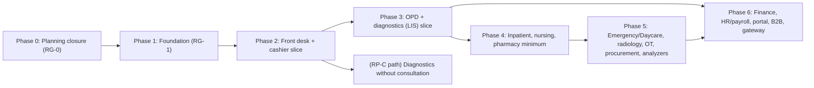

# G — Implementation plan for AI coding agents

| Control | Value |
| --- | --- |
| Document | G Implementation plan (phases, epics, tasks, readiness, agent workflow) |
| Version | 0.4.0-draft |
| Status | **PROPOSED.** Phase order follows dependencies. **No calendar dates, durations, team sizes or productivity multipliers are given or implied** (C-030). |
| Owner role | Tech lead (plan); integrator (shared files); product owner (release scope, Q-001) |
| Updated | 2026-10-12 |
| Extends | baseline [AGENTS.md](../baseline/hospital-saas-planning-kit-v0.3/AGENTS.md), [AGENT_DEVELOPMENT.md](../baseline/hospital-saas-planning-kit-v0.3/docs/AGENT_DEVELOPMENT.md), [TASK template](../baseline/hospital-saas-planning-kit-v0.3/docs/templates/TASK.md) |

## 1. Working rules

1. **Vertical slices.** A task delivers one observable outcome through the layers it touches: contract → API → database → permissions → audit → UI → tests. It does not deliver "the billing tables".
2. **Ready before active.** A task starts only when it meets the Definition of Ready (§4). Unresolved questions are either answered or **explicitly excluded** from the task.
3. **Agents never decide policy.** If a task would need an OPEN clinical, financial, payroll, bed-charge or approval rule, the agent stops and reports. It does not guess (R-10).
4. **Evidence over claims.** Handoffs include the actual commands run and their results. "Should work" is not evidence (v0.3 AGENTS).
5. **One integrator** owns shared files (§6).
6. **Whole-product scope stays visible.** Later epics are listed even when blocked, so architecture decisions consider them, but they are not detailed into ready tasks prematurely.

## 2. Dependency-based phases



| Phase | Purpose | Entry criteria | Exit evidence (gate) |
| --- | --- | --- | --- |
| **0 Planning closure** | Answer P1 questions; approve foundation ADRs; choose a release option | This pack reviewed | RG-0 ([N §5](N-traceability-readiness.md#5-release-gates)) |
| **1 Foundation** | Monorepo, toolchain pins, CI, tenancy/RLS, auth, audit, idempotency, outbox/jobs, i18n shell, design-system spike, print spike, staging deploy, backup/restore | RG-0 | RG-1: two-tenant isolation suite passes; restore drill on staging done; pipeline enforced |
| **2 Front desk + cashier** | Registration, practitioners, scheduling, check-in/walk-in, doctor-fee invoice, cashier payment, receipts, cashier session | RG-1; Q-003 (front desk + cashier part), Q-020, Q-022, Q-024, Q-034, Q-035, Q-037, Q-038, Q-039, Q-046 (receipt printer), Q-050, Q-051 | RG-2 for the slice |
| **3 OPD + diagnostics** | Consultation, prescription print, orders, service invoice and gate, LIS manual entry to release, report delivery, collection reports | Phase 2; Q-009, Q-017 (or interim accepted), Q-066, Q-067, Q-011 (templates/ranges for pilot tests) | RG-2 → RG-3 → RG-4 for **RP-A** |
| **4 Inpatient** | Admission/beds/transfer/cleaning, running account/deposits/final bill, nursing worklist/indent/returns, pharmacy dispensing minimum, stock ledger | Phase 3 (or Phase 2 + LIS for RP-B ordering); Q-004, Q-006, Q-007 (or manual charges), Q-008, Q-014, Q-015, Q-016, Q-018, Q-040, Q-063, Q-069 | RG-2 per slice; RG-4 for **RP-B** |
| **5 Procedures and operations** | Emergency/Daycare, radiology, OT, procurement/reagents, analyzer integration | Q-005, Q-025..Q-028, Q-047, Q-064, Q-065 | RG-2/RG-5 per module |
| **6 Enterprise breadth** | Finance ledger or export, HR/payroll, patient portal, B2B/referrals, payment gateway | Q-029..Q-033, Q-045 | RG-5 per module |

**Whole product vs proposed first release:**

| Option | Phases required before go-live |
| --- | --- |
| RP-A (recommended default) | 0, 1, 2, 3 |
| RP-B | 0, 1, 2, 3 (LIS may be reduced to what the pilot uses), 4 |
| RP-C | 0, 1, 2 (patients, direct-diagnostic visits, service invoice, cashier), 3 (LIS part only) |

Everything else remains whole-product scope.

## 3. Epics and bounded tasks

Each task lists requirement IDs, dependencies, blocking questions and its key acceptance criteria. Full acceptance cases live in H (automated) and I (UAT). Task IDs are stable.

### Phase 1 — Foundation

| Task | Outcome | Requirements | Depends on | Blocking Qs | Key acceptance criteria |
| --- | --- | --- | --- | --- | --- |
| **T-FND-01** Stack spike and pins | Workspace with pinned versions builds web/api/worker; Jest ESM test runs; Playwright test runs; `prisma migrate dev` against PG 18; `turbo prune` + Docker build per app | D1 §6, P-021, ADR-013 | RG-0 | Q-054 | Commands and outputs recorded; `docs/STACK_VERSIONS.md` committed; deviations raised as ADR amendments |
| **T-FND-02** Monorepo skeleton and boundaries | `apps/*`, `packages/*` per D §5; dependency-cruiser + ESLint import rules; one sample module | NFR-MAINT-001, ADR-001 | T-FND-01 | — | A deliberate cross-module internal import fails CI |
| **T-FND-03** CI baseline | GitHub Actions PR and main workflows per [L](L-cicd-sonarqube.md); Sonar on main; branch protection | ADR-012 | T-FND-02 | Q-055, Q-056 | A red check blocks merge; the Sonar gate result is visible on main |
| **T-FND-04** Tenant context and RLS spike | `withTenant()` with Prisma 7 + adapter-pg; RLS migration; app/migrator roles | ADR-003, NFR-ISO-001 | T-FND-01 | — | The ADR-003 evidence list passes under concurrency, including after errors (see §8 example) |
| **T-FND-05** Docker dev/prod images | Multi-stage images (web, api, worker, migrate); compose for dev | [K](K-docker-design.md) | T-FND-02 | — | Images run as non-root; health checks pass; image scan in CI |
| **T-DB-01** First migrations | Identity, tenancy, platform tables (`audit_event`, `outbox_event`, `idempotency_record`, `number_sequence`, `policy_version`) | E §6–§9 | T-FND-04 | — | Migration applies on a fresh DB; RLS coverage check passes |
| **T-DB-02** RLS coverage check | CI query (E §6.3) | NFR-ISO-001 | T-DB-01 | — | A table without a policy fails CI |
| **T-DB-03** Testkit | Two-tenant synthetic fixtures (overlapping MRNs), DB test harness, factories | AS-009, H §8 | T-DB-01 | — | Used by at least one integration test |
| **T-ACC-01** Login, session, CSRF | UC-ACC-01 | FR-ACC-001, -002, -005, -009 | T-DB-01 | Q-051 (defaults) | AT-ACC-001..005 pass |
| **T-ACC-02** Roles, permissions, guards | Permission catalogue in contracts; `@RequirePermission` decorator and global `PermissionGuard` with default deny per [D §7.2](D-system-design.md#72-authorization); role templates seeding | FR-ACC-008, -009, -011 | T-ACC-01 | Q-003 (synthetic templates only) | Denial tests per permission; audit of denials; a route with no permission marker is refused, and a test fails if any route lacks a marker |
| **T-ACC-03** Lockout and diagnostics | UC-ACC-02 | FR-ACC-004, FR-SUP-003 | T-ACC-01 | Q-051 | AT-ACC-006..008 |
| **T-ACC-04** TOTP MFA | MFA enrol/verify for privileged roles | FR-ACC-006 | T-ACC-01 | Q-051 | AT-ACC-009, -010 |
| **T-ACC-05** User administration UI | SCR-22 | FR-ACC-008, -010 | T-ACC-02, T-UI-02 | — | Revocation effective on the next request (AT-ACC-011) |
| **T-PLT-01** Idempotency | Interceptor + `idempotency_record` + `GET /operations/{key}` | FPR-08, SP-01/02/08 | T-DB-01 | — | AT-PLT-001..004 |
| **T-PLT-02** Audit writer and search | Same-transaction audit; denied-attempt audit; SCR-24 | FR-AUD-001..006 | T-DB-01 | Q-053 (retention excluded) | AT-AUD-001..006 |
| **T-PLT-03** Outbox, relay, inbox, BullMQ | D §9.4, §10 | NFR-REL-001/002, ADR-006 | T-DB-01, T-FND-05 | — | AT-JOB-001..006 |
| **T-PLT-04** Number sequences | Tenant-scoped sequences with CP-09 patterns | FR-CFG-003 | T-DB-01 | Q-034 (synthetic pattern) | Concurrency test: 1,000 parallel allocations, no duplicates |
| **T-PLT-05** Policy versions | Publish/preview/effective-dating; cache invalidation | FR-SAA-005, FR-CFG-002 | T-PLT-03 | — | AT-CFG-001..003 |
| **T-PLT-06** Observability baseline | pino redaction, correlation IDs, metrics endpoint, OTel wiring | NFR-OBS-001, FR-AUD-006 | T-FND-02 | — | A log redaction test proves the NID and cookie are absent |
| **T-PLT-07** API request pipeline middleware | NestJS middleware and layer order per [D §8.6](D-system-design.md#86-api-request-pipeline-nestjs): request ID, `AsyncLocalStorage` request context, security headers, body size limit, request logging; per-session API rate-limit guard (second PR, once the Valkey client from T-PLT-03 exists) | NFR-OBS-001, NFR-SEC-005, FR-AUD-006, ADR-021 | T-ACC-01 | — | The response echoes `X-Request-Id` and the same ID is in the log line and the problem body; a malformed incoming ID is replaced; an oversize body returns a 413 `PAYLOAD_TOO_LARGE` problem; a session over its limit gets a 429 `RATE_LIMITED` problem; a test asserts the layer order |
| **T-PLT-08** Response envelope interceptor | Global `ResponseEnvelopeInterceptor` per [D §8.2](D-system-design.md#82-rest-conventions-proposed) and §8.6: contract check of the result (ADR-005), then `{ data, meta }`; existing auth endpoints and the web `apiRequest` client moved to the envelope | ADR-005, NFR-OBS-001 | T-PLT-07, T-UI-02 | — | Every JSON success matches `{ data, meta.correlationId }`; a list carries `meta.nextCursor`; a result with an undeclared field gives `500 INTERNAL_ERROR` and nothing leaks; errors stay RFC 9457; `204` has no body; the web client unwraps `data` in one place |
| **T-UI-01** Design-system spike | Build the five hard in-house primitives (Dialog, Combobox, Menu, Tabs, Toast) with keyboard contracts, then a keyboard-heavy front-desk and cashier prototype; tokens, contrast test and reuse lint rules per ADR-022 | NFR-UX-001, NFR-ACC-001 | T-FND-02 | — | axe clean; keyboard-only Playwright flow; contrast test and reuse lint rules in CI; spike checks recorded (ADR-022) |
| **T-UI-02** App shell | Layout, permission-filtered navigation, language switch, session expiry handling | FR-I18N-001, SP-11 | T-ACC-01, T-UI-01, T-I18N-01 | — | AT-I18N-001; logout clears caches |
| **T-I18N-01** Catalogs and checks | `packages/i18n`, missing/unused key CI check, formatters | FR-I18N-002, -005, ADR-017 | T-FND-02 | Q-050 (interim formats) | CI fails on a missing bn key |
| **T-PRN-01** Print/PDF spike | Bilingual receipt and lab report via HTML print and Chromium PDF | ADR-010, FR-PRN-005, -006 | T-FND-05 | Q-046 | Native-speaker review of the rendering; sample PDFs attached |
| **T-OPS-01** Staging deploy | Staging VPS with Compose; deploy workflow | [J](J-vps-deployment-operations.md) | T-FND-03, T-FND-05 | Q-044 | Smoke test passes after deploy |
| **T-OPS-02** Backups and restore drill | pgBackRest + object storage; RB-07 executed | NFR-REC-001 | T-OPS-01 | Q-043 (interim targets) | Timed restore record |
| **T-OPS-03** Monitoring stack | Prometheus/Grafana/Loki/Alloy; alerts | NFR-OBS-001 | T-OPS-01 | — | Alert fires in a drill |

### Phase 2 — Front desk and cashier slice

| Task | Outcome | Requirements | Depends on | Blocking Qs | Key acceptance criteria |
| --- | --- | --- | --- | --- | --- |
| **T-PAT-01** Register patient | UC-PAT-01 incl. duplicate candidates, MRN, idempotency | FR-PAT-001, -002, -005, -006, -009, -011 | T-PLT-01..04, T-ACC-02 | Q-034, Q-035 | AT-PAT-001..006 (example in §8) |
| **T-PAT-02** Patient search | Phone normalization, trigram name search (bn/en), MRN | FR-PAT-003, FR-I18N-003 | T-PAT-01 | — | AT-PAT-007; p95 under target at volume (M) |
| **T-PAT-03** NID storage and reveal | Masking, audited reveal, encryption decision | FR-PAT-007, FR-AUD-003 | T-PAT-01 | — | AT-PAT-009 |
| **T-PAT-04** Identity edit | UC-PAT-02 with history | FR-PAT-008 | T-PAT-01 | Q-036 (who may edit: synthetic template) | AT-PAT-010 |
| **T-PRA-01** Practitioner master | Create/edit; immediate availability | FR-PRA-001..003 | T-ACC-02 | — | AT-PRA-001 |
| **T-SCH-01** Schedules | Session creation and publication | FR-SCH-002 | T-PRA-01 | Q-037 | AT-SCH-001 |
| **T-SCH-02** Book, reschedule, cancel | UC-SCH-01/02 with capacity | FR-SCH-001..006 | T-SCH-01, T-PAT-01 | Q-037 | AT-SCH-002..006 |
| **T-BIL-01** Catalogue and price lists | Service items, price list versions, doctor fee items; publish | FR-CFG-001, -002, FR-BIL-007 | T-PLT-05 | Q-038 | AT-CFG-002, AT-BIL-002 |
| **T-BIL-02** Charge interface and invoices | `PostCharge`, invoice creation rules, totals | FR-BIL-001, -006, -008, -009, -031, -033 | T-BIL-01 | — | AT-BIL-001, -009, -010, -021, -022 |
| **T-VIS-01** Check-in | UC-VIS-01, including doctor-fee invoice issue | FR-VIS-002, -004, -005, FR-SCH-004, FR-BIL-010 | T-SCH-02, T-BIL-02 | Q-037, Q-038 | AT-VIS-001..003 |
| **T-VIS-02** Walk-in and diagnostic visit | UC-VIS-02 | FR-VIS-001, FR-ORD-001 | T-VIS-01 | — | AT-VIS-004, -005 |
| **T-BIL-03** Cashier session | UC-BIL-04 | FR-BIL-026 | T-BIL-02 | — | AT-BIL-016, -017 |
| **T-BIL-04** Record payment (doctor fee and service lines) | UC-BIL-01/02; receipt | FR-BIL-002, -004, -011, -012, -019 (interim), -027, -034, -035 | T-BIL-03 | Q-004 excluded, Q-022, Q-024 | AT-BIL-003..008, -011..014, -018 (example in §8) |
| **T-BIL-05** Uncertain outcome UI | Status check by key; no "pay again" | FR-BIL-036 | T-BIL-04, T-PLT-01 | — | AT-E2E-003 |
| **T-BIL-06** Method correction | UC-BIL-05 | FR-BIL-025 | T-BIL-04 | Q-068 (interim) | AT-BIL-015 |
| **T-PRN-02** Receipt, token and invoice templates | bn/en/bilingual; reprint marking | FR-PRN-001..005, FR-BIL-027 | T-PRN-01, T-BIL-04 | Q-046, Q-050 | UAT-PRN-001..003 |
| **T-UI-03** Front desk and cashier screens | SCR-02..07 | F §4.1–4.2 | T-UI-02 + the tasks above | — | Keyboard-only E2E AT-E2E-001, -002 |

### Phase 3 — OPD and diagnostics slice

| Task | Outcome | Requirements | Depends on | Blocking Qs |
| --- | --- | --- | --- | --- |
| T-CLI-01 Doctor worklist | SCR-08 with statuses and polling | FR-CLI-002, ADR-015 | T-VIS-01, T-BIL-04 | — |
| T-CLI-02 Consultation note | Draft/sign/amend | FR-CLI-003, -007 | T-CLI-01 | Q-066 |
| T-CLI-03 Prescription | Lines, fulfilment choice, print | FR-CLI-001, -004..006 | T-CLI-02 | Q-067 |
| T-ORD-01 Orders | Clinician and direct orders → service invoice lines | FR-ORD-001..005, -007, -008 | T-BIL-02 | — |
| T-ORD-02 Eligibility port and gate | `assertEligible` used by departments | FR-BIL-003, FR-LAB-004 | T-ORD-01, T-BIL-04 | Q-004 excluded |
| T-ORD-03 Interim cancellation | UC-ORD-02 | FR-ORD-006, FR-BIL-020 | T-ORD-01 | Q-017 (rest excluded) |
| T-LAB-01 Lab configuration | Test definitions, ranges, templates, versions | FR-LAB-003, -014, -016, -019 | T-PLT-05 | Q-011 (pilot test set) |
| T-LAB-02 Collection and labels | UC-LAB-01 | FR-LAB-004, -005 | T-ORD-02, T-LAB-01, T-PRN-01 | Q-046 |
| T-LAB-03 Receive/reject/recollect/dispatch | UC-LAB-02 | FR-LAB-006, -007 | T-LAB-02 | — |
| T-LAB-04 Result entry | Grid, versions, flags | FR-LAB-008, -018 | T-LAB-03 | Q-010 excluded |
| T-LAB-05 Verify | — | FR-LAB-009, -011 | T-LAB-04 | Q-009 |
| T-LAB-06 Release + no-regression | UC-LAB-03/05 | FR-LAB-002, -010, -025 | T-LAB-05 | Q-009 |
| T-LAB-07 Amendment | UC-LAB-04 | FR-LAB-012 | T-LAB-06 | Q-011 (approval) |
| T-LAB-08 Report print, PDF, delivery | UC-LAB-06 | FR-LAB-020, -022, FR-PRN-006 | T-LAB-06, T-PRN-01 | Q-013 (interim) |
| T-REP-01 Collection report | — | FR-REP-002, -003 | T-BIL-04 | Q-068 |
| T-REP-02 Report jobs and exports | Background reports, audited exports | FR-REP-004, -005 | T-PLT-03 | — |
| T-REP-03 Dashboard | — | FR-REP-007 | T-REP-01 | — |

### Phase 4 — Inpatient (outline; detailed when Phase 4 is scheduled)

| Epic | Tasks (outline) | Blocking Qs |
| --- | --- | --- |
| EP-16 Admissions and beds | T-IPD-01 bed master and board · T-IPD-02 admit (all routes) · T-IPD-03 allocate (exclusion constraint) · T-IPD-04 transfer · T-IPD-05 cleaning · T-IPD-06 discharge steps and departure flags | Q-006, Q-008, Q-069 |
| EP-17 Running account | T-BIL-10 IPD running invoice + interim payments · T-BIL-11 final bill · T-BIL-12 manual bed charges (until Q-007) | Q-004, Q-006, Q-007, Q-040 |
| EP-18 Nursing | T-NUR-01 ward list · T-NUR-02 batch indent · T-NUR-03 returns and slip · T-NUR-04 cancellation requests | Q-016, Q-018, Q-070 |
| EP-19 Pharmacy and stock minimum | T-INV-01 stock ledger and balances · T-INV-02 opening balance and adjustments · T-PHA-01 catalogue · T-PHA-02 dispense (indent and prescription) · T-PHA-03 return acceptance · T-INV-03 transfers | Q-014, Q-015, Q-063 |

### Phases 5–6 — Blocked epics (kept visible)

| Epic | Blocked by |
| --- | --- |
| EP-20 Emergency and Daycare | Q-005, Q-025, Q-026 |
| EP-21 Radiology | Q-028 (DEF-004 for PACS) |
| EP-22 OT | Q-027, Q-061 |
| EP-23 Procurement and reagents | Q-064, Q-065 |
| EP-24 Analyzer integration | Q-047 |
| EP-25 Finance ledger/export | Q-029 |
| EP-26 HR, attendance, payroll | Q-030, DEF-001 |
| EP-27 Patient portal | Q-033, Q-013 |
| EP-28 B2B and referrals | Q-031, Q-032 |
| EP-29 Payment gateway | Q-045 |
| EP-30 Legacy migration tooling | Q-048 |

## 4. Definition of Ready and Definition of Done

**Definition of Ready (task may move to "ready"):**
- [ ] Task ID, title, owner/reviewer named. Requirement and decision IDs listed.
- [ ] Outcome stated as observable behavior, with at least one Given/When/Then positive case.
- [ ] Denial (wrong role, wrong tenant), duplicate/retry and stale/concurrent cases listed where relevant.
- [ ] All OPEN questions affecting the behavior are **answered or explicitly excluded**, with the interim behavior stated (e.g., "deposits excluded — FEATURE_NOT_AVAILABLE").
- [ ] Contract drafted (request/response/error codes) or marked "contract task first".
- [ ] Data changes identified. Shared-file reservations requested from the integrator (§6).
- [ ] Allowed files/packages listed. Dependencies done or stubbed by agreement.
- [ ] Test commands known (after T-FND-03, the real scripts).
- [ ] Domain reviewer identified for clinical/financial behavior.

**Definition of Done:**
- [ ] Behavior implemented in all listed layers. No business writes from Next.js.
- [ ] Tests added and **actually run**: unit, PostgreSQL integration, API (permission denial, cross-tenant, idempotency), E2E where UI changed, plus accessibility checks for new screens.
- [ ] Audit events for sensitive actions; logs free of patient content.
- [ ] Both language catalogs updated; print templates updated if relevant.
- [ ] Contracts regenerated (OpenAPI committed, no drift). Migrations reviewed by the integrator. Expand/contract plan if needed.
- [ ] Docs updated in the same PR: requirement status, traceability row (N), changed rules (never silently).
- [ ] CI green, including SonarJS lint rules. Coverage thresholds for touched domain packages met.
- [ ] Handoff note written (§7) with commands, results, limitations and open questions.
- [ ] Domain reviewer sign-off for clinical/financial behavior (recorded in the PR).

## 5. Context packet for each agent task

Give an agent **only** what the task needs. Large irrelevant context causes invented connections.

```text
CONTEXT PACKET — <Task ID> <title>
1. Task card (from §3/§8): outcome, scope, allowed files, excluded behavior
2. Rules that must not be broken (quote): relevant C-* decisions, FPR-* rules
3. Requirements: the FR-*/NFR-* rows (copied from C-srs with IDs)
4. Use case(s): UC-* text from the module file
5. Contracts: the Zod schemas (existing) or the draft contract for this task
6. Data: the tables/columns involved (from E or the real Prisma schema), constraints, RLS notes
7. Permissions: codes from C00 §8 and the default templates used in tests
8. Errors: codes from C00 §9 and HTTP mapping (D §8.3)
9. UI: screen ID and wireframe (F), states (F §8), copy keys (A1)
10. Tests: required cases (H/I IDs), fixtures (testkit), commands to run
11. Open questions: IDs that are EXCLUDED and the interim behavior
12. Repository conventions: AGENTS.md (repo), module structure (D §5), lint rules
```

**Example (abridged): T-BIL-04 packet.**
- Decisions: C-008, C-009, C-010, C-011, C-029.
- Rules: FPR-03, -04, -06, -08, -11.
- Requirements: FR-BIL-002, -004, -011, -012, -019 (interim), -027, -034, -035.
- Use case: UC-BIL-01/02.
- Contract: `RecordPaymentRequest/Response` (D §8.4).
- Tables: `invoice`, `invoice_line`, `payment`, `payment_allocation`, `cashier_session`, `idempotency_record`, `audit_event`, `outbox_event`.
- Permission: `billing.payment.record`.
- Errors: `AMOUNT_EXCEEDS_BALANCE`, `INVALID_TRANSITION`, `IDEMPOTENCY_KEY_REUSED`, `STALE_RECORD`.
- Tests: AT-BIL-003..008, -011..014, -018.
- **Excluded:** deposits (Q-004), cross-invoice payment (Q-024), discounts (Q-019), refunds (Q-021), gateway (Q-045).

## 6. Shared schema, contract and migration coordination

| Shared asset | Owner | Rule |
| --- | --- | --- |
| `packages/database/prisma/schema/*.prisma` and `migrations/` | Integrator | Agents propose schema changes in the PR. The integrator generates and renames migrations, checks expand/contract, and merges in order. One migration directory sequence; no parallel conflicting migrations. |
| `pnpm-lock.yaml`, root `package.json`, `turbo.json` | Integrator | Dependency additions need justification (D1 alignment). Exact versions. |
| `packages/contracts` (error codes, permission catalogue, shared schemas) | Integrator + module owner | New codes appended. A breaking change to a published schema requires a new version (H §7). |
| `packages/i18n` catalogs | UX lead / integrator | Keys added with both languages. The native-review flag is set for new Bangla strings. |
| `packages/ui` | UX lead | Component changes reviewed for accessibility. |
| Docs (A2/A3/C-srs/E/N) | Product owner / architect | Requirement status changes only through decisions (A2 §7). |

**Branching and parallel work:**
- Trunk-based. Short-lived branches `task/T-XXX-short-name`. PRs are small (one task).
- Parallel tasks are allowed when they touch different modules and do not both need a migration. Otherwise they are **serialized by the integrator** (reservation list in the tracker).
- Parallel agents use separate worktrees and **separate test databases** (`hms_test_<task>`).
- **Contract-first for parallel UI/API:** the contract PR merges first, then UI and API tasks proceed in parallel against the generated client and mocks.
- After merging, the integrator runs the integration suite on `main`. Unit tests passing on each branch is not enough (v0.3 AGENT_DEVELOPMENT).

## 7. Review responsibilities and handoff

| Responsibility | Who (role; may be the same person or agent, but not the same review) | Checks |
| --- | --- | --- |
| Planner | Tech lead / planning agent | Task is ready (§4); context packet complete |
| Implementer | Coding agent | Builds the behavior and tests; writes the handoff |
| Verifier | A different agent or a human, not the implementer | Runs the tests; tries denial, retry and concurrency; compares with requirements |
| Integrator | Designated role | Shared files, migrations, contracts, merge order |
| Domain reviewer | Finance / lab / nursing / front desk lead | Clinical and financial behavior matches decisions; no invented rules |
| Security reviewer (for auth, tenancy, export, files) | Tech lead or security-minded reviewer | Isolation, permission and audit coverage |

**Handoff template (attach to the PR):**

```text
Task: T-…            Requirements: FR-… / NFR-…        Decisions: C-… / P-…
Changed files/packages:
Behavior implemented (bullet list):
Excluded behavior and why (question IDs):
Migrations: <name> — expand/contract? backfill? destructive? rollback/forward-fix notes
Contracts: changed schemas; OpenAPI regenerated (yes/no)
Commands run and results (copy actual output summary):
  pnpm turbo run lint typecheck test --filter=…   → pass/fail
  pnpm --filter api test:integration              → …
  pnpm --filter web e2e -- --grep "@billing"      → …
Tests added (IDs): AT-…
Screenshots / print samples (if UI/print):
Known limitations / follow-ups:
Questions raised:
```

## 8. Example implementation tasks

### Example 1 — T-FND-04 Tenant context and RLS spike (ready once T-FND-01 is done)

- **Outcome:** a reusable `withTenant(ctx, fn)` in `packages/database`, the first RLS migration, the `hms_app`/`hms_migrator` roles, and evidence that isolation holds through Prisma 7 + `@prisma/adapter-pg`.
- **Requirements:** NFR-ISO-001, FR-SAA-001; ADR-003.
- **Allowed files:** `packages/database/**`, `packages/testkit/**`, `docker/compose.dev.yaml` (DB init only).
- **Acceptance (Given/When/Then):**
  - Given tenants Alpha and Beta with identical MRNs, when 200 concurrent requests alternate tenants through `withTenant`, then each returns only its own tenant's rows (AT-ISO-001).
  - Given a transaction that throws inside `withTenant`, when the next request reuses the pooled connection without a context, then a `SELECT` returns zero rows and an `INSERT` fails (AT-ISO-002).
  - Given `hms_app`, when it attempts `UPDATE` on `payment`, then permission is denied (AT-DB-002).
  - Given a tenant-A child referencing a tenant-B parent, when inserted, then a FK violation occurs (AT-DB-005).
- **Excluded:** PgBouncer (separate task if adopted).
- **Evidence:** test output; a short note comparing the interactive-transaction approach with alternatives.

### Example 2 — T-PAT-01 Register patient

- **Outcome:** a receptionist registers a new patient after reviewing duplicate candidates. The MRN is server-generated, NID is optional, and the operation is idempotent.
- **Requirements:** FR-PAT-001, -002, -005, -006, -009, -011; FR-AUD-001; FR-I18N-003.
- **Decisions:** identity agreements, C-024, C-025.
- **Contract:** `POST /api/v1/patients` (`RegisterPatientRequest`: `nameBn?`, `nameEn?`, `sex`, `birthDate?` | `reportedAgeYears?`, `phone?`, `nid?`, `address?`, `confirmNewDespiteCandidates: boolean`, `shownCandidateIds: uuid[]`) → `201 {patientId, mrn, version}`. `GET /api/v1/patients/duplicate-candidates?…` → candidates with reasons.
- **Permissions:** `patient.record.register`, `patient.record.search`.
- **Acceptance:**
  - Given no NID, when registering "Salma Begum" (synthetic), then the patient is created with MRN `MRN-<seq>` and the audit event `patient.registered`.
  - Given a candidate with the same normalized phone, when submitting without `confirmNewDespiteCandidates`, then `VALIDATION_FAILED` (code `DUPLICATE_CANDIDATES_PRESENT`) with candidate IDs; with confirmation, the patient is created and the audit lists the shown candidates.
  - Given the same idempotency key twice, then one patient (AT-PAT-005).
  - Given a doctor-only user, then `PERMISSION_DENIED`.
  - Given age only, then `birth_date` is null and `birth_date_precision = YEAR_ESTIMATED` with the reported age stored (AT-PAT-006).
- **Excluded:** merge (Q-036); final MRN format (Q-034, synthetic pattern used); extra required fields (Q-035).

### Example 3 — T-BIL-04 Record payment

- **Outcome:** UC-BIL-01 and UC-BIL-02 complete through API and UI, with receipt print.
- **Acceptance** (synthetic amounts; tests in H §5):
  - D = 500.00, S = {CBC 300.00, X-ray 700.00}. Pay D in full → D `PAID`; S unchanged at 1,000.00 (AT-BIL-001).
  - Pay CBC → CBC `ELIGIBLE`, X-ray `NOT_ELIGIBLE`; the lab collection gate refuses the X-ray (AT-BIL-005).
  - Two concurrent 700.00 payments for the X-ray → one succeeds; the other `AMOUNT_EXCEEDS_BALANCE` (AT-BIL-013).
  - Same key replay → same receipt; different payload → `IDEMPOTENCY_KEY_REUSED` (AT-BIL-011, -012).
  - Doctor role → `PERMISSION_DENIED` (AT-BIL-003).
  - No open cashier session → `INVALID_TRANSITION`.
  - Receipt reprint → "Copy 2", no new payment (AT-BIL-018).
  - MOBILE/bKash appears as MOBILE in the session totals (AT-BIL-008).
- **Excluded:** Q-004, Q-019, Q-021, Q-022 (rejects overpayment), Q-024, Q-045.

### Example 4 — T-LAB-06 Release and no-regression

- **Outcome:** a lab authority releases a verified result. No read, print or navigation path changes status.
- **Acceptance:** UC-LAB-05 scenario plus the source regression set (AT-LAB-001..005); separation rule CP-13 (AT-LAB-015); an entry-only user is denied (AT-LAB-014); the `LabResultReleased` outbox event triggers a PDF render job (AT-JOB-004).
- **Excluded:** critical-result notifications (Q-012), reversal (Q-011).

## 9. Seeding the repository's own AGENTS.md (task T-FND-02)

The application repository gets an `AGENTS.md` (with a `CLAUDE.md` pointer, as in v0.3) containing:
1. the source-of-authority order (decisions → specs → proposals)
2. the "never invent policy" rule with the A3 link
3. module boundaries (D §5)
4. the `withTenant` and permission patterns, with examples
5. idempotency and outbox usage
6. money/time helpers
7. i18n rules
8. test commands
9. DoR/DoD (§4)
10. the handoff template (§7)

It links to these documents rather than copying business rules (one authoritative location).
