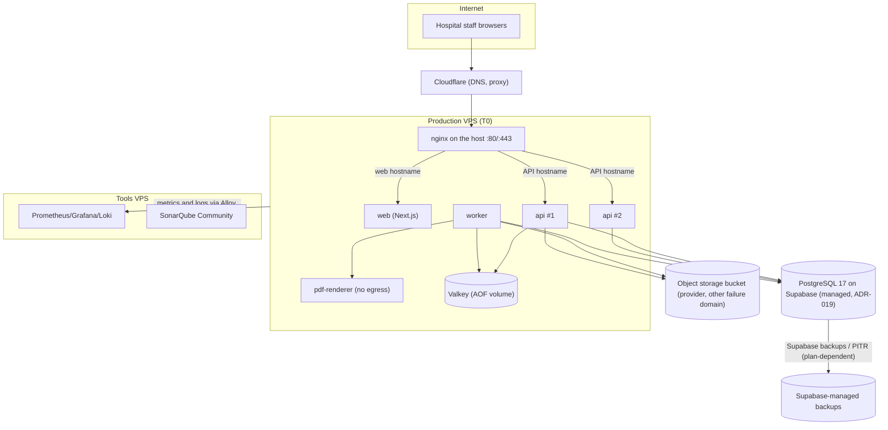

# J — VPS deployment and operations

| Control | Value |
| --- | --- |
| Document | J VPS deployment, operations, recovery and runbooks |
| Version | 0.4.0-draft |
| Status | **PROPOSED.** VPS hosting is CONFIRMED (C-026). **Staging:** the existing DigitalOcean droplet in SGP1 (ADR-020) with the database on Supabase (ADR-019). **The production server size and topology are not selected yet.** Sizing figures are starting assumptions to be validated by load tests ([M](M-capacity-performance.md)), not capacity guarantees. **Current state (2026-10-15):** a manual staging deployment exists on the droplet, run by Docker Compose and a hand-run redeploy script from `main`. It is not the pipeline described below; what is actually deployed, and the boundary that keeps development and AI agents away from it, are in [DEPLOYMENT.md](../../DEPLOYMENT.md). The rest of this document is the target design. |
| Owner role | DevOps lead; product owner (risk acceptance, RPO/RTO, support hours) |
| Updated | 2026-10-15 |
| Related | [K Docker](K-docker-design.md), [L CI/CD](L-cicd-sonarqube.md), ADR-011, ADR-014, [templates/](../templates/README.md) |
| Amended by | [ADR-019](D2-adr/ADR-019-supabase-postgres.md): the database is PostgreSQL 17 on Supabase, not a container on the VPS; Supabase provides backups. [ADR-020](D2-adr/ADR-020-valkey-nginx-droplet.md): staging runs on the existing DigitalOcean droplet (SGP1) shared with the ecommerce app; host nginx + certbot replace Caddy; Valkey is the queue store. [ADR-021](D2-adr/ADR-021-separate-web-api-origins.md): separate web and API hostnames. §2–§7, §9.1, §10 and the runbooks are updated to match; §8 keeps the pgBackRest design only for a self-hosted database. |

## 1. Operating principles

1. **Images are immutable.** The same image digest moves from staging to production.
2. **PostgreSQL is the system of record.** Everything else (Redis, containers) can be rebuilt. Object storage holds the only copies of generated files, so it is backed up or replicated.
3. **Backups are only real once restored.** Restore drills are gate evidence (RG-3, RG-4).
4. **Rollback does not undo business facts.** Payments, stock movements and released results committed by a new version stay committed. Recovery is forward-fix plus reconciliation (v0.3 OPERATIONS).
5. **Least exposure.** Only ports 80/443 (and SSH from restricted sources) are reachable. Databases are never published.
6. **24-hour hospital.** Maintenance windows are agreed with the hospital. The paper downtime procedure exists before go-live (RB-03).

## 2. Environments

| Environment | Purpose | Data | Topology (proposed) | Access |
| --- | --- | --- | --- | --- |
| Development | Local work by developers and agents | Synthetic seeds | Docker Compose (PostgreSQL 17, Valkey; S3-compatible storage and a mail catcher added when needed); apps run with `pnpm dev` | Developer machines |
| CI | Automated tests | Fresh synthetic | GitHub-hosted runners with service containers | GitHub |
| **Staging** | Release verification, UAT rehearsal, load tests, restore drills | Synthetic, including volume seeds | The existing DigitalOcean droplet in SGP1 (2 vCPU / 4 GB / 120 GB), shared with the ecommerce app: web, api, Valkey (and worker) in Docker Compose behind host nginx; database on Supabase (ADR-019, ADR-020). Web on `healthcare.bytespate.com`, API on `healthcareapi.bytespate.com` (ADR-021) | Team; pilot testers via named accounts |
| **UAT** (may be the same as staging during the pilot) | Department acceptance | Synthetic; de-identified only by owner approval | As staging | Pilot staff |
| **Production** | Live hospital use | Real | T0 single VPS (start) → expansion (§13) | Hospital staff; DevOps via SSH bastion |
| **Tools** | SonarQube Community, Prometheus/Grafana/Loki, error tracking, (optional) self-hosted GitHub runner | No patient data | One small VPS, separate from production | Team |

Each environment has separate credentials, secrets, buckets and DNS names. Production secrets are never used elsewhere.

## 3. Topology options

**Since ADR-019, PostgreSQL is a managed Supabase service in every topology.** Below, "PostgreSQL", "VPS-B" and "standby" mean the Supabase project and its plan options (compute size, read replicas, PITR), not database servers we run. ADR-020 replaces Caddy with nginx on the host.

| Option | Description | Availability characteristics | When to use |
| --- | --- | --- | --- |
| **T0 Single VPS** (proposed start, ADR-011) | All services on one VPS via Compose. Object storage and the backup repository off-VPS. | Host failure = outage until restore or rebuild (RTO proposal ≤ 4 h). Planned maintenance needs a window. | Pilot; one or a few hospitals; owner accepts the risk (Q-043) |
| T1 App + DB split | VPS-A: nginx, web, api, worker, renderer, Valkey. VPS-B: PostgreSQL (private network). | Isolates DB I/O; independent sizing; still single points of failure | When the DB competes with app CPU/RAM, or at the M §8 triggers |
| T2 T1 + streaming replica | Hot standby on VPS-C (async streaming replication); used for reporting reads and manual failover | Faster recovery (promote the standby: minutes, plus DNS/config switch) | When RTO < restore time, or reporting load grows |
| T3 Multiple app nodes | 2+ app VPSs behind a load balancer (provider LB or nginx/HAProxy pair); Valkey separate; PostgreSQL primary + standby | Survives an app node loss; zero-downtime deploys | Higher availability needs; more concurrent users |



## 4. Resource-sizing assumptions (not capacity guarantees)

These are **starting points for load testing**, derived from typical memory needs of the components. They must be replaced by measured values (M §7) before go-live. Provider vCPU performance varies widely, so measure on the chosen provider.

| Environment / scenario | vCPU | RAM | Disk | Notes |
| --- | --- | --- | --- | --- |
| Staging (actual, ADR-020) | 2 | 4 GB (+ 2 GB swap) | 120 GB | The existing droplet, shared with the ecommerce app. No database on it (Supabase). One API replica; per-container memory limits |
| Production T0 — pilot, one medium hospital (synthetic profile in E §10.2) | 8 | 32 GB | 400 GB NVMe (DB + WAL + logs) | Leaves headroom for load spikes, Chromium rendering and maintenance |
| Production T0 — minimal pilot (RP-C / small hospital) | 4 | 16 GB | 200 GB NVMe | Only if the load test at the pilot's measured peak passes with margin |
| Tools VPS | 4 | 16 GB | 200 GB | SonarQube Community needs ≥ 4 GB RAM (small install) plus its Elasticsearch disk headroom; monitoring stack retention drives disk |

**Proposed memory budget on an 8 vCPU / 32 GB T0** (tune from measurements):

| Service | Memory limit |
| --- | --- |
| PostgreSQL | Not on the VPS (Supabase, ADR-019). Its memory is the Supabase compute size, chosen from load tests. The original self-hosted budget was `shared_buffers` ≈ 8 GB, `effective_cache_size` ≈ 20 GB |
| api × 2 | 1 GB each |
| web | 1 GB |
| worker | 1.5 GB |
| pdf-renderer | 2 GB |
| Valkey | 1 GB (`maxmemory` set; `noeviction`) |
| nginx (host service) | 128 MB |
| Monitoring agents | 512 MB |
| OS / page cache | the rest |

## 5. DNS, TLS, reverse proxy, firewall, service access and secrets

| Topic | Proposal |
| --- | --- |
| DNS | Cloudflare hosts the `bytespate.com` zone. Staging: `healthcare.bytespate.com` (web) and `healthcareapi.bytespate.com` (API) are **A records inside that zone**, pointing at the droplet's reserved IP (ADR-021). Cloudflare's "Add a site" does not accept subdomains; records at the old registrar host are ignored. Keep records on **DNS only** (grey cloud) until the certificate is issued, then switch to **Proxied**. One-level subdomains are covered by Cloudflare's free certificate; deeper names (e.g. `api.healthcare.…`) are not. Per-tenant subdomains are optional later (DNS-01 challenge). Low TTL on production records. |
| TLS | Two hops. Browser ↔ Cloudflare: Cloudflare's edge certificate. Cloudflare ↔ droplet: a Let's Encrypt certificate from **certbot** (webroot mode, one certificate for both hostnames, `--deploy-hook "systemctl reload nginx"`, renewed by certbot's timer). Cloudflare SSL mode must be **Full (strict)** for these hostnames (a Configuration Rule if the rest of the zone uses another mode); **Flexible causes a redirect loop**. HSTS after verification (NFR-SEC-001). |
| Reverse proxy | **nginx on the host** (shared with the ecommerce app, whose configuration is never edited). HMS adds its own server blocks: port 80 redirects to HTTPS except `/.well-known/acme-challenge/`; one 443 server per hostname proxies to web or api on `127.0.0.1`. Restores the real visitor IP from `CF-Connecting-IP`, trusted **only** from Cloudflare's published IP ranges (needed for audit and lockout). Adds security headers (CSP, HSTS, X-Content-Type-Options, Referrer-Policy, frame-ancestors none) and a request size limit on the API host. CORS headers come from the API, not nginx (ADR-021). Shared-`http`-context names (maps, TLS session cache) use an `hms_` prefix to avoid clashing with the ecommerce config. Access logs without bodies or identifying query strings. |
| Firewall | Host firewall default deny inbound; allow 80/443 (nginx) and 22 only from admin addresses. **Docker-published ports bypass some host firewalls (e.g., UFW)**, so web and api publish **only on `127.0.0.1`** (where nginx reaches them) and Valkey publishes nothing. Never open the app ports. The DigitalOcean cloud firewall mirrors this. |
| SSH | Key-only, no root login, no passwords. A `deploy` user for CI with a restricted command wrapper (only `/opt/hms/bin/deploy.sh <digest-file>`). Individual admin accounts for humans with MFA where the provider supports it. Optional WireGuard VPN for admin access. |
| Repository access | The repositories are **private** (C-047). The server reads the code with a **read-only deploy key** added under the repository's Settings → Deploy keys (one key per repository and server; never a personal key or token). If CI later builds images, the server instead pulls them with a read-only registry token. |
| Service access | Database admin through an SSH tunnel to `127.0.0.1` on the host or `docker exec`. No public pgAdmin. Grafana/Sonar on the tools VPS behind IP allow-lists and SSO/strong passwords. |
| Secrets | Files in `/opt/hms/secrets/` (root-owned, 0400), mounted as Docker Compose secrets (`/run/secrets/...`). Apps read `*_FILE` variables. Contents: DB passwords per role, session secret, CSRF secret, field-encryption key (NID), S3 keys, pgBackRest encryption passphrase, SMTP creds. GitHub stores only the deploy SSH key, registry credentials and staging/prod host fingerprints (environment secrets). Rotation runbook in RB-12; rotation at least on staff change and on suspicion. |
| Time | `chrony`/NTP enabled; container time from the host (NFR-TIME-001). |

## 6. Persistence

| Data | Where | Persistence and protection |
| --- | --- | --- |
| PostgreSQL data | Supabase project (Singapore), ADR-019 | Supabase-managed storage and backups; point-in-time recovery depends on the plan. The free plan pauses after 7 days idle and is for development and demos only. |
| PostgreSQL backups | Supabase | Plan-dependent daily backups / PITR. The restore drill (RB-07) must be run against Supabase before the pilot. Optional extra: a scheduled `pg_dump` to a separate bucket. |
| Valkey | Volume with AOF (`appendfsync everysec`) | Loss tolerated: the outbox republishes (D §9.4). Not backed up separately. |
| Object storage (PDFs, exports, uploads) | Provider bucket per environment | Versioning on; lifecycle for exports (e.g., 30 days, PROPOSED); replication or periodic copy to the backup provider |
| TLS certificates | `/etc/letsencrypt` on the host (certbot) | Re-issuable; keep to avoid rate limits |
| Application containers | Stateless | Rebuilt from images |
| Logs | Stdout → Alloy → Loki on the tools VPS | Retention 30 days (PROPOSED; Q-053) |

## 7. Configuration management

- `/opt/hms/` layout on each VPS:

  ```text
  compose.prod.yaml
  .env                 non-secret
  secrets/
  bin/deploy.sh
  releases/<git-sha>.digests
  ```

  The HMS nginx server blocks live in the host's nginx (`/etc/nginx/sites-available/hms.conf`, enabled by symlink), version-controlled in the repository and copied on change. `nginx -t` must pass before any reload.

- Configuration is version-controlled in the infrastructure part of the repository (with placeholders). Secrets are never committed.
- Environment variable inventory: [K §7](K-docker-design.md#7-environment-variable-inventory).
- Host provisioning (Docker, firewall, users, chrony, unattended security updates) is scripted (Ansible or shell, PROPOSED), so a replacement VPS can be rebuilt quickly during RB-07.

## 8. Backups and tested restoration

> **ADR-019:** the database runs on Supabase, which takes the backups. The RPO/RTO targets and the duty to **test a restore** (RB-07) still apply and are verified against Supabase's backup/PITR features for the chosen plan. The pgBackRest design below applies only if PostgreSQL is self-hosted again.

**Proposed engineering targets** (NFR-REC-001; the owner decides, Q-043):
- **RPO ≤ 15 min** (WAL archiving with `archive_timeout = 60s` normally gives seconds to a minute)
- **RTO ≤ 4 h** for a full T0 rebuild

| Item | Proposal |
| --- | --- |
| Tool | pgBackRest 2.59.x (D1) with an S3 repository |
| Schedule | Full weekly (Sunday 02:00 Asia/Dhaka), differential daily (02:00), WAL continuous |
| Retention (PROPOSED; Q-053) | 4 full + their differentials (about 1 month of PITR). Monthly full kept 12 months. Nightly logical `pg_dump -Fc` kept 14 days in a separate bucket. |
| Encryption | Repository encryption with a passphrase in the secret store; bucket server-side encryption; TLS in transit |
| Verification | `pgbackrest check` daily; `pgbackrest verify` weekly; alert on archive failures and backup age > 26 h |
| Object storage | Bucket versioning plus daily sync to the backup provider (or provider replication) |
| Configuration | `/opt/hms` (without secrets) in git; secrets in the vendor's secret manager or password vault with recovery procedures |

**Restore drill (RB-07), at least before RG-3, before RG-4, and periodically after go-live (proposed quarterly):**
1. Provision a clean VPS (scripted).
2. Restore the latest full + WAL to a target time with `pgbackrest restore --type=time --target=...`.
3. Start PostgreSQL. Run the reconciliation queries (D §9.5) and `prisma migrate status`.
4. Deploy the matching app images. Point a temporary DNS name at the host.
5. Sync object storage, or point at the bucket.
6. Smoke-test: log in, open patients, print a released report, verify invoice totals against a pre-drill snapshot of counts and totals.
7. Record timings (RTO measured) and data loss (RPO measured), problems found and fixes. Store the record as gate evidence.

## 9. Releases, migrations, rollback limits and forward fixes

### 9.1 Release procedure (RB-01)

1. **Candidate:** CI on `main` builds images (tagged by git SHA, pinned by digest), the Sonar gate passes, staging deploys automatically and smoke and E2E tests pass on staging ([L §7](L-cicd-sonarqube.md#7-artifact-publishing-and-deployment-to-vps)).
2. **Change review:**
   - release notes
   - migrations classified (expand-only / contract / data backfill)
   - risk
   - rollback/forward-fix plan
   - hospital notified of any visible change
   - maintenance window if a contract step or long migration is included
3. **Pre-flight on production:**
   - last WAL archived < 5 min ago
   - backup age < 26 h
   - disk > 30% free
   - no active incident
   - error-budget burn normal
4. **Deploy** (`workflow_dispatch` "deploy-production" with the digest file, approved by a maintainer):
   1. pull images by digest
   2. run the one-off `migrate` container (`prisma migrate deploy` + SQL migrations) as `hms_migrator`
   3. if it fails, stop: no app change, and follow RB-02
   4. recreate `api` (with two replicas, nginx `proxy_next_upstream` retries on the other one; with a single replica, as on staging, expect a few seconds of 502), then `worker` (graceful SIGTERM), then `web`
5. **Verify:** health checks green, smoke tests (log in as the synthetic monitor account, read a patient, issue and void nothing), dashboards normal for 30 minutes.
6. **Record:** release digest, migration IDs, time, operator. Update the status page or hospital notice.

### 9.2 Migration ordering

- Migrations run **before** new code starts, and must be **backward compatible with the currently running version** (expand step).
- Contract steps (drop column, tighten constraint) ship in a **later** release, after the code no longer uses the old structure.
- Long-running changes (index builds) use `CREATE INDEX CONCURRENTLY` in a separate non-transactional migration, outside peak hours.
- Data backfills run as worker jobs after deploy (E §11), never inside the migration.

### 9.3 Rollback limitations

| Situation | Possible action | Not possible |
| --- | --- | --- |
| Bad app release, expand-only migrations | Redeploy the previous image digests (RB-02). The old code tolerates the expanded schema. | — |
| Bad migration that failed midway | The transactional migration rolled back; fix and re-run | Partial non-transactional steps (e.g., concurrent index) may need manual cleanup |
| Contract migration already applied | **Forward fix only** (new release) | Re-adding dropped data without a restore |
| New version posted wrong money or stock | Stop the faulty command (feature flag or hotfix). Identify affected records via audit/outbox. Correct through **correction records** (reversal, adjustment, amendment). Reconcile. | Deleting or editing posted facts (C-029) |
| Data corruption discovered late | Restore to staging at a point in time, compare, and apply reviewed corrections in production | Rolling the whole production database back |

### 9.4 Reconciliation after incidents

After any incident touching money, stock or results, run the reconciliation jobs (D §9.5) for the affected period. Compare paper downtime records with system entries. Finance and the department leads sign off the reconciliation report.

## 10. Health checks, monitoring, logging and alerting

**Health endpoints:**

| Service | Liveness | Readiness |
| --- | --- | --- |
| api | `GET /health/live` (process up) | `GET /health/ready` (DB `SELECT 1` within 1 s; Redis ping; migrations at the expected version) |
| web | `GET /api/health` (Route Handler, no business data) | same |
| worker | HTTP `:9464/health` (small server) | Heartbeat timestamp < 60 s; Redis reachable |
| pdf-renderer | Its own health endpoint | — |
| PostgreSQL (Supabase) | Checked through the api readiness probe (`SELECT 1`) and the Supabase dashboard/status page | — |
| valkey | `valkey-cli ping` | — |

Docker health checks use these endpoints. nginx marks a failing api upstream with passive checks (`max_fails`/`fail_timeout`).

**Alert catalogue** (PROPOSED thresholds; tune after the pilot):

| Alert | Condition | Severity | Runbook |
| --- | --- | --- | --- |
| Synthetic workflow probe failing | 3 consecutive failures (1-min interval) | Page | RB-04 |
| API 5xx rate | > 2% for 5 min | Page | RB-04 |
| API p95 latency | > 2× target (NFR-PERF-001) for 10 min | Warn | RB-04 |
| DB connections | > 80% of `max_connections` for 5 min | Warn | RB-05 |
| Disk free | < 20% warn; < 10% page | Warn/Page | RB-05 |
| WAL archive failing / backup age | Archive error, or backup age > 26 h | Page | RB-07 |
| Outbox lag | Oldest unpublished > 5 min | Page | RB-06 |
| Queue failed jobs | > 0 in `pdf-render`/`integration-inbound` for 15 min | Warn | RB-06 |
| Redis memory | > 80% of `maxmemory` | Warn | RB-12 |
| Certificate expiry | < 14 days | Warn | RB-08 |
| Login failures spike / lockouts | > 5× baseline | Warn | RB-10 |
| Reconciliation mismatch | Any nightly check fails | Page (business hours) | RB-14 |

**Logging:**
- JSON logs with `correlationId`. Patient content is redacted (FR-AUD-006).
- Log retention is separate from audit retention.
- Dashboards: request rates/latency by route, DB, queues/outbox, business KPIs (payments/hour, released reports/hour) for anomaly spotting.

## 11. Worker and queue recovery, graceful shutdown, and drills

- **Graceful shutdown:**
  - API: Express adapter drains in-flight requests on shutdown (NestJS 12); Compose `stop_grace_period: 30s` for api.
  - Worker: `worker.close()` on SIGTERM; `stop_grace_period: 60s`; long jobs are restartable.
- **Recovery:**
  - stalled jobs return automatically
  - failed jobs are inspected in a queue dashboard (internal, auth-protected) or through the CLI
  - re-drive after fixing the cause
  - outbox republish for a time window
- **Incident drills** (staging, before RG-3, then periodically):
  1. kill the API container under load
  2. stop the worker for 20 minutes
  3. fill the disk to the warning level
  4. break the WAL archive credentials
  5. revoke a user during their session
  6. simulate certificate renewal failure

  Each drill checks that the alert fires, the runbook works, and no duplicate or lost business records result.

## 12. Runbooks

Each runbook has: trigger, impact, first actions (≤ 5 minutes), diagnosis, resolution, verification, communication, follow-up. Summaries:

| ID | Runbook | Key steps |
| --- | --- | --- |
| RB-01 | Deploy a release | §9.1 |
| RB-02 | Roll back the app / forward fix | Confirm the migration class. Expand-only → redeploy the previous digests. Contract applied → hotfix forward. Run reconciliation. Notify. |
| RB-03 | **Hospital downtime (paper) procedure** | Declare downtime. Hand out the downtime kit (pre-printed registration, receipt book with serials, lab request/result forms, bed census sheet). Record times. After recovery, back-enter in order (registrations → payments → orders/results) with the "downtime back-entry" flag. Cross-check receipt serials. Finance reconciles. |
| RB-04 | API down or high error rate | Check nginx (`systemctl status nginx`, error log), Cloudflare (521/522/525/526 errors point at the droplet or its certificate), api health and the recent deploy. Check Supabase and Valkey health. Restart the unhealthy container. If DB-bound, see RB-05. Communicate to hospital contacts. |
| RB-05 | Database disk or connections exhausted | Check the Supabase dashboard (disk, connections, pooler limits). Find long transactions (`pg_stat_activity`), terminate safe ones. Raise pool limits only with the M §6 budget; upgrade the Supabase compute or plan if recurring. |
| RB-06 | Outbox lag, queue backlog, stuck jobs | Check the relay heartbeat. Restart the worker. Inspect failed jobs. Fix the cause. Re-drive. If Redis lost data → RB-12 then republish from outbox. |
| RB-07 | **Restore from backup (PITR)** | Restore with Supabase's backup/PITR feature (plan-dependent), into a new project if possible, then repoint the app's connection strings. Decide the target time with the product owner. Communicate expected data loss. Reconcile after restore. |
| RB-08 | Certificate renewal failure | Run `certbot renew --dry-run` and read its log. Check DNS, ports 80/443, and that nginx still serves `/.well-known/acme-challenge/` on 80 and 443. If Cloudflare's Bot Fight Mode or a WAF challenge blocks the ACME path, add a skip rule for it. Check the Let's Encrypt rate limits. Manual certificate as a last resort. |
| RB-09 | Suspected data exposure / security incident | Contain (revoke sessions/keys, block IPs). Preserve logs and audit. Assess the scope with the audit queries. Notify the product owner and the affected hospital per contract. Rotate secrets. Post-incident review. (Legal notification duties are DEFERRED with government topics; follow contracts and counsel.) |
| RB-10 | Login failures / lockout spike | Check for brute force (IPs) and a broken deploy. Unlock in bulk only with the hospital admin's consent. Review rate limits. |
| RB-11 | Printer or label problems at a site | Confirm browser print settings ([I §5](I-manual-test-uat-plan.md#5-printing-labels-scanners-and-real-devices)). Test page. Reprint from records. Escalate a template defect with sample photos. |
| RB-12 | Redis restart / data loss; secret rotation | Restart with AOF. If data was lost, republish the outbox window and clear caches. Secret rotation: create a new secret, deploy with both accepted where supported, revoke the old. |
| RB-13 | Object storage outage | Desk printing continues (HTML). Pause PDF/export jobs (they retry). Inform users that downloads are delayed. |
| RB-14 | Payment/collection reconciliation after an incident | Run reconciliation queries. Compare cashier sessions, receipts and paper receipt books. Correct via approved corrections only. Finance sign-off. |

## 13. Upgrade paths beyond one VPS

Triggers are defined in [M §8](M-capacity-performance.md#8-bottleneck-detection-and-expansion-triggers). Suggested order:

1. **Vertical scaling** of the T0 VPS (more vCPU/RAM, faster disk). Quickest. Requires a reboot window.
2. **T1:** move PostgreSQL to its own VPS on a private network. Tune `max_connections`. Add PgBouncer (transaction mode), if connection counts grow.
3. **T2:** streaming replica for reporting reads (`hms_readonly`) and as a promotable standby. A documented failover runbook (promote, repoint `DATABASE_URL`, fence the old primary).
4. **T3:** two or more app VPSs behind a load balancer. Workers scale separately. Redis on its own small VPS. Shared object storage already in place.
5. **Partitioning and archival** of large tables (audit, outbox, print events, later stock movements).
6. Orchestrator (Swarm/Nomad/Kubernetes) only when the number of hosts makes Compose management error-prone.

## 14. Host security and maintenance checklist

- [ ] Supported LTS Linux distribution. Automatic security updates for the OS. Reboots scheduled in maintenance windows.
- [ ] Docker Engine from the official repository, kept current. Containers run non-root (K).
- [ ] Firewall and provider security groups per §5. SSH hardened. fail2ban or equivalent.
- [ ] Disk encryption where the provider supports it (or provider-level encryption at rest).
- [ ] Separate VPS for tools. The production VPS has no SonarQube or CI runners.
- [ ] Monitoring agent (Alloy, node exporter). Alerting tested.
- [ ] Time sync. Correct timezone settings in apps (UTC on hosts; facility timezone in the app).
- [ ] Documented access list (who can SSH, who can deploy). Reviewed quarterly.
