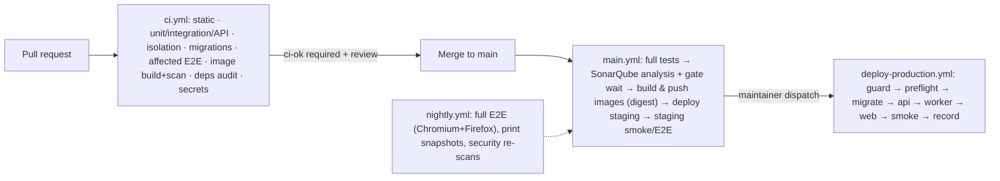

# L — CI/CD and SonarQube

| Control | Value |
| --- | --- |
| Document | L CI/CD pipeline, quality gates, security scanning, deployment controls |
| Version | 0.4.0-draft |
| Status | GitHub Actions (C-022) and SonarQube Community Build (C-023) are **CONFIRMED**. Pipeline design is **PROPOSED** (ADR-012). Templates are **untested**: YAML-parsed, and `actionlint` 1.7.7 reported no findings with shellcheck unavailable. Not run on GitHub. |
| Owner role | DevOps lead + tech lead |
| Updated | 2026-10-12 |
| Templates | [`templates/github/workflows/`](../templates/github/workflows/) (`ci.yml`, `main.yml`, `deploy-production.yml`, `nightly.yml`), [`templates/github/dependabot.yml`](../templates/github/dependabot.yml), [`templates/sonar/sonar-project.properties`](../templates/sonar/sonar-project.properties) |

## 1. Pipeline overview

**Provider:** GitHub Actions on GitHub-hosted Ubuntu runners (CONFIRMED provider, C-022). Self-hosted runners are **not** proposed for the start. If one is used later (e.g., for faster builds), it runs on the tools VPS, never on production, and is restricted to `main` and trusted workflows. Self-hosted runners were targeted in the 2026 Trivy-action incident (D1 V-16).

## 2. Branch and repository protections (proposed)

- `main` is protected:
  - PR required
  - 1 approving review (2 for changes to `packages/database`, `packages/contracts`, `packages/authz`, auth code or workflows, enforced through CODEOWNERS)
  - required status `ci-ok`
  - linear history
  - no force-push
  - signed commits/tags (PROPOSED)
- **CODEOWNERS:**
  - integrator owns `packages/database/**`, `packages/contracts/**`, `pnpm-lock.yaml`, `turbo.json`
  - DevOps owns `.github/**`, `docker/**`, `infra/**`
  - security-minded reviewer co-owns `packages/authz/**` and `mod-identity-access`
- Workflows use least-privilege `permissions:` per workflow and job.
- `pull_request_target` is **not** used. It was the root cause in the 2026 Trivy compromise chain.
- **All third-party actions are pinned to full commit SHAs**, with the version in a comment. Dependabot proposes SHA updates; humans review the release notes.

## 3. Pull-request checks (`ci.yml`)

| Job | Contents | Blocks merge | Rationale |
| --- | --- | --- | --- |
| static | Prettier check; `turbo run lint typecheck --affected` (ESLint 10 + typescript-eslint + **eslint-plugin-sonarjs**); dependency-cruiser boundaries; i18n catalog check; contract drift (OpenAPI from Zod); **gitleaks CLI** secret scan of the PR range | Yes | Fast feedback. SonarJS rules give PRs Sonar-like code-smell checks, which Community Build cannot do on PRs (CX-013). |
| test | PostgreSQL 18 + Redis service containers; all migrations from scratch; affected unit/integration/API tests with coverage; **permission matrix always** | Yes | Real DB for constraints and grants (H §2) |
| migrations | When `packages/database/**` changes: fresh apply, drift check, upgrade-with-data test | Yes | Protects production data and expand/contract (E §11) |
| e2e | Build affected apps; seed synthetic data; Playwright (Chromium) affected journeys + axe | Yes | Staff journeys, keyboard flows, committed-state display |
| images | hadolint; build all images (no push); image vulnerability scan; fail on CRITICAL | Yes | Image hygiene before main |
| dependencies | `pnpm audit --prod --audit-level high` or OSV-Scanner | Yes, for HIGH/CRITICAL in production dependencies (an exception process is documented) | NFR-SEC-004 |
| ci-ok | Aggregates results | **Single required check** | Simple branch protection |

**Coverage thresholds on PRs** come from Jest's `coverageThreshold` per domain package (NFR-MAINT-002, PROPOSED 80% lines / 70% branches for `mod-*` domain and application layers). This substitutes for Sonar's "coverage on new code" gate, which only runs on main.

## 4. SonarQube Community Build setup and quality gate

**Server (Q-056):**
- Self-hosted on the **tools VPS** (Docker image; ≥ 4 GB RAM for a small install, plus 50% heap for Elasticsearch; SSD; ≥ 10% free disk).
- PostgreSQL as its database, ideally on a separate instance.
- Linux kernel setting `vm.max_map_count` per the Sonar installation guide.
- Never co-hosted with production.
- HTTPS via its own Caddy.
- Access restricted (IP allow-list plus strong admin credentials).
- A project token stored as the `SONAR_TOKEN` GitHub secret; `SONAR_HOST_URL` as a repository variable.

**Analysis (main branch only):**
- `SonarSource/sonarqube-scan-action` (SHA-pinned) with `-Dsonar.qualitygate.wait=true`, so the job fails when the gate fails, and staging promotion stops.
- `sonar.projectVersion` set per commit/release, so "new code" is defined against the previous version.

**Coverage import:**
- `sonar.javascript.lcov.reportPaths` lists each workspace's `lcov.info`.
- Coverage is generated from the **repository root**, so file paths are unique across workspaces (Sonar's monorepo guidance).

**Exclusions (rationale):**

| Exclusion | Why |
| --- | --- |
| `node_modules`, `dist`, `.next`, `coverage`, generated clients, `*.d.ts` | Not source |
| Prisma migration SQL | Reviewed by the integrator and tested by migration tests. Sonar SQL analysis adds noise. |
| Coverage exclusions: module wiring, `main.ts`, config, contracts (schemas only), i18n catalogs, stories, testkit, Next.js layout shells | Declarative or exercised by E2E. Measuring them would push agents to write meaningless tests. |
| Duplication exclusions: generated contracts/clients | Generated |

**Quality gate (PROPOSED; start from "Sonar way" and adapt):**

| Condition (on new code) | Threshold | Why |
| --- | --- | --- |
| Reliability rating | A (no new bugs) | Billing and lab code must not introduce known bug patterns |
| Security rating | A (no new vulnerabilities) | Patient data |
| Security hotspots reviewed | 100% | Forces human review of auth/crypto/file code |
| Maintainability rating | A | Keeps agent-generated code readable |
| Coverage | ≥ 80% | Aligned with NFR-MAINT-002 (domain-heavy codebase) |
| Duplicated lines | ≤ 3% | Discourages copy-paste modules |

**When the main gate fails:**
1. Staging is not updated.
2. A follow-up PR fixes it, or a reviewer marks a finding as a false positive with a reason in Sonar.
3. No production deployment uses a commit whose gate failed.

## 5. Dependency, secret and image scanning

| Scan | Tool (proposed) | Where | Policy |
| --- | --- | --- | --- |
| Secrets in commits | gitleaks CLI (pinned version + checksum) | PR (range), nightly (full history) | Block. Rotate any leaked secret even after removal (RB-12). |
| Dependency vulnerabilities | `pnpm audit` or OSV-Scanner on `pnpm-lock.yaml`; Dependabot alerts (free) | PR, nightly | Block HIGH/CRITICAL in production deps. Time-boxed exceptions recorded in the repo. |
| Dependency updates | Dependabot grouped weekly (npm, actions, docker) | Weekly | Integrator merges. Prisma CLI and client always move together (CX-017). TS major blocked until the ecosystem allows (CX-018). |
| Dockerfile lint | hadolint (pinned image digest) | PR | Block on errors |
| Image vulnerabilities | Trivy (**pinned to a verified, SHA-referenced release**, given the March 2026 compromise) or Grype | PR (built images), main (pushed digests), nightly (deployed digests) | Block CRITICAL with a fix available. Track HIGH. |
| SBOM / provenance | Buildx SBOM + provenance attestations (verify plan support) | main | Stored with images |
| Code scanning (CodeQL), secret push protection | GitHub Code Security / Secret Protection | Optional | Paid for private repos (D1 V-15). Decide with Q-055. |

## 6. Turborepo caching policy

| Task | Cached? | Inputs/outputs declared | Notes |
| --- | --- | --- | --- |
| `build` | Yes | Source globs, `tsconfig`, env vars that affect the build (declared in `turbo.json` `env`) → `dist/**`, `.next/**` (excluding `.next/cache`) | Deterministic |
| `lint`, `typecheck` | Yes | Source + config | — |
| `test:unit` | Yes | Source + test files → coverage | Pure, no I/O |
| `test:integration`, `test:isolation`, `e2e` | **No** | — | Stateful (database, browser); must run fresh |
| `db:migrate*`, `deploy*`, `seed*` | **No** | — | Side effects |
| `contracts:generate` | Yes | Zod sources → `openapi.json` | The drift check compares the committed file |

- **Local cache** is used in CI via `actions/cache` keyed on the lockfile and `turbo.json`.
- **Remote cache** is optional: Vercel Remote Cache or a self-hosted cache server on the tools VPS. Credentials (`TURBO_TOKEN`) are a CI secret and are passed into Docker builds only as build arguments for the build stage, never to runtime images.
- **Never cache artifacts containing patient data.** Only synthetic data exists in CI anyway (AS-009).
- `--affected` uses git history (`fetch-depth: 0`). On `main`, run everything.

## 7. Artifact publishing and deployment to VPS

> **Current state (2026-10-15):** none of this pipeline exists yet. Staging is deployed by hand: the server owner pulls `main` and runs a redeploy script (build on the server, migrate, restart). Releases reach `main` only through a `dev` -> `main` release PR (docs/GIT_WORKFLOW.md section 5). Developers and AI agents do not deploy. See [DEPLOYMENT.md](../../DEPLOYMENT.md). The steps below are the target design for T-FND-03 and T-FND-05.

1. **Build once** on `main`. Images are tagged `sha-<git-sha>` and pushed to GHCR. **Digests** are captured into `release.env` (artifact `release-manifest`).
2. **Staging** (automatic, environment `staging`):
   1. SSH as `deploy` with a forced command that runs `/opt/hms/bin/deploy.sh`.
   2. The script pulls by digest, runs the migrate container, then recreates api → worker → web.
   3. Health wait.
   4. Smoke and E2E tests against staging run with synthetic data.
3. **Production** (manual, `deploy-production.yml`):
   1. Input: the successful `main` run ID and a change-record ID.
   2. Guard: the actor must be in the maintainer allow-list, and the source run must be successful on `main`.
   3. Preflight on production: backup age, WAL archive lag, disk space, incident status.
   4. Deploy the same digests.
   5. Production smoke test with a synthetic monitoring account (read-only checks).
   6. Record the release.
   
   **Why not environment "required reviewers"?** They are unavailable for private repositories on Free/Pro/Team (CX-014). If the organization uses GitHub Enterprise, add required reviewers to the `production` environment as an additional control.
4. **Release tagging:** after a successful production deploy, tag `vX.Y.Z` (signed) on the commit and attach the release notes and migration list.

## 8. Migration ordering, rollback, forward fixes and smoke tests

- Order within a deploy: **migrate → api → worker → web**.
- Migrations are expand-compatible with the running version (J §9.2). The pipeline's `migrations` job runs the upgrade-with-data test (AT-DB-007) for every PR that changes migrations.
- **Rollback** = redeploy the previous `release.env` digests through the same workflow, only if the migrations since then were expand-only. The deploy script refuses a rollback across a contract migration (it reads migration metadata labels; PROPOSED convention: a `-- contract` marker in the migration header) and points to the forward-fix process (RB-02).
- **Smoke tests (production)**, read-only with a synthetic monitoring account:
  - health endpoints
  - login
  - patient search
  - open a released synthetic report (HTML)
  - check the doctor worklist query
  - check the outbox lag metric
- **Post-deploy watch:** 30 minutes of dashboard observation with the alert thresholds from J §10. Any money/stock anomaly triggers RB-14.

## 9. What quality gates do not prove

Passing CI, a green Sonar gate and high coverage show that:
- the code compiles
- the tests that exist pass
- certain classes of defects and vulnerabilities were not detected

They do **not** show any of the following:
- that the right patient is selected at the desk
- that the billing model matches the hospital's policy
- that a deposit or discount rule is correct (those rules are OPEN)
- that lab reports are clinically correct and print legibly on the hospital's printers
- that Bangla terminology is right
- that permissions hold against attack paths nobody has written a test for

That evidence comes from:
- requirement-linked tests reviewed by domain reviewers (H)
- UAT with real staff and devices (I)
- the isolation suite and security review
- restore drills (J)
- the traceability register showing each requirement's evidence ([N](N-traceability-readiness.md))

A green pipeline is necessary, never sufficient, for a release gate (C-029).
