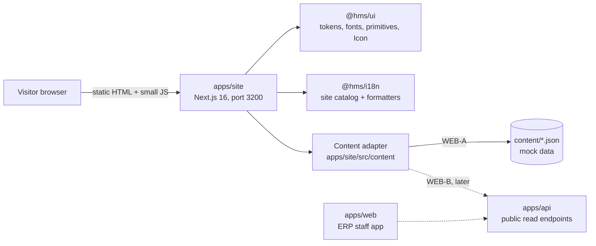
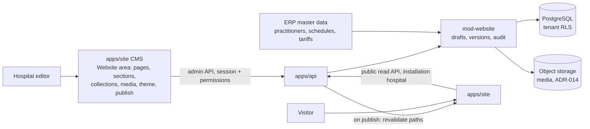
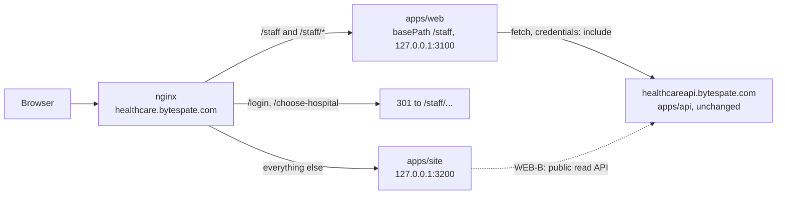
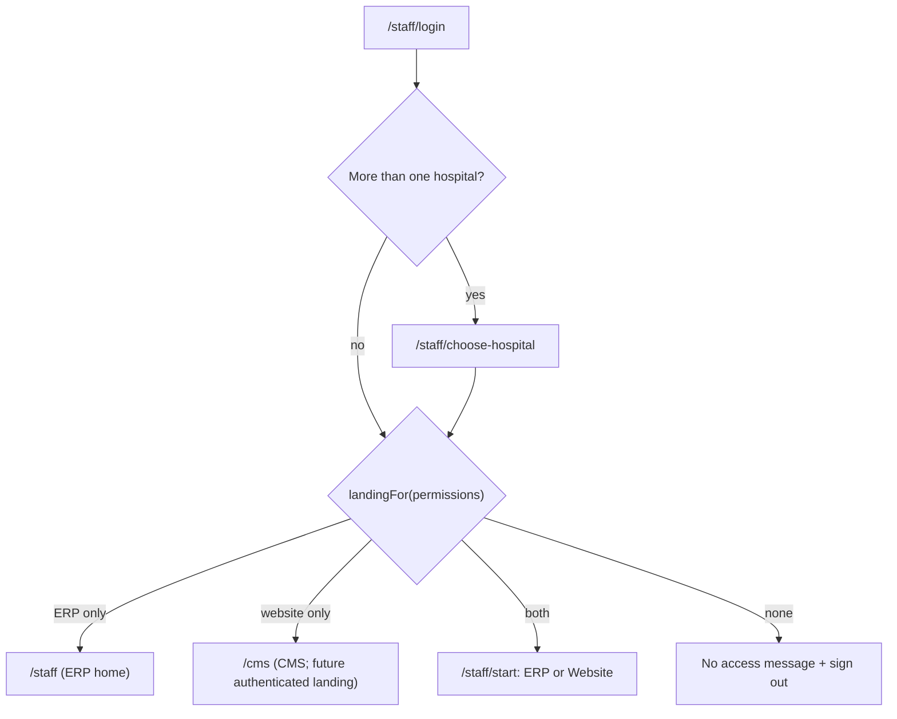

# D — System design (public website)

| Control    | Value                                                                                                                                                                                                                             |
| ---------- | --------------------------------------------------------------------------------------------------------------------------------------------------------------------------------------------------------------------------------- |
| Document   | D System design for `apps/site`                                                                                                                                                                                                   |
| Version    | 0.1.0-draft                                                                                                                                                                                                                       |
| Status     | Proposal                                                                                                                                                                                                                          |
| Owner role | Technical architect / tech lead                                                                                                                                                                                                   |
| Updated    | 2026-10-21                                                                                                                                                                                                                        |
| Related    | ERP [D](../planning/docs/D-system-design.md), [ADR-002](../planning/docs/D2-adr/ADR-002-nextjs-usage.md), [ADR-017](../planning/docs/D2-adr/ADR-017-localization.md), [ADR-022](../planning/docs/D2-adr/ADR-022-ui-foundation.md) |

## 1. Context



WEB-A has no runtime dependency on `apps/api`, the database or any external service.

## 2. Stack

Same pinned versions as `apps/web` (see `docs/STACK_VERSIONS.md`): Next.js 16.4.0 (App Router), React 19.3.0, Tailwind CSS 4.3.3, next-intl 4.14.9, TypeScript 6.0.3, Vitest, Playwright, axe. Zod (as in `@hms/contracts`) validates the mock content. No new runtime dependency is proposed for WEB-A.

## 3. Application layout

```text
apps/site/
  app/
    [locale]/
      layout.tsx            html, fonts, providers, shell
      page.tsx              home
      doctors/page.tsx, doctors/[slug]/page.tsx
      departments/..., centres/..., packages/..., tests/page.tsx
      book-appointment/page.tsx, reports/page.tsx
      patients-and-visitors/page.tsx, emergency/page.tsx
      branches/..., contact/page.tsx, articles/..., notices/page.tsx
      about/page.tsx, careers/page.tsx, portal/page.tsx
      sample-collection/page.tsx, feedback/page.tsx
      not-found.tsx
    sitemap.ts, robots.ts
    globals.css             tailwind + @hms/ui/styles.css + @source paths
  content/                  mock data in CMS format (C-070, P-040): site.json, pages/*.json, collections
  src/
    i18n/                   routing.ts, navigation.ts, request.ts
    content/                adapter interface, JSON implementation, localize()
    sections/               section registry: one renderer per section type (P-036)
    components/             shell, cards, forms (site-only)
  proxy.ts                  next-intl locale routing (Next 16 "proxy" convention)
  next.config.ts            next-intl plugin, security headers, standalone output
```

## 4. Rendering

- Every route is statically generated (P-028): `generateStaticParams` over locales x slugs; `setRequestLocale` in each layout and page so pages stay static.
- Client components only where interaction needs them: language switch, mobile menu, hero search, directory filters, package filter, test search, booking wizard, mock forms.
- No Server Actions: `'use server'` stays banned, as in `apps/web` (ADR-002).

## 5. Localization

- next-intl routing with locales `bn-BD` and `en` and URL prefixes `/bn` and `/en` (`localePrefix: { mode: 'always', prefixes: {...} }`), default `bn-BD` (P-023).
- `proxy.ts` redirects `/` and unprefixed paths to `/bn`. Browser-language and cookie detection are off (`localeDetection: false`, decided in T-WEB-01): every new visitor gets Bangla first (C-062), links stay deterministic, and the site sets no cookies.
- UI text: `siteMessages` in `packages/i18n` (P-024). Content text: `{ bn, en }` fields resolved by `localize(text, locale)` in the content adapter (P-025).
- The language switch links to the same pathname in the other locale (next-intl navigation helpers).

## 6. Content adapter (P-026)

```ts
// apps/site/src/content/index.ts (shape only)
export interface SiteContent {
  listDepartments(): Department[];
  getDepartment(slug: string): Department | undefined;
  listDoctors(filter?: DoctorFilter): Doctor[];
  getDoctor(slug: string): Doctor | undefined;
  listCentres(): Centre[];
  listPackages(category?: PackageCategory): HealthPackage[];
  listTests(filter?: TestFilter): TestPrice[];
  listBranches(): Branch[];
  listArticles(category?: string): Article[];
  listNotices(): Notice[];
  listJobs(): JobOpening[];
}
```

- WEB-A: reads the JSON files at build time, validates them with Zod (a malformed file fails the build), and returns typed objects.
- WEB-B: the same interface backed by ERP public read endpoints. Pages do not change.
- Entities and fields are defined in [E](E-content-model.md).

## 7. Boundaries and reuse (P-030, P-031)

| Rule                                                                                                                                       | How it is enforced                                               |
| ------------------------------------------------------------------------------------------------------------------------------------------ | ---------------------------------------------------------------- |
| `apps/site` imports only `@hms/ui`, `@hms/i18n`, `@hms/contracts`                                                                          | New dependency-cruiser rule `site-allowed-packages-only`         |
| No imports between apps                                                                                                                    | Existing rule `no-app-to-app`                                    |
| No raw `button`/`input`/`select`/`textarea`/`dialog`, no color literals, no `Intl.*`/`toLocale*`, icons only via `Icon`, no `'use server'` | `webGuardrails` file globs extended to `apps/site/**`            |
| Shared primitives and icons live in `packages/ui`                                                                                          | Review + lint                                                    |
| The catalog usage test scans `apps/site` for site keys                                                                                     | Extended `catalog.test.ts` (or a sibling `site-catalog.test.ts`) |

Needed `packages/ui` additions (P-031): about 36 icons for departments and contact, and `buttonClassName(variant, size)` so links can look like buttons. Possible later candidates if `apps/web` needs them too: a `Container` layout and a `Card` pattern.

## 8. Customer installations (C-089, supersedes shared SaaS website routing)

Each purchasing hospital receives its own ERP installation and public website on its own domain. WEB-A continues to use the CareSpate demo content. Customer identity and branding remain configuration and CMS data, never hard-coded into page components.

WEB-B reads the published website snapshot for the hospital configured for that installation. Shared platform subdomains and host-based selection between multiple customer hospitals are no longer required. Deployment-specific host validation and configuration will be designed during implementation; this decision changes no staging hosts or runtime code. Existing tenant identifiers, `withTenant()` and RLS safeguards stay in place until any removal is separately designed and reviewed.

## 9. Security

| Item                               | WEB-A setting (P-029)                                                                                                                                                                                                                                                                                       |
| ---------------------------------- | ----------------------------------------------------------------------------------------------------------------------------------------------------------------------------------------------------------------------------------------------------------------------------------------------------------- |
| Content-Security-Policy (enforced) | `default-src 'self'; script-src 'self' 'nonce-...'` or hashes as Next requires; `style-src 'self' 'unsafe-inline'` (Tailwind runtime-free, review); `img-src 'self' data:`; `font-src 'self'`; `connect-src 'self'`; `frame-ancestors 'none'`; `base-uri 'self'`; `form-action 'self'`; `object-src 'none'` |
| Other headers                      | `Referrer-Policy: strict-origin-when-cross-origin`, `X-Content-Type-Options: nosniff`, `Permissions-Policy` denying camera, microphone, geolocation; `poweredByHeader: false`                                                                                                                               |
| Storage                            | No cookies and no `localStorage` of personal data in WEB-A (lesson from R1).                                                                                                                                                                                                                                |
| Forms                              | No network submission in WEB-A (FR-WEB-GEN-006).                                                                                                                                                                                                                                                            |
| Robots                             | `noindex` while content is demo (FR-WEB-SEO-002).                                                                                                                                                                                                                                                           |

The exact CSP for Next.js inline bootstrap scripts is a spike check in T-WEB-01; the target is no `unsafe-eval` and no third-party origins.

## 10. Performance

Self-hosted fonts with unicode-range subsets are already in `@hms/ui` (C-056). Images use `next/image` with explicit sizes; placeholders are inline SVG using `currentColor` and token classes, so they cost almost nothing. Budgets in C NFR-WEB-PERF-001.

## 11. Website CMS (EP-32, WEB-B)

**Current implementation: T-CMS-DEMO-01 (C-091, C-092).** The CMS screens and preview are entirely in `apps/site`. They read fictional seed content and browser local storage (`hms.cms.demo.v1`). Shared contracts validate snapshots. No authentication, network calls or ERP/database writes occur. The public-site adapter still reads the committed mock files. Saving, publishing and restoring below describe future production behavior; in the demo those operations only update local browser snapshots. `/cms` bypasses public locale routing and all CMS responses carry noindex and private/no-store headers.

Requirements: [C2](C2-cms-requirements.md). Decisions: C-072, P-035..P-042.



- **Shared schemas:** site settings, navigation, every section type and every collection type are Zod schemas in `@hms/contracts`. The editor builds its forms from them, the API validates against them, and `apps/site` renders with them, so a field cannot exist in one place and not another.
- **Section registry:** `apps/site` keeps a map from section type to a React component; `apps/site/src/cms` owns section editing (C-091). Adding a section type means adding a schema, a renderer and an editor form together (one task).
- **Publish flow:** the same authorized editor changes drafts and publishes without second-person approval (C-086); "Publish" validates the whole site, writes an immutable `website_version` snapshot, records an audit event and calls the site's revalidation endpoint for the changed paths (P-037, P-041).
- **Public read API:** `GET /api/v1/public/site` and per-collection endpoints return only the published snapshot for the installation hospital (C-089); no session, no draft data, rate limited and cacheable.
- **Production preview (future):** the CMS in `apps/site` opens a preview with a short-lived signed token that lets it read the draft for that tenant only.
- **Doctor and price data:** read from ERP modules and merged with CMS public fields at publish time (P-042); the site never writes to the ERP.
- **WEB-A to WEB-B switch:** only the content adapter changes from "read JSON files" to "read published snapshot" (P-026, P-040).

## 12. Development and deploy impact

| Item                 | Change                                                                                                                                                                               |
| -------------------- | ------------------------------------------------------------------------------------------------------------------------------------------------------------------------------------ |
| New app              | `apps/site` (`@hms/site`), `pnpm --filter @hms/site dev` on port 3200 (P-034); included in `pnpm dev`, `build`, `lint`, `typecheck`, `test` through turbo                            |
| New env vars         | None in WEB-A                                                                                                                                                                        |
| Migrations           | None                                                                                                                                                                                 |
| New service / domain | No new domain (C-075). When the one-host routing ships (section 13): a site container and an nginx path rule, applied by the project lead; nothing is deployed by agents (CLAUDE.md) |
| CI                   | New app joins existing lint, typecheck, test, e2e and boundary jobs                                                                                                                  |

## 13. One host: public site and staff app (C-075..C-081)

Only two hosts exist: `healthcare.bytespate.com` and `healthcareapi.bytespate.com` (C-075). The public site takes the root of the first; the staff ERP app moves under `/staff` (C-076); the CMS demo stays in `apps/site` at `/cms` (C-091, C-092). The API host is unchanged. This section is a proposal for ADR-023 "Public site and staff app share one host", which would amend ADR-021 point 1 (one container per host); it is merged into the ERP ADRs only on approval. This section describes existing staging routing; customer installation direction is now C-089 (section 8).

### 13.1 Request routing



| Path                                     | Served by   | Login                                         |
| ---------------------------------------- | ----------- | --------------------------------------------- |
| `/`, `/bn/...`, `/en/...`                | `apps/site` | Never                                         |
| `/staff/login`, `/staff/choose-hospital` | `apps/web`  | -                                             |
| `/staff/start`                           | `apps/web`  | Yes (choice screen)                           |
| `/staff/...` ERP screens                 | `apps/web`  | Yes, ERP permission                           |
| `/cms/bn`, `/cms/en` demo editor         | `apps/site` | No login; fictional browser-only demo (C-092) |

nginx sketch for the project lead (not applied by agents):

```nginx
location = /login           { return 301 /staff/login; }
location = /choose-hospital { return 301 /staff/choose-hospital; }
location /staff { proxy_pass http://127.0.0.1:3100; }   # apps/web, basePath /staff
location /      { proxy_pass http://127.0.0.1:3200; }   # apps/site
```

### 13.2 Login and landing



- The existing login, CSRF, session and hospital choice (T-ACC-01, T-UI-02) are reused unchanged; only the last redirect calls `landingFor()` (P-046).
- Permissions come with the session (T-ACC-02). The current CMS demo has no permission grants or real login. Until production CMS integration exists no user holds `website.*`, so everyone lands on the ERP home and the behavior equals today's.
- The shell shows an "ERP / Website" switch only when both sides are allowed (FR-WEB-ROUTE-004). The API enforces permissions on every call; the landing is routing, not security.

### 13.3 Security on a shared origin (C-080)

| Topic          | Effect of sharing `healthcare.bytespate.com`                                                                                                                                          | Control                                                                                                                         |
| -------------- | ------------------------------------------------------------------------------------------------------------------------------------------------------------------------------------- | ------------------------------------------------------------------------------------------------------------------------------- |
| Session cookie | Unchanged: host-only on the API host, `httpOnly` (ADR-021). The site's pages never see it.                                                                                            | -                                                                                                                               |
| CORS           | `https://healthcare.bytespate.com` is already the allowed origin; the site gets the same origin, so a script running on a site page could call the API as the signed-in staff member. | Enforced CSP on both apps (P-029, P-047); CMS content is structured text only (P-036); no third-party scripts (NFR-WEB-SEC-002) |
| Login attacks  | `/staff/login` is public and guessable, like any path name.                                                                                                                           | Rate limiting and lockout (C-032, T-ACC-03); two-factor for website publishers and admins (C-081)                               |
| Indexing       | Search engines could list staff pages.                                                                                                                                                | `robots.txt` disallow and `X-Robots-Tag` (P-045)                                                                                |
| Exit path      | -                                                                                                                                                                                     | When a third host is allowed, move the site or the staff app to its own host; only nginx and `basePath` change                  |

### 13.4 Development and verification

- Development joins both apps on `http://localhost:3000` through `apps/dev-proxy`, started by `pnpm dev` (P-044, revised 2026-10-24): `/staff` goes to the staff app, everything else to the site, as nginx does. Each app also answers on its own port (site `http://localhost:3200/bn`, staff app `http://localhost:3100/staff`). `CORS_ORIGINS` in `.env.example` lists `http://localhost:3000` as well; `NEXT_PUBLIC_API_URL` stays as it is.
- The `apps/web` Playwright config uses the `/staff` base URL; `apps/site` e2e checks that its proxy leaves `/staff` paths alone.
- The joined-host behavior (AT-WEB-060) is checked on staging by the project lead after the nginx change.

### 13.5 Deploy impact (for the PR of T-WEB-18)

| Item          | Change                                                                                        |
| ------------- | --------------------------------------------------------------------------------------------- |
| New service   | `apps/site` container on `127.0.0.1:3200`                                                     |
| nginx         | `healthcare.bytespate.com`: `/staff` -> web, `/` -> site, two legacy redirects (section 13.1) |
| Build         | `apps/web` built with `basePath: '/staff'`                                                    |
| Env vars      | None new; `CORS_ORIGINS` and `NEXT_PUBLIC_API_URL` unchanged                                  |
| Origin / CORS | None                                                                                          |
| Migrations    | None                                                                                          |
| Users         | Staff URL changes from `healthcare.bytespate.com` to `healthcare.bytespate.com/staff` (Q-087) |
