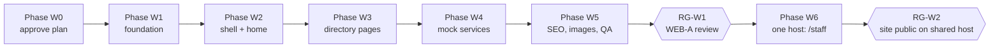

# G — Implementation plan (public website)

| Control    | Value                                                                                                                            |
| ---------- | -------------------------------------------------------------------------------------------------------------------------------- |
| Document   | G Implementation plan for EP-31 Public website                                                                                   |
| Version    | 0.1.0-draft                                                                                                                      |
| Status     | Proposal                                                                                                                         |
| Owner role | Tech lead                                                                                                                        |
| Updated    | 2026-10-21                                                                                                                       |
| Follows    | ERP [G](../planning/docs/G-implementation-plan.md): working rules, DoR/DoD and context packet apply unchanged unless stated here |

## 1. Working rules

- One task per branch from `dev`: `feat/T-WEB-nn-<slug>`; Conventional Commits with footer `Refs: T-WEB-nn`; feature log entry in `docs/log/` in the same commit; push to all three remotes (CLAUDE.md).
- No deployment, no new env vars, no backend calls in WEB-A.
- Plain ASCII in code and config; Bangla only in `packages/i18n` catalogs and `apps/site/content/*.json` (P-024, P-025).
- Bangla-first review of every screen at 360, 768 and 1366 px before a task is done.
- The work branch is `feat/T-WEB-01-site-scaffold` (renamed from `feat/EP-27-public-site-mock` on 2026-10-21, never pushed). It carries this planning pack and the uncommitted T-WEB-02 draft edits (icons, `buttonClassName`).

## 2. Phases

## 3. Tasks

### Phase W0 — Approval

| Task                       | Outcome                                                                                                                              | Requirements | Depends on | Blocking Qs | Key acceptance criteria                                               |
| -------------------------- | ------------------------------------------------------------------------------------------------------------------------------------ | ------------ | ---------- | ----------- | --------------------------------------------------------------------- |
| **T-WEB-00** Plan approval | Product owner answers Q-071..Q-073 and P-025, P-027 (done 2026-10-21 -> C-067..C-071); tech lead approves the remaining P-023..P-034 | A            | -          | -           | Decisions recorded in A with date; approved IDs merged into ERP A2/A3 |

### Phase W1 — Foundation

| Task                                     | Outcome                                                                                                                                                                                                                                      | Requirements                                                                   | Depends on | Blocking Qs         | Key acceptance criteria                                                                                                                                                                                             |
| ---------------------------------------- | -------------------------------------------------------------------------------------------------------------------------------------------------------------------------------------------------------------------------------------------- | ------------------------------------------------------------------------------ | ---------- | ------------------- | ------------------------------------------------------------------------------------------------------------------------------------------------------------------------------------------------------------------- |
| **T-WEB-01** Site scaffold               | `apps/site` Next.js 16 app on port 3200 with Tailwind and `@hms/ui/styles.css`, next-intl URL routing (`/bn`, `/en`) via `proxy.ts`, security headers, standalone output; joins turbo tasks; lint guardrails and boundary rule extended      | FR-WEB-GEN-001, NFR-WEB-SEC-001, NFR-WEB-MAINT-001, P-023, P-029, P-030, P-034 | T-WEB-00   | -                   | `pnpm dev` serves `/bn` and `/en`; `/` redirects to `/bn`; a raw `<button>` in `apps/site` fails lint; importing `@hms/database` from `apps/site` fails `boundaries:check`; CSP enforced with no console violations |
| **T-WEB-02** Shared UI additions         | Icons and `buttonClassName` in `packages/ui`, with tests                                                                                                                                                                                     | P-031                                                                          | T-WEB-01   | -                   | `pnpm --filter @hms/ui build test lint` pass; existing `apps/web` unaffected (its tests and e2e pass)                                                                                                               |
| **T-WEB-03** Site catalog                | `siteMessages` (en, bn-BD) in `packages/i18n` with parity, placeholder and usage tests over `apps/site`                                                                                                                                      | FR-WEB-GEN-002, P-024                                                          | T-WEB-01   | Q-079 (review only) | Missing Bangla key fails typecheck; unused key fails test                                                                                                                                                           |
| **T-WEB-04** Content layer and mock data | Zod schemas for site settings, navigation, sections and collections (shared ones in `@hms/contracts`), CMS-format JSON (`site.json`, `pages/*.json`, collections), adapter interface and JSON implementation, `localize()`, section registry | FR-WEB-GEN-007, -008, C-070, P-026, P-036, P-040, E                            | T-WEB-01   | -                   | Malformed JSON, an unknown section type or a dangling slug fails the build; unit tests cover filters and lookups; all content fictional                                                                             |

### Phase W2 — Shell and home

| Task                    | Outcome                                                                                                               | Requirements                       | Depends on   | Blocking Qs | Key acceptance criteria                                                                                      |
| ----------------------- | --------------------------------------------------------------------------------------------------------------------- | ---------------------------------- | ------------ | ----------- | ------------------------------------------------------------------------------------------------------------ |
| **T-WEB-05** Site shell | Top bar, header with departments menu, mobile panel, footer, demo notice, skip link, language switch keeping the path | FR-WEB-NAV-*, FR-WEB-GEN-004, -005 | T-WEB-02..04 | -           | Keyboard-only navigation of menu and mobile panel; switch on `/bn/doctors` lands on `/en/doctors`; axe clean |
| **T-WEB-06** Home page  | All home sections from F section 3 with hero search suggesting doctors and departments                                | FR-WEB-HOME-*                      | T-WEB-05     | -           | Search "card" suggests Cardiology and its doctors in both languages; SM-W04 holds                            |

### Phase W3 — Directory pages

| Task                                  | Outcome                                                                      | Requirements                 | Depends on | Blocking Qs        | Key acceptance criteria                                                                                         |
| ------------------------------------- | ---------------------------------------------------------------------------- | ---------------------------- | ---------- | ------------------ | --------------------------------------------------------------------------------------------------------------- |
| **T-WEB-07** Doctors                  | Directory with search and filters in the URL; profile with tabs and schedule | FR-WEB-DOC-*                 | T-WEB-05   | -                  | Filter by department and branch together; shared URL restores filters; schedule times in Bangla digits on `/bn` |
| **T-WEB-08** Departments and centres  | Lists and details linking doctors                                            | FR-WEB-DEP-*                 | T-WEB-07   | -                  | Every department page lists exactly its doctors                                                                 |
| **T-WEB-09** Packages and test prices | Package list, detail, test price search                                      | FR-WEB-PKG-*, FR-WEB-TST-001 | T-WEB-05   | Q-078 (label only) | Prices formatted with `formatMoney` and lakh grouping, labelled "sample price"                                  |

### Phase W4 — Mock services and information

| Task                           | Outcome                                                                                                               | Requirements                         | Depends on | Blocking Qs | Key acceptance criteria                                                                                                            |
| ------------------------------ | --------------------------------------------------------------------------------------------------------------------- | ------------------------------------ | ---------- | ----------- | ---------------------------------------------------------------------------------------------------------------------------------- |
| **T-WEB-10** Booking wizard    | Four-step mock booking with pre-selection from URL and a demo confirmation                                            | FR-WEB-BOOK-*, BW-W02                | T-WEB-07   | -           | Times come from the doctor's schedule and `slotMinutes`; phone accepts Bangla digits; no network request is made (asserted in e2e) |
| **T-WEB-11** Patient services  | Online report lookup, sample collection, feedback, international query forms (all mock)                               | FR-WEB-REP-001, FR-WEB-SVC-001, -002 | T-WEB-05   | -           | Each form validates and ends in the demo message; no network request                                                               |
| **T-WEB-12** Information pages | Patients and visitors, emergency, branches, contact, articles, notices, about, careers, portal coming soon, not found | FR-WEB-SVC-003, -004, FR-WEB-INF-*   | T-WEB-05   | -           | All routes render in both languages; not-found page in the right language                                                          |

### Phase W5 — SEO, images and quality

| Task                                    | Outcome                                                                                                                                                                                                                                                                                                                                                          | Requirements                                                                      | Depends on    | Blocking Qs | Key acceptance criteria                                          |
| --------------------------------------- | ---------------------------------------------------------------------------------------------------------------------------------------------------------------------------------------------------------------------------------------------------------------------------------------------------------------------------------------------------------------- | --------------------------------------------------------------------------------- | ------------- | ----------- | ---------------------------------------------------------------- |
| **T-WEB-13** SEO                        | Metadata per page, `hreflang`, canonical, `sitemap.ts`, `robots.ts` (noindex while demo), structured data templates                                                                                                                                                                                                                                              | FR-WEB-SEO-*                                                                      | T-WEB-06..12  | -           | Sitemap lists both locales; every page has a unique title        |
| **T-WEB-14** Image slots and prompts    | `ImageSlot` placeholder component; `content/image-prompts.md` with one prompt per slot (F section 6)                                                                                                                                                                                                                                                             | C-065                                                                             | T-WEB-06..12  | -           | Every slot in content has a prompt; placeholders use tokens only |
| **T-WEB-15** WEB-A quality pass         | Playwright smoke for every route in both languages, axe on every route, Lighthouse mobile budget on three pages, Bangla review                                                                                                                                                                                                                                   | NFR-WEB-* , SM-W01..W03                                                           | T-WEB-13, -14 | -           | H section 2 all green; UAT-WEB-001 signed                        |
| **T-WEB-17** Full-pass features (C-074) | Doctor leave notice and related doctors (with T-WEB-07); OPD hours (with T-WEB-08); package price table (with T-WEB-09); appointment request section (with T-WEB-10); branch pages with branch-scoped search, patient rights and discharge guide (with T-WEB-12); inside/outside Dhaka hotlines (with T-WEB-05); site-wide search with a build-time static index | FR-WEB-DOC-006, -007, DEP-004, PKG-004, GEN-009, -010, INF-007, SVC-005, SRCH-001 | T-WEB-05..12  | -           | AT-WEB-050..058 pass in both languages                           |
| **T-WEB-16** Body map (stretch)         | Interactive body map linking areas to departments                                                                                                                                                                                                                                                                                                                | R1 X16                                                                            | T-WEB-08      | Q-074       | Keyboard and screen-reader usable alternative list               |

### Phase W6 — One host: public site at the root, staff app at `/staff` (C-075..C-081)

| Task                                  | Outcome                                                                                                                                                                                                                                                                                                                  | Requirements                                                       | Depends on | Blocking Qs     | Key acceptance criteria                                                                                                                                                              |
| ------------------------------------- | ------------------------------------------------------------------------------------------------------------------------------------------------------------------------------------------------------------------------------------------------------------------------------------------------------------------------ | ------------------------------------------------------------------ | ---------- | --------------- | ------------------------------------------------------------------------------------------------------------------------------------------------------------------------------------ |
| **T-WEB-18** Staff app under `/staff` | `apps/web` `basePath: '/staff'`, its Playwright base URL and CI updated; `X-Robots-Tag` and the P-047 security headers on `apps/web`; site `proxy.ts` matcher and headers skip `/staff`, site `robots.txt` disallows it; nginx sketch and deploy impact in `docs/DEPLOYMENT.md` (text only, applied by the project lead) | FR-WEB-ROUTE-001, -002, -006, NFR-WEB-SEC-002, P-043..P-045, P-047 | T-WEB-01   | Q-087 (release) | All existing `apps/web` unit and e2e tests pass at `/staff`; AT-WEB-065, -067 pass; `/staff/login` signs in against the local API with no CORS change; deploy impact table filled in |

### EP-32 Website CMS (WEB-B, outline; detailed when scheduled)

**T-CMS-DEMO-01 (2026-10-25, C-091, C-092):** browser-only demo in `apps/site`, using fictional CareSpate content. Includes bilingual settings, branding, menus/footer, page and SEO editing, custom demo pages, ready-made section add/remove/order/visibility, draft and published previews, demo publication, restoration and reset. No authentication, API or database integration. The production task rows below are future work; their CMS UI belongs in `apps/site`.

Scope update 2026-10-25: C-086..C-090 settle Q-078, Q-080..082 and Q-086. The same editor publishes, ready-made sections support selectable themes and curated fonts, finance controls ERP prices, and each customer gets its own installation and domain without subscription plan restrictions. Exact theme/font options and technical upload limits remain implementation design work.

| Task                                                    | Outcome                                                                                                                                      | Requirements                     | Depends on                          | Blocking Qs    |
| ------------------------------------------------------- | -------------------------------------------------------------------------------------------------------------------------------------------- | -------------------------------- | ----------------------------------- | -------------- |
| **T-CMS-01** Data model                                 | `mod-website` tables, RLS, migrations, seed from the CareSpate template                                                                      | C2 FR-CMS-001, -019; E section 4 | RG-W1, ERP foundation               | -              |
| **T-CMS-02** Admin and public APIs                      | Draft CRUD, publish, versions, restore; public read for the installation hospital; permissions                                               | FR-CMS-010..012, -014            | T-CMS-01                            | -              |
| **T-CMS-03** Site settings, theme and navigation editor | Settings, hospital name, logo, favicon, contrast-checked color, selectable themes, curated fonts, header and footer menus                    | FR-CMS-001, -013                 | T-CMS-02                            | -              |
| **T-CMS-04** Page and section editor                    | Add, reorder, hide, edit sections per schema; custom pages; SEO fields                                                                       | FR-CMS-002..004, -016, -017      | T-CMS-02                            | -              |
| **T-CMS-05** Media library                              | Upload, resize to WebP, alt text, usage view                                                                                                 | FR-CMS-008, NFR-CMS-003          | T-CMS-02                            | -              |
| **T-CMS-06** Collections editors                        | Departments, centres, packages, branches, articles, notices, jobs, guide; doctor public profiles on ERP practitioners; published price items | FR-CMS-005..007                  | T-CMS-02, ERP scheduling and tariff | -              |
| **T-CMS-07** Preview and publish                        | Signed preview of drafts in `apps/site`, publish with validation, revalidation, version history and rollback                                 | FR-CMS-009, -010, -015           | T-CMS-03..06                        | -              |
| **T-CMS-08** Site on CMS data                           | Content adapter reads the installation hospital published snapshot; customer domain configuration                                            | P-041, D section 11              | T-CMS-07                            | -              |
| **T-CMS-09** Form inbox                                 | Site forms deliver to a staff inbox with spam protection and retention                                                                       | FR-CMS-018                       | T-CMS-02                            | privacy review |
| **T-CMS-10** Permission-based landing and switch        | `landingFor()`, the `/staff/start` choice screen, the "ERP / Website" switch in the shell, "no access" states for ERP and CMS URLs           | FR-WEB-ROUTE-003..005, P-046     | T-WEB-18, T-ACC-02, T-CMS-02        | -              |
| **T-CMS-11** Two-factor for website roles               | Website publish, theme and settings permissions marked privileged, so the TOTP flow is required for them                                     | FR-WEB-ROUTE-007, C-081          | T-ACC-04, T-CMS-02                  | -              |

### Later epics (kept visible)

| Epic                                                              | Blocked by                                      |
| ----------------------------------------------------------------- | ----------------------------------------------- |
| WEB-B ERP data on the site (doctors, schedules, prices, branches) | Q-078; ERP scheduling and tariff modules; EP-32 |
| WEB-C Booking, reports, portal, payments                          | Q-033, Q-013, Q-045; EP-27, EP-29               |

## Demo acceptance (T-CMS-DEMO-01)

- Given fictional content, editing and saving changes only browser storage; refreshing restores the draft.
- Publishing creates a demo snapshot; further draft edits never change that snapshot or the public website.
- Restoring a version creates a new draft revision; stale tabs cannot overwrite newer drafts.
- Reset clears only CMS demo storage; invalid/full/disabled storage has an explicit recovery message.
- English and Bangla editor screens have no axe violations at desktop and 360 px; no `/api/v1` request is made.
- No new environment variables, migrations or deployment services.

## 4. Definition of Ready and Done

ERP G section 4 applies. Additional Done items for site tasks:

- Works and is reviewed in Bangla first, then English, at 360, 768 and 1366 px.
- No hard-coded user-facing string in components; no Bangla in `.ts`/`.tsx`.
- `pnpm lint`, `typecheck`, `test`, `boundaries:check` and the site e2e pass.
- Feature log entry written.

## 5. Context packet for a site task

Give the agent: this pack's README, A, the task row above, the relevant C requirements, D sections 3 to 7, E for content tasks, F for UI tasks, `DESIGN.md`, `packages/ui/src/index.ts`, and the CLAUDE.md code rules. Do not give competitor HTML or scripts.

## 6. Traceability (WEB-A)

| Objective                                 | Requirements                                   | Tasks                           | Tests                                           |
| ----------------------------------------- | ---------------------------------------------- | ------------------------------- | ----------------------------------------------- |
| BO-W01 demo-quality site                  | FR-WEB-GEN-_, FR-WEB-NAV-_, FR-WEB-HOME-*      | T-WEB-01..06, -15               | AT-WEB-001..006, UAT-WEB-001                    |
| BO-W02 find a doctor fast                 | FR-WEB-DOC-_, FR-WEB-DEP-_                     | T-WEB-07, -08                   | AT-WEB-010..014                                 |
| BO-W03 one source for prices              | FR-WEB-PKG-*, FR-WEB-TST-001                   | T-WEB-09                        | AT-WEB-020..022                                 |
| BO-W04 booking and report entry points    | FR-WEB-BOOK-*, FR-WEB-REP-001                  | T-WEB-10, -11                   | AT-WEB-030..035                                 |
| BO-W05 search engines                     | FR-WEB-SEO-*                                   | T-WEB-13                        | AT-WEB-040..042                                 |
| BO-W06, BO-W07 per-tenant, editable sites | FR-WEB-GEN-007, -008 (WEB-A); FR-CMS-* (WEB-B) | T-WEB-04 (format); T-CMS-01..09 | AT-WEB-007, -008; AT-CMS-* (written with EP-32) |

## 7. Release gate

**RG-W1 (WEB-A review):** all T-WEB-01..15 done; H section 2 green; product owner signs UAT-WEB-001 (layout parity with continental.health in HMS style, Bangla first); demo notice present; nothing deployed.

**RG-W2 (site public on the shared host):** T-WEB-18 done and merged with the project lead's agreement (Q-087); login rate limiting and lockout live (T-ACC-03, C-081); staff app security headers in place (P-047); the project lead has applied the nginx rules and checked AT-WEB-060 on staging. Before the CMS opens to hospital editors, T-CMS-10 and T-CMS-11 are also done.

## 8. Status (2026-10-21)

Built and pushed as stacked branches `feat/T-WEB-01-site-scaffold` .. `feat/T-WEB-15-quality-pass` (each on top of the previous, none merged to `dev` yet). Details per task in `docs/log/`.

| Task                                                                                                 | Status                                                                                                                                         |
| ---------------------------------------------------------------------------------------------------- | ---------------------------------------------------------------------------------------------------------------------------------------------- |
| T-WEB-00, -01, -02, -04, -05 (with -03 shell keys), -06, -07, -08, -09, -10, -11, -12, -13, -14, -15 | Done                                                                                                                                           |
| T-WEB-17                                                                                             | Done: X19, X20 (T-WEB-07), X33, X23 (T-WEB-08), X26 (T-WEB-09), X21, X25 (T-WEB-12), X28 (site search), X30 (shell)                            |
| T-WEB-16 body map                                                                                    | Not started (stretch, Q-074)                                                                                                                   |
| RG-W1                                                                                                | Waiting for the product owner: UAT-WEB-001..006 (Bangla copy review Q-079, phone walk-through, screen reader pass) and a Lighthouse mobile run |
| T-WEB-18                                                                                             | Done on `dev` (2026-10-24, with the local dev proxy, P-044 revised). Not released to `main` until the project lead agrees (Q-087)              |
| T-CMS-01..11                                                                                         | Production integration not started; T-CMS-DEMO-01 is implemented separately.                                                                   |
